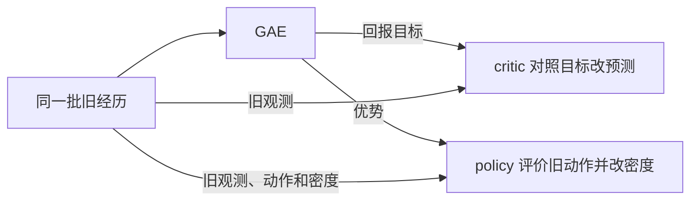

# check_np3o_interface.py：一批经历怎样让网络学一步

内容由 AI 整理。2026-11-25 对照源码重写。

被解释文件：[Tita_Lab/scripts/check_np3o_interface.py](../../../Tita_Lab/scripts/check_np3o_interface.py)。

当前源码已将两个小批量损失接到 `losses.py`。11 月 25 日的运行已用这两个函数完成 critic 和策略各 8 次更新。[losses.py](../../../Tita_Lab/src/Tita_Lab/learning/np3o/losses.py) · [运行记录](../../../docs/audits/2026-11-25_loss_extraction/README.md)

**第一遍只读第 1 节。** 第 1 节跟着同一条动作看完整过程。读到哪一步觉得跳得太快，再打开对应的小节。

## 1. 从一条经历看完整次更新

假设 TITA 第 0 步为了追上速度命令，给轮子加了较大的力矩。第 0 步的跟踪奖励不错，加速度 cost 是 0。同一回合的第 1 步，机器人为了稳住身体，关节加速度超了限。第 1 步才出现 cost。如果更新时只看第 0 步，策略就只看得到眼前的好处。

**采集时**，策略根据第 0 步的观测抽出动作。环境执行动作，返回这一步的奖励、六类 cost、结束标记和下一份观测。脚本把结果和产生动作的那份观测放在同一条记录里。脚本还保存当时的动作密度和 critic 的价值预测。第 1 步照同样的方式记下来。

**采完一批后**，GAE 把同一回合里后几步的结果考虑进来。对第 0 步，程序会问两件事。第一，从这个观测出发，算上后续，累计奖励和 cost 大概是多少？这是**回报目标**。第二，这次抽到的动作带来的结果，比旧 critic 预计的多多少奖励或 cost？这个差叫**优势**。奖励和每类 cost 各有一份。第 9 节用两步数字把这个差算出来。

**更新 critic 时**，脚本把第 0 步旧观测再给当前 critic。critic 给出新的累计量预测。脚本把新预测和刚算好的固定回报目标做比较，误差给 critic 参数提供调整方向。第 12 节从一个权重的手算讲起。

**更新策略时**，脚本还拿第 0 步的旧观测和旧动作。当前策略重新算同一个动作的密度，看相比采集时变大了还是变小了。奖励优势用来判断这个方向对任务有没有利，cost 优势和约束用来判断这个方向是否增加了代价。第 13 节讲密度怎样变成梯度，第 17 节讲六类 cost 怎样参与同一次更新。

脚本只在最后两段改变网络参数。环境只在采集阶段往前走。一次运行完成一批数据的学习计算，下一批需要训练流程另外采集。



## 2. main 怎样准备环境

```python
task = "TitaLab-Velocity-Tita"
cfg, _ = resolve_task_config(task_name=task, agent_cfg_entry_point=None, overrides=["physics=isaacsim_physx"])

# 任务注册决定实际配置类型；这里将该类型告诉Pylance。
cfg = cast("VelocityEnvCfg", cfg)

cfg.scene.num_envs = args.num_envs
cfg.compute_final_obs = True
cfg.seed = 42
torch.manual_seed(42)

if args.episode_length_s is not None:
    cfg.episode_length_s = args.episode_length_s

# 新Lab启动接口负责启动与关闭Kit；环境仍由gym.make创建。
with launch_simulation(cfg, args):
    native_env = gym.make(task, cfg=cfg)
    try:
        run_check(TitaNP3OEnvWrapper(native_env), args.max_steps)
    finally:
        native_env.close()
```

`resolve_task_config` 从任务名找到 TITA 的环境配置。脚本显式选 `physics=isaacsim_physx`，并传 `agent_cfg_entry_point=None`。因此脚本用命令行的采集长度，然后自己创建策略、critic 和存储。`cast` 给编辑器提供配置类型，返回的仍是原对象。

`launch_simulation` 管理仿真运行的上下文。`gym.make` 用配置创建环境，`TitaNP3OEnvWrapper` 把环境返回的数据整理成训练端需要的形状。`finally` 让脚本在检查过程中抛出异常时也尝试关闭环境。`compute_final_obs=True` 的用途在第 7 节。[env_wrapper.py 说明](../src/Tita_Lab/learning/np3o/env_wrapper.py.md)

## 3. 脚本里有哪些对象

```python
policy = TitaGaussianPolicy(init_noise_std=1.0).to(device=env.device)
policy.eval()
value_networks = TitaValueNetworks().to(device=env.device)
value_networks.eval()

gamma, lam = 0.99, 0.95

# 在inference_mode外分配存储，之后训练可以把这些普通张量作为输入。
storage = TitaRolloutStorage(
    num_envs=env.num_envs,
    num_steps=max_steps,
    num_obs=env.num_obs,
    num_actions=env.num_actions,
    num_costs=env.num_cost,
    device=env.device,
)

obs = env.reset()
```

| 对象 | 采集时做什么 | 更新时做什么 |
| --- | --- | --- |
| `policy` | 从观测建立动作分布，抽动作，并给这个动作算密度 | 给同一个旧动作算新密度，接收策略损失的梯度 |
| `value_networks` | 对当前观测预测累计奖励和六类累计 cost | 对旧观测重新预测，按回报目标更新参数 |
| `storage` | 复制每一步的记录 | 算好 GAE 后，按相同索引把观测、动作、旧密度和学习目标一起交出去 |

`policy` 和 `value_networks` 是两个 `nn.Module` 对象，各有自己的权重和偏置。`.to(device=env.device)` 把模块的参数和缓冲放到环境使用的设备。采集期间，两组网络参数都固定。下文说“旧值”，指这一段保存的网络输出。

## 4. 形状检查怎样定位接线错误

```python
assert actions.shape == (env.num_envs, 8)
assert policy.action_mean.shape == actions.shape
assert policy.action_std.shape == actions.shape
assert log_prob.shape == (env.num_envs,)
assert entropy.shape == (env.num_envs,)
assert torch.isfinite(actions).all(), "Non-finite action."
assert torch.isfinite(log_prob).all(), "Non-finite action log density."
assert torch.isfinite(entropy).all(), "Non-finite action entropy."
assert (policy.action_std > 0.0).all(), "Non-positive action standard deviation."

assert reward_values.shape == (env.num_envs, 1)
assert cost_values.shape == (env.num_envs, env.num_cost)
assert torch.isfinite(reward_values).all(), "Non-finite reward value."
assert torch.isfinite(cost_values).all(), "Non-finite cost value."
assert (cost_values >= 0.0).all(), "Negative cost value."
```

`N=env.num_envs`。形状 `(N, 8)` 表示一行是一台机器人，一行有 8 个动作分量。对数密度形状是 `(N,)`，因为代码要为每台机器人的一整个 8 维动作保留一个数。critic 的奖励预测 `(N, 1)` 有一列，cost 预测 `(N, 6)` 有六列。

`torch.isfinite` 对每个元素检查有限性，`.all()` 要求全都通过。`assert` 在条件不成立时停止本次检查，报错位置能帮助定位是哪一步给错形状或数值。要知道模型是否更新，脚本还会比较前后的参数。

## 5. 采集时为什么关掉梯度记录

```python
with torch.inference_mode():
    for _ in range(max_steps):
        if not lab_env.sim.is_running():
            break
```

采集阶段只需要动作、奖励和价值预测的**数值**。`torch.inference_mode()` 让 PyTorch 跳过这段计算的求导记录。脚本在进入上下文前就分配 `storage`，再把采集结果复制进普通张量。更新时网络会重新前向，PyTorch 会为新的计算记录求导关系。

`eval()` 和 `train()` 设置模块的运行模式，例如控制 BatchNorm 用哪份统计。`inference_mode()` 控制梯度记录。当前脚本在采集时显式调用 `policy.act()`，所以即使用了 `eval()`，动作仍是抽样得到的。

当前 NP3O 只需要仿真给出一批经历。更新策略时，梯度沿着“当前策略参数 → 当前动作密度 → 损失”传播。环境推进、阈值 cost 和 reset 都发生在采集阶段。换一个能提供物理梯度的引擎，也需要另写连接物理计算与学习目标的训练方法，当前求导路径才会改变。

## 6. 一份观测怎样产生动作、密度和价值

```python
actions = policy.act(obs=obs)  # (N,8)，这次交给环境的是采样结果。
log_prob = policy.get_actions_log_prob(actions=actions)  # (N,)。
entropy = policy.entropy  # (N,)。
reward_values, cost_values = value_networks(obs)
```

`obs` 是动作之前的观测。`policy.act` 先算高斯分布的均值，再根据均值和标准差抽样。`get_actions_log_prob` 对刚抽到的整组动作算对数密度。后续 PPO 要比较新、旧策略给这一组动作的密度，所以这里需要保存旧值。`entropy` 描述分布有多分散，脚本用它做检查和输出。

`value_networks(obs)` 读取同一份动作前观测，返回一列奖励价值和六列 cost 价值。价值是“从这里开始继续行动，预计会累计多少”的估计。环境要等 `env.step` 才能返回这一拍真正发生的奖励和 cost。[policy.py](../src/Tita_Lab/learning/np3o/policy.py.md) · [critic.py](../src/Tita_Lab/learning/np3o/critic.py.md)

## 7. 下一份观测和 reset 前观测为什么要分开

```python
next_obs, _, rewards, costs, dones, infos = env.step(actions=actions)
time_out_flags: torch.Tensor = infos.get("time_outs", torch.zeros_like(dones, dtype=torch.bool))

# 默认没有超时价值补偿，分别为(N,1)/(N,6)。
timeout_reward_values = torch.zeros_like(reward_values)
timeout_cost_values = torch.zeros_like(cost_values)
terminated: torch.Tensor = infos["terminated"]

# 失败与时间上限同时触发时，按真实终止处理。
bootstrap_timeouts = time_out_flags.to(dtype=torch.bool) & ~terminated

if bool(bootstrap_timeouts.any()):
    if "final_obs" not in infos:
        raise RuntimeError("Enable cfg.compute_final_obs for timeouts.")

    final_obs = pack_tita_observations(infos["final_obs"])
    final_reward_values, final_cost_values = value_networks(final_obs[bootstrap_timeouts])
    timeout_reward_values[bootstrap_timeouts] = final_reward_values
    timeout_cost_values[bootstrap_timeouts] = final_cost_values

# obs仍是产生本次动作的旧观测；next_obs是环境推进后的新观测。
storage.add(
    observations=obs,
    actions=actions,
    rewards=rewards,
    costs=costs,
    dones=dones,
    time_outs=time_out_flags,
    reward_values=reward_values,
    cost_values=cost_values,
    log_probs=log_prob,
    action_mean=policy.action_mean,
    action_std=policy.action_std,
    timeout_reward_values=timeout_reward_values,
    timeout_cost_values=timeout_cost_values,
)
obs = next_obs
```

`env.step` 返回的 `next_obs` 用来决定下一步动作。`storage.add(observations=obs, ...)` 保存旧 `obs`，因为脚本用旧 `obs` 产生了刚刚执行的动作。脚本先写记录，再令 `obs = next_obs`。如果两行顺序反了，更新就会拿下一步的观测去评价上一拍的动作。

结束步尤其容易混淆。环境会给结束的机器人自动 reset。此时 `next_obs` 的对应行已经属于新回合。若只是达到时间上限，脚本需要估计旧回合在截断点继续行动的后果，所以会从 `infos["final_obs"]` 取 reset 前的最后观测，再交给旧 critic。若机器人已真实终止，后续价值取 0。两种条件同一步都触发时，`time_out_flags & ~terminated` 会把该行排除在超时自举外。

最后一条记录如果没有结束，代码用本批采完之后的 `obs` 计算 `last_*_values`。`final_obs` 属于某个结束步，`last_*_values` 服务于采集边界。哪一个价值会被用上，由每台机器人的结束标记决定。

## 8. 为什么 24 步能得到 96 条记录

一次 `env.step` 让 4 个环境各走一步，也让 `completed` 增加 1。24 次调用得到 $24\times4=96$ 条经历。每台机器人的仿真时间为 $24\times0.01=0.24$ 秒，一个环境在这段时间内可能 reset。

`dones.sum()` 数出这一步有几台机器人结束，`time_out_flags.sum()` 数出触发时间上限的行。最后的 `steps` 数的是并行推进了多少次，`resets`、`timeouts` 数的是各环境的事件次数。

## 9. GAE 怎样得到目标和优势

```python
# 最后一个决策状态：用于估计采集结束后尚未观察到的回报。
with torch.inference_mode():
    last_reward_values, last_cost_values = value_networks(obs)

storage.compute_returns(
    last_reward_values,
    last_cost_values,
    gamma=gamma,
    lam=lam,
)
```

旧 critic 在动作前估计当前价值。动作执行后，环境给出本步奖励，旧 critic 再用下一状态估计后续。如果“本步实际奖励加折扣后的后续估计”高于原预测，程序就得到一个正的修正量，叫 TD 误差。cost 使用同一做法，按六列分别算。

第 1 节的故事可以缩成手算例子。一个环境走两步，第 1 步真实终止。折扣 $\gamma=0.9$，GAE 参数 $\lambda=0.8$。表里的 cost 只取一列，示例数字与实际 TITA 日志无关。

| 步 | 环境给的奖励 | 环境给的 cost | 旧 critic 的奖励预测 | 旧 critic 的 cost 预测 |
| --- | ---: | ---: | ---: | ---: |
| 0 | 1 | 0 | 1 | 0.2 |
| 1 | 2 | 1 | 1 | 0.4 |

从第 1 步倒着算。真实终止后取未来价值 0，所以第 1 步的奖励 TD 误差是 $2-1=1$，cost TD 误差是 $1-0.4=0.6$。第 0 步的 cost TD 误差是 $0+0.9\times0.4-0.2=0.16$。GAE 还以 $\gamma\lambda=0.72$ 的权重接上后一拍的修正，所以第 0 步的 cost 优势是 $0.16+0.72\times0.6=0.592$。加回旧预测 $0.2$，第 0 步的 cost 回报目标就是 $0.792$。

这里的 $0.592$ 回答“相对旧预测多了多少 cost”。$0.792$ 回答“从第 0 步开始预计累计多少 cost”。前者交给策略更新，后者交给 critic 拟合。程序对奖励做同样的计算。第 0 步奖励优势是 $1.62$，回报目标是 $2.62$。所以，同一个动作可能比预期多赚奖励，也比预期多花 cost。

`compute_returns` 对本批只算一次。critic 更新后，`storage` 里的旧预测、目标和优势仍提供同一份比较依据。[rollout_storage.py 第 13 节](../src/Tita_Lab/learning/np3o/rollout_storage.py.md#13-gae-把后几步结果算进当前动作)

## 10. 一批、一个 epoch 和一次更新怎样对应

一批有 96 条经历。每轮把经历分成 4 份，每份有 24 条。遍历完 4 份就完成一个 epoch。当前重复 2 个 epoch，所以一个优化器做 $4\times2=8$ 次 `step()`。critic 和策略各有一个优化器，分别遍历这批经历，各自抽签。

`run_check` 在更新前也单独遍历一次生成器来检查形状。那一遍只取数和打印，优化器在随后调用的两个更新函数里执行。如果仿真窗口在采满之前关闭，脚本会打印 `Skipped: rollout is incomplete`，跳过本批 GAE 和参数更新。

## 11. 小批量为什么按同一组编号取数

```python
num_mini_batches, num_learning_epochs = 4, 2
batch_count = 0
for batch in storage.mini_batch_generator(
    num_mini_batches=num_mini_batches,
    num_learning_epochs=num_learning_epochs,
):
    # B是本次交给更新代码的记录数，不是并行环境数。
    mini_batch_size = batch["observations"].shape[0]
    assert batch["observations"].shape == (mini_batch_size, 586)
    assert batch["actions"].shape == (mini_batch_size, 8)
    assert batch["reward_returns"].shape == (mini_batch_size, 1)
    assert batch["cost_returns"].shape == (mini_batch_size, env.num_cost)
    assert batch["log_probs"].shape == (mini_batch_size, 1)
```

生成器把时间轴和环境轴展平成记录轴。每条记录拥有一个编号。取同一批编号就能拿到正确配对的旧观测、动作、密度和目标。例如 `batch["observations"][i]` 和 `batch["reward_returns"][i]` 属于同一台机器人在同一拍的经历。

更新阶段可以打乱记录，因为依赖时间顺序的 GAE 已经算好了。如果先打乱时间，后一步的 cost 就可能接到别的回合或环境上。[rollout_storage.py 第 14 节](../src/Tita_Lab/learning/np3o/rollout_storage.py.md#14-小批量怎样一次取出整条记录)

## 12. check_value_update：从误差到自动求导，再到参数更新

### 12.1 critic 现在要拟合什么

```python
reward_loss, cost_loss = compute_value_losses(
    value_networks=value_networks,
    observations=batch["observations"],
    reward_returns=batch["reward_returns"],
    cost_returns=batch["cost_returns"],
)
loss: torch.Tensor = reward_loss + cost_loss
```

每条记录有一份旧观测和一份已算好的目标。critic 用当前参数重新读旧观测，得到当前预测。`reward_loss` 先算预测与目标的差，平方，再对 $B$ 个数平均。`cost_loss` 对 $B\times6$ 个平方误差一起平均。这里的 $B$ 是一次小批量的记录数。

平方让正负误差都增加损失，差得越远，惩罚越大。一份观测可能对应多种后续结果。用平方误差做回归时，理论上预测值选成目标的条件均值，平均误差最小。当前目标由 GAE 估出来，critic 在本次检查中拟合这一批固定目标。

### 12.2 先手算一个权重为什么该增加

假设一个网络只有一个可调权重 $w$。观测简化成 $x=2$，目标是 $y=3$，预测为 $\hat y=wx$。当 $w=0.5$ 时，预测只有 1，平方误差 $L=(\hat y-y)^2=4$。

如果 $w$ 增大一点，预测会增大两倍那么多。预测此时低于目标，所以预测增加会减小误差。链式法则把这两个变化率乘起来。

$$
\frac{\partial L}{\partial w}
=\underbrace{2(\hat y-y)}_{\text{预测变化时，损失怎么变}}
\times
\underbrace{x}_{\text{权重变化时，预测怎么变}}
=2(1-3)\times2=-8.
$$

若用最简单的梯度下降，学习率取 $0.1$，新权重为 $0.5-0.1\times(-8)=1.3$。新预测为 $2.6$，平方误差为 $0.16$。真实脚本用 Adam 处理每个参数的梯度，先用这个例子看懂导数的方向。

### 12.3 PyTorch 记住了哪些运算

PyTorch 在重新前向时记住“预测由哪些权重算出来，损失又怎样由预测算出来”。这份依赖叫计算图。`loss.backward()` 从损失出发，沿图用链式法则计算参数的导数。对使用到的可学习参数，PyTorch 把结果写进 `parameter.grad`。上一例中的 `w.grad` 得到 `-8`，权重要等优化器 `step()` 才变。

观测和 GAE 目标是固定数据。就像上一例中 $x=2$ 和 $y=3$ 固定，损失仍会随 $w$ 变。若两份损失共同使用一组编码器参数，PyTorch 会把奖励误差和 cost 误差给该参数的梯度贡献加起来。

### 12.4 小批量更新的四个动作

```python
optimizer.zero_grad(set_to_none=True)  # 清除上次梯度，参数值不变。
loss.backward()  # 自动计算各参数的梯度。
torch.nn.utils.clip_grad_norm_(  # 限制梯度过大的情况。
    parameters=parameters,
    max_norm=max_grad_norm,
    error_if_nonfinite=True,
)
optimizer.step()  # 根据梯度，实际修改参数。
```

1. `zero_grad(set_to_none=True)` 清除参数上一次保存的梯度。PyTorch 默认会把重复求出的梯度加到原 `.grad`，所以每份小批量更新前要先清理。
2. `loss.backward()` 用当前损失给参数计算梯度。损失的两个分项是标量张量，二者相加后一起参与求导。
3. `clip_grad_norm_` 查看全部参数梯度合起来有多大，必要时按同一比例缩小。`max_norm=1.0` 控制的是总梯度范数。第 13 节的 PPO 裁剪控制的是目标函数中怎样使用密度比。
4. `optimizer.step()` 用梯度修改网络参数。Adam 为每个参数保存梯度及其平方的移动统计，再决定本次调整幅度。脚本在遍历小批量之前创建 Adam，所以后续七次更新能接着用前几次的统计。

`parameters_before` 用 `detach().clone()` 保存更新前的一份独立数值。末尾的差值能检验至少一个参数是否改变。只保存 `parameters()` 返回的对象引用，更新前后的比较会指向同一个参数对象。

`reward_loss_sum` 和 `cost_loss_sum` 累加每次更新的 Python 数值。`item()` 从损失张量取出这一个数。日志最后除以更新次数。求导使用每次重新算出的 `loss` 张量。第 14 节说明为什么日志平均和图上终点不同。[PyTorch 自动求导](https://docs.pytorch.org/docs/2.11/notes/autograd.html) · [Adam API](https://docs.pytorch.org/docs/2.11/generated/torch.optim.Adam.html)

## 13. check_policy_update：策略怎样学会调整动作分布

### 13.1 为什么对同一个旧动作算两次密度

```python
policy.update_distribution(batch["observations"])
new_log_probs: torch.Tensor = policy.get_actions_log_prob(
    batch["actions"],
).unsqueeze(-1)  # (B,1)，与保存的旧对数密度对齐。
old_log_probs: torch.Tensor = batch["log_probs"]
normalized_advantages: torch.Tensor = (batch["reward_advantages"] - advantage_mean) / advantage_std
assert new_log_probs.shape == old_log_probs.shape == normalized_advantages.shape

# 每一种cost使用前面算好的均值和标准差。
# B是这个小批量的记录数；每条记录有C个cost优势，形状为(B,C)。
normalized_cost_advantages: torch.Tensor = (
    batch["cost_advantages"] - cost_mean
) / cost_std
assert normalized_cost_advantages.shape == (new_log_probs.shape[0], k.numel())

# rho = 新策略对旧动作的密度 / 采集策略对该动作的密度。
ratio: torch.Tensor = torch.exp(new_log_probs - old_log_probs)
if update_count == 0:
    # 第一次更新前，当前策略应与采集策略一致，rho应接近1。
    assert torch.allclose(
        ratio,
        torch.ones_like(ratio),
        rtol=1e-4,
        atol=1e-4,
    ), "Policy changed before its first update."
    first_ratio_mean = float(ratio.detach().mean().item())
```

策略要决定以后哪些动作更常出现。环境只告诉我们某次动作后得到了什么结果，所以策略用优势给观察到的旧动作打分，再改变动作周围的密度。

先固定一份旧观测和一个旧动作。采集时策略给这个动作的密度已记好。更新时策略再算一次。新值除以旧值，就是 `ratio`。程序保存的是对数密度。对数相减再取指数，等于直接做密度相除。比值大于 1 表示当前策略给同一个旧动作的密度提高了。

$$
\rho=\exp(\ell_{\mathrm{new}}-\ell_{\mathrm{old}})
=\frac{\pi_\theta(a\mid o)}{\pi_{\mathrm{old}}(a\mid o)}.
$$

这里 $o$ 是旧观测，$a$ 是旧动作，$\pi_\theta$ 是当前参数为 $\theta$ 的策略密度。$\pi_{\mathrm{old}}$ 是采样时的密度，$\ell$ 是相应密度的对数。[policy.py 的密度解释](../src/Tita_Lab/learning/np3o/policy.py.md)

第一次更新之前，分子、分母的值接近，$\rho$ 也接近 1。**求导关心的是如果现在改参数，分子会怎样变。** 当前策略算出的分子依然会随参数变。若把 `ratio` 整个换成固定常数，损失与策略参数之间的计算关系才会断开。`allclose` 在第一次检查每条记录，`first_ratio_mean` 显示这些记录的平均。

### 13.2 奖励优势怎样进入 PPO 裁剪目标

奖励项由 [losses.py](../../../Tita_Lab/src/Tita_Lab/learning/np3o/losses.py) 计算。

```python
clipped_ratio: torch.Tensor = ratio.clamp(
    min=1.0 - clip_param,
    max=1.0 + clip_param,
)
reward_loss: torch.Tensor = -torch.minimum(
    ratio * normalized_advantages,
    clipped_ratio * normalized_advantages,
).mean()
```

正的奖励优势鼓励提高动作密度，负的优势鼓励降低动作密度。我们只有一批旧样本，策略改得太多又会访问不同的状态，所以 PPO 用裁剪限制单条旧记录继续鼓励更大的改动。

假设一条记录的标准化优势是 $+1$。若 `ratio=1.4`，直接乘积是 1.4，裁剪后乘积是 1.2，`minimum` 只计 1.2。再看优势为 $-1$ 的记录。若 `ratio=0.5`，直接乘积是 $-0.5$，裁剪到 0.8 的乘积是 $-0.8$。`minimum` 计 $-0.8$，所以继续大幅降低这个动作的密度也不会让这条记录的目标变得更好。

对各条记录求平均后，程序在前面放负号。Adam 统一按减小 `loss` 的方向更新，减小负的奖励目标等价于提高奖励目标。裁剪改变目标中怎样计算这些项。更新结束后，策略给某条动作的实际密度比仍可能落在区间外。

`advantage_mean` 和 `advantage_std` 来自整批奖励优势。程序从小批量优势减去整批平均再除以整批标准差，让各小批量用相同尺度。标准化后的正负表示优势高于或低于本批平均。GAE 原值保存在 storage。[PPO 原论文](https://arxiv.org/abs/1707.06347)

<details>
<summary>想推导为什么策略用密度和优势时再读</summary>

从一份固定观测出发，策略对动作分配密度 $p_\theta(a)$。若给动作一个得分 $f(a)$，平均得分就是 $\int p_\theta(a)f(a)\,\mathrm da$。对策略参数求导会遇到密度的导数。因为 $\partial_\theta p_\theta=p_\theta\partial_\theta\log p_\theta$，梯度可以写成“抽到的动作得分乘动作对数密度的导数”的期望。实际训练用旧样本和密度比构造局部目标。固定观测的例子只说明密度为何出现。

对同一观测，把所有动作得分都减去一个与动作无关的基线，不改变这个期望梯度。因为 $\int p_\theta(a)\,\mathrm da=1$ 对参数的导数为零。critic 提供状态价值作为参照，GAE 再根据采样片段估计优势。

</details>

## 14. 拟合图在比较什么

```python
reward_error: torch.Tensor = reward_values - storage.reward_returns.flatten(0, 1)
cost_error: torch.Tensor = cost_values - storage.cost_returns.flatten(0, 1)
row: dict[str, float] = {
    "update": float(update),
    "reward_mse": float(reward_error.square().mean().item()),
    "cost_mse": float(cost_error.square().mean().item()),
}
# CSV另存每类cost的MSE；类别顺序在metadata.json中记录。
per_cost: list[float] = cost_error.square().mean(dim=0).cpu().tolist()
row.update({f"cost_{index}_mse": float(value) for index, value in enumerate(per_cost)})
```

`measure_value_fit` 在更新前测一次，每次 critic 更新后再测一次。8 次更新得到 9 个点。每次都输入同一批 96 条观测，和同一批 GAE 目标比较。`@torch.no_grad()` 让测量过程不记录求导。函数用 `was_training` 记下测量前的模式，测完切回。

| 文件 | 记录内容 |
| --- | --- |
| `value_metrics.csv` | 每次测量的奖励 MSE、六类 cost 的平均 MSE 和逐类 MSE |
| `reward_predictions.csv` | 每条经历的 GAE 目标、更新前预测和更新后预测 |
| `metadata.json` | 环境数、步数、GAE 和优化器设置、cost 顺序 |
| `critic_fit.png` 与 `critic_fit.pdf` | 两条误差曲线和奖励预测对比图 |

`[VALUE_UPDATE]` 中的损失是八次**不同小批量**上训练损失的平均。曲线最后一点是更新结束后用**整批**数据重测的误差。两种数字看的是不同的输入和不同时间的参数。

11 月 25 日，整批奖励 MSE 从 `0.315601` 降到 `0.123848`，cost 平均 MSE 从 `0.952881` 降到 `0.631117`。结果说明 critic 更贴近本批目标。判断策略是否改善动作，还要用更新后的策略重新采样并测量跟踪和实际 cost。[实际图和数据记录](../../../docs/audits/2026-11-25_loss_extraction/README.md)

## 15. 按你卡住的位置找对应文件

| 你眼下在看什么 | 从哪里接上 |
| --- | --- |
| 一条经历对齐、TD 误差或超时自举 | [rollout_storage.py](../src/Tita_Lab/learning/np3o/rollout_storage.py.md) |
| 动作的均值、标准差和 `log_prob` | [policy.py](../src/Tita_Lab/learning/np3o/policy.py.md) |
| 586 个观测怎样变成奖励和 cost 预测 | [critic.py](../src/Tita_Lab/learning/np3o/critic.py.md) |
| 过去十帧怎样用于动作和辅助学习 | [actor.py](../src/Tita_Lab/learning/np3o/actor.py.md) |
| 一整批更新在训练循环中处于哪里 | [一批经历怎样完成策略更新](../../../docs/一批经历怎样完成策略更新.md) |

## 16. .patch文件与旧命令说明（历史附录）

<details>
<summary>展开此前补丁文件、命令及失败块的说明；本轮不用执行这些旧命令</summary>

以下内容保留此前的补丁讲解，按当时背景阅读。旧绘图调用缺参问题已修，当前约束更新也已通过用户检查。历史中的运行与应用示例不自动成为本轮待办；本次命令与结果在第19节。

本节解释此前给出的绘图补丁与命令。当前check已包含绘图代码的多个部分，旧补丁不适合直接重复套用；当前待补调用见第14.1节。本节中的应用命令用于理解此前操作，不作为现在重新执行旧补丁的要求。

### 16.1 先看文件、工具与Python脚本各自负责什么

**.patch通常是保存“两个版本之间文本差异”的普通文本文件，中文叫补丁文件。** 它记录哪些文件的哪些位置需要保留、删除或增加内容。它可以用VSCode直接打开阅读。

本项目的补丁是[2026-11-13_check_value_plots.patch](../../../docs/patches/2026-11-13_check_value_plots.patch)。内容采用unified diff，即统一差异格式。这份文件描述对check_np3o_interface.py的修改，包括导入、绘图函数、记录逻辑和函数调用处。

| 名称 | 是什么 | 什么时候起作用 |
| --- | --- | --- |
| .patch文件 | 差异数据，供人阅读或工具处理 | 打开查看时只显示文本 |
| patch命令 | 本机的GNU文本补丁工具 | 根据补丁查找并修改目标文本文件 |
| check_np3o_interface.py | 实际Python脚本 | 用python运行时执行其中代码 |
| 绘图输出 | 运行后的PNG/PDF/CSV等数据 | 补丁正确应用并运行脚本后才可能生成 |

流程可以写为：

```text
准备.patch差异文件
        ↓
查看差异内容，核对目标文件与改动
        ↓
patch工具读取差异，修改对应.py文件
        ↓
python运行修改后的.py，执行仿真、更新与绘图
```

打开或保存.patch不会自动修改.py；修改后的.py在运行时也不会自动读取这份.patch。已经应用的修改保存在.py里，之后删掉.patch不会撤销这些修改。补丁可以保留作变更说明，但它不包含项目完整内容，不能代替完整备份或源码版本记录。

扩展名.patch是一种命名习惯，类似内容也经常叫.diff；工具主要根据文件内容识别差异格式。本次的.patch由比较两个文本版本生成，不是通过执行里面的Python语句来修改文件。

### 16.2 怎样读开头的---、+++与a/、b/

这份补丁开头实际写着：

```diff
--- a/Tita_Lab/scripts/check_np3o_interface.py
+++ b/Tita_Lab/scripts/check_np3o_interface.py
```

第一行声明修改前的文件路径，第二行声明修改后的文件路径。这里的a/与b/用来区分前后版本；它们是补丁中采用的路径前缀，本项目不需要真的存在a、b两个目录。

两行都指向check_np3o_interface.py，意味着对同一个目标文件进行修改。它没有要求新建一个b/Tita_Lab工程，也不会因为+++就把整个Python文件当成新文件重新创建。

本次差异里只有这一对目标文件头，所以应用范围是一份脚本；一份补丁也可以包含多组文件头，对多个文件分别提出改动。判断实际范围要读文件内容，不能只看.patch文件名。

### 16.3 怎样读@@、加号、减号和上下文

本补丁的第一块开头为：

```diff
@@ -6,10 +6,19 @@
```

这一块称为hunk，意思是一段连续的修改块。-6,10表示旧版本从第6行开始的10行，+6,19表示新版本从第6行开始的19行；这些范围包含保留的上下文行、空行及实际增删行。它们描述生成补丁时的两个版本，未必等于你后来又编辑过的文件行号。

接下来每一行开头的标记有固定含义：

| 行首标记 | 意思 |
| --- | --- |
| 一个空格 | 上下文行：保留，用于定位附近代码 |
| 一个减号- | 从旧版本删除这一行 |
| 一个加号+ | 在新版本加入这一行 |
| ---、+++ | 文件头，有自己的含义，不能当成普通增删代码行 |

例如，下面是独立构造的小例子，仅说明格式：

```diff
--- a/example.py
+++ b/example.py
@@ -1,2 +1,3 @@
 x = 1
-y = 2
+y = 3
+print(y)
```

它表示保留x=1，将y=2换成y=3，再加入print(y)。新文件最后应当是：

```python
x = 1
y = 3
print(y)
```

加号、减号和@@属于差异格式，不应作为行首字符复制进Python源码。若手工修改，应当根据差异保留真正的Python代码；去掉差异标记后，原有Python缩进仍要保留。

patch会结合行号和附近的上下文来寻找位置，所以前面多加几行不一定导致应用失败；但上下文和预期旧内容已经改变时，就可能找不到合适位置。它不是只按“当前第209行”机械写入。

### 16.4 为什么之前先cd到Tita_HWBR根目录

此前命令第一步是：

```bash
cd /mnt/D/BaiduSyncdisk/1ACrutial_Files/Ubuntu_2404_projects/isaaclab_ws/Tita_HWBR
```

cd改变当前终端的工作目录。它不安装软件、不激活Python环境，也不改任何源码内容。后面的相对路径从这个工作目录开始解释。

本补丁里的目标路径带有Tita_Lab/scripts/...；下一节的-p1去掉a/或b/后，工具会在当前目录下找：

```text
Tita_HWBR/                         ← 当前工作目录
└── Tita_Lab/
    └── scripts/
        └── check_np3o_interface.py
```

若仍站在Tita_HWBR/Tita_Lab里执行相同命令，工具可能按相对路径去找Tita_Lab/Tita_Lab/scripts/...，与真实目录不符。此前cd到根目录是为了让相对路径对齐。

GNU patch本身是系统文本工具，不依赖lab3_sim62的Python环境。之后运行check脚本时，才需要使用已配置的Lab环境。

### 16.5 逐个读预检查命令

此前给出的命令是：

```bash
patch --dry-run --forward -p1 -i docs/patches/2026-11-13_check_value_plots.patch
```

| 部分 | 本次具体作用 |
| --- | --- |
| patch | 启动GNU补丁工具 |
| --dry-run | 预演如何应用，报告结果，不实际改目标文件 |
| --forward | 跳过看起来已应用或方向相反的补丁，避免自动按反方向处理 |
| -p1 | 对补丁中的目标文件路径去掉最前面的1个路径部分 |
| -i | 指定后面的文件作为补丁输入 |
| docs/patches/...patch | 输入文件的相对路径，从当前Tita_HWBR目录查找 |

-p1在这里的具体变化是：

```text
补丁记录：a/Tita_Lab/scripts/check_np3o_interface.py
去掉1段：  Tita_Lab/scripts/check_np3o_interface.py
实际查找：<当前工作目录>/Tita_Lab/scripts/check_np3o_interface.py
```

b/路径也作同样处理。-p1操作的是补丁里的路径前缀，不表示cd到上级目录，也不表示只修改第1个文件。

--forward只根据差异和文件状态作判断，不理解Python函数签名、参数含义或RL流程。它也不能证明应用后的脚本在业务上正确。

若将来看到下面形式：

```bash
patch --dry-run --forward -p1 < docs/patches/2026-11-13_check_value_plots.patch
```

小于号<在这里是shell输入重定向：把文件内容送给patch的标准输入。对于本例，它与用-i指定输入文件达到相同目的；它不是Python或数学中的比较运算。

### 16.6 去掉--dry-run后，命令会真的修改文件

此前第二条命令是：

```bash
patch --forward -p1 -i docs/patches/2026-11-13_check_value_plots.patch
```

它保留相同输入与路径处理规则，去掉--dry-run，因此开始实际应用差异，可能修改.py文件。这就是此前把“预检查”和“应用”分成两条命令的原因：预检查结果应先看清楚，再决定是否执行写入。

这条命令调用的是GNU patch，不读取或管理项目的Git提交，也不会自动创建commit或推送。它能在普通文件夹中工作。源码恢复和版本管理仍按你自己维护的方式处理，补丁不会自动提供一个经过核验的回滚点。

之后执行的命令则是另一个阶段：

```bash
cd Tita_Lab

python scripts/check_np3o_interface.py \
  --num_envs 4 --max_steps 24 --device cuda:0 --viz kit
```

python运行的是实际.py。task/环境数/采集长度/物理设备/Kit可视化由脚本与CLI参数处理；这一步不会检查此前补丁是否完整应用。行末的反斜杠表示同一条shell命令继续到下一行。

### 16.7 怎样理解成功、FAILED、Reversed与.rej

| 输出或文件 | 含义 |
| --- | --- |
| checking file ... | 工具正在检查此目标文件；单独这一行不证明Python已运行 |
| patching file ... | 正在实际修改目标文件；仍应查看后续是否有失败块 |
| Hunk ... FAILED | 对应修改块未找到匹配位置，未能应用 |
| offset | 修改块在与原记录不同的行号处匹配 |
| fuzz | 匹配时忽略了部分边缘上下文，应核对实际落点 |
| Reversed (or previously applied) ... | 工具认为方向或已有内容像反向/已应用状态；属于判断提示 |
| .rej文件 | 实际应用时未能应用的修改块通常保存到这里 |

“Reversed或previously applied”不等于已经验证所有修改都完整存在；部分内容已改、部分未改，或上下文已变化，都需要结合文件内容判断。在本次缺参报错时，绘图函数已存在、签名新增run_metadata，而调用处尚未传入；本轮后续只读核对已经看到该调用补齐。

一次实际应用会按hunk逐块处理。若某些块成功、另一些失败，目标文件可能已经被部分修改；命令报错并不自动把已成功的块全部撤销。失败块通常放入目标文件名加.rej的文件，某些情况下工具也可能生成.orig等备份文件。它们由文本工具产生，不能据此当作Git提交或完整项目快照。

这也解释了为何应用后的代码仍要核对接线完整性：本补丁既新增参数，也修改调用，几处改动需要配套。仅凭当前TypeError不能断定此前究竟是部分应用、手工复制还是后续修改造成；该报错确认当时函数与调用尚未同步；当前保存代码中的参数已补齐。

### 16.8 当前这个项目接下来怎样处理

当前旧补丁保留作变更记录阅读；不要把本节的应用命令当作要求重新套用它。绘图函数与run_metadata调用当前都已保存，接线过程见第14.1节；用户现已生成实际图与CSV，见第14.6节；旧补丁只供阅读，不再应用。

本轮助手只更新这份说明，读取了本机GNU patch 2.7.6的--help及man patch，并查看现有补丁和源码；没有再次应用补丁，没有修改两个源码工程，也没有执行Git、Torch或仿真。

参考入口：[GNU统一差异格式](https://www.gnu.org/software/diffutils/manual/html_node/Unified-Format.html)、[GNU patch参数](https://www.gnu.org/software/diffutils/manual/html_node/patch-Options.html)。本轮GNU网页访问超时，具体选项与逐块处理行为以本机工具帮助和安装的man文档核对。

</details>

## 17. 六类 cost 怎样进入同一次策略更新

### 17.1 两处 cost_loss 分别在改谁

critic 的 `cost_loss` 衡量累计 cost 预测的误差，优化器据此调整 critic。策略的 `cost_loss` 衡量按照当前的代理计算，策略会超过哪些约束以及需要罚多少，优化器据此调整动作分布。

例如机器人下一拍出现较大的加速度 cost，critic 学会更准确地估计这个 cost。策略则可能降低容易造成高 cost 的动作密度。两部分从同一条经历出发，各自解决预测和行为两个问题。

### 17.2 程序为每一种 cost 保留自己的尺度

```python
cost_mean: torch.Tensor = storage.cost_advantages.mean(dim=(0, 1))
cost_std: torch.Tensor = storage.cost_advantages.std(
    dim=(0, 1), correction=0,
).clamp_min(1e-8)

# 每种cost各有一个惩罚系数k和允许上限d。
# 去掉多余的维度，再使用与cost数据相同的设备和数值类型。
k: torch.Tensor = cost_k.detach().reshape(-1).to(
    device=storage.device,
    dtype=storage.costs.dtype,
)
d: torch.Tensor = cost_d.detach().reshape(-1).to(storage.costs)
assert k.shape == d.shape == cost_mean.shape
assert torch.isfinite(k).all() and (k >= 0.0).all()
assert torch.isfinite(d).all()

# 取reset后第0步的cost回报目标，再对所有环境求平均。
# 用它估计从初始状态出发的累计cost，其中包含旧critic的预测。
initial_cost: torch.Tensor = storage.cost_returns[0].mean(dim=0)

# cost优势减去了均值，这里要把均值补回来；
# 再除以标准差，使约束项与标准化后的cost优势使用相同尺度。
cost_offset: torch.Tensor = (
    (1.0 - gamma) * (initial_cost - d) + cost_mean
) / cost_std
assert torch.isfinite(cost_offset).all()
```

六类 cost 的数值尺度可以很不同。程序对整批的时间轴和环境轴求均值和标准差，保留六列各自的统计。`mean(dim=(0, 1))` 从 `(T,N,C)` 得到 `(C,)`。这里 $T$ 是步数，$N$ 是环境数，$C=6$ 是 cost 种类数。`clamp_min(1e-8)` 给标准差设下限，防止某列数值相同时除零。

`k` 和 `d` 各有六个数。当前 `k` 按加速度、关节速度、轮接触力、位置、绊碰和力矩的顺序为 `[0.1, 0.3, 0.1, 0.3, 0.1, 0.3]`。`d` 当前全为零。程序把 `d` 当作允许的折扣累计 cost 上限，`k` 决定超过上限后这类惩罚在总损失中占多重。环境端先按速度、力矩、力等物理阈值计算当步 cost，再乘一次策略步长。[cost_manager.py 说明](../src/Tita_Lab/tasks/velocity/cost_manager.py.md)

### 17.3 第 0 步的 cost 目标有什么用

`initial_cost` 用来估计采集策略从 reset 开始的折扣累计 cost。当前 check 先 reset 全部环境，然后取 `storage.cost_returns[0]` 在所有环境上的均值。这个数含短采样窗之外由旧 critic 补的估计，当前 critic 又从随机参数开始，所以它只是本次检查用的近似。从回合中途开始采下一批时，第 0 个位置的含义会变，持续训练要单独选择适用的累计 cost 估计。

### 17.4 优势减去平均值后，约束为什么要补回平均值

旧策略的累计 cost 估计记作 $\widehat J_j$，上限为 $d_j$。$j$ 指第几类。想知道新策略会不会超过上限，程序需要把“旧策略用了多少额度”和“改变动作分布会多带来多少 cost”放到同一尺度。

折扣累计量的总权重是 $1+\gamma+\gamma^2+\cdots=1/(1-\gamma)$，其中 $\gamma$ 是折扣因子。把总权重归一化成 1，累计差 $\widehat J_j-d_j$ 就对应 $(1-\gamma)(\widehat J_j-d_j)$。程序再加上改变策略带来的平均 cost 变化的局部估计。

程序用的优势是 $\widetilde A_j=(A_j-\mu_j)/\sigma_j$。$A_j$ 是原 cost 优势，$\mu_j$ 和 $\sigma_j$ 是旧批数据的均值与标准差。要把旧累计差也放到这个新坐标，先把 $A_j=\sigma_j\widetilde A_j+\mu_j$ 代回原约束，再把各项除以 $\sigma_j$。旧累计差与补回的平均值一起变成 `cost_offset`。

$$
\mathrm{offset}_j
=\frac{(1-\gamma)(\widehat J_j-d_j)+\mu_j}{\sigma_j}.
$$

程序接着用有限的旧样本、密度比和裁剪估计标准化优势的均值。这是用于更新的代理约束。新策略真实累计了多少 cost，要用新策略重新采样。[N-P3O 原论文公式 15–16](https://arxiv.org/html/2309.15430v1#S3.SS2)

### 17.5 先按类别判超限，再求一个总损失

```python
cost_surrogate: torch.Tensor = torch.maximum(
    ratio * normalized_cost_advantages,
    clipped_ratio * normalized_cost_advantages,
).mean(dim=0)

# 每种约束只惩罚正的违反量，再按k加权求和。
violation: torch.Tensor = cost_surrogate + cost_offset
cost_loss: torch.Tensor = (k * torch.relu(violation)).sum()
```

check 随后接收两项损失和逐类违反量。

```python
reward_loss, cost_loss, violation = compute_policy_losses(
    ratio=ratio,
    normalized_advantages=normalized_advantages,
    normalized_cost_advantages=normalized_cost_advantages,
    cost_offset=cost_offset,
    k=k,
    clip_param=clip_param,
)

loss: torch.Tensor = reward_loss + cost_loss
```

`ratio` 的形状是 `(B,1)`，同一条记录的比值会乘到这条记录的六个 cost 优势，结果是 `(B,C)`。程序使用 `maximum` 取直接估计和裁剪估计中更大的一个，限制对 cost 下降的乐观估计。`mean(dim=0)` 对样本求平均，剩下六个代理量。每个代理量再加相应的 `cost_offset`，得到这一类的 `violation`。

举例说，三列 `violation` 分别为 $0.2,-0.4,0.1$，对应 `k` 为 $0.1,0.3,0.1$。`relu` 把负数置为零，惩罚等于 $0.1\times0.2+0.3\times0+0.1\times0.1=0.03$。如果先把各列加起来，一类约束的富余可能抵消另一类的超限。逐类取正部给每项约束保留自己的判断。

同一批数据中，提高某列 `d` 会降低该列的违反量，可能让它不再受罚。提高 `k` 会放大该列为正时的损失和梯度贡献。环境依然按物理判据记录当步 cost。

### 17.6 为什么先单独测 cost 梯度

```python
cost_grads: tuple[torch.Tensor | None, ...] = torch.autograd.grad(
    outputs=cost_loss,
    inputs=parameters,
    retain_graph=True,
    allow_unused=True,
)
first_cost_grad_norm = sum(
    float(grad.detach().square().sum().item())
    for grad in cost_grads if grad is not None
) ** 0.5
```

第一次更新时，`torch.autograd.grad` 算合计 cost 惩罚对策略参数的梯度，并把梯度作为元组返回。`allow_unused=True` 允许本次计算用不到的参数对应 `None`。代码把拿到的梯度元素平方后求和，再开方，得到 `first_cost_grad_norm`。

后面还要用 `loss.backward()` 对总损失求导，所以这里传 `retain_graph=True`。`autograd.grad` 的返回值用于报告。参数 `.grad` 由总损失的 `backward()` 填入，Adam 用这个结果更新策略。合计范数非零表明至少有一部分 cost 惩罚给出了梯度，逐类贡献需要分开测量。

### 17.7 怎样读本次 cost 数值

第一次合计 cost 梯度范数为 `0.2595`。本次 `[COST_VIOLATION]` 的第一列加速度项平均约 `0.699890`，其余五列平均为负。`0.1 × 0.699890` 约等于日志中的 `cost_loss=0.069989`，说明平均惩罚主要来自加速度项。均值可能掩盖个别小批量。[原始日志](../../../docs/audits/2026-11-25_loss_extraction/user_run.txt)

### 17.8 为什么代码里还有带 sum 的变量

每次策略更新用 Tensor 总损失 `reward_loss + cost_loss` 求导。`loss_sum`、`reward_loss_sum` 和 `cost_loss_sum` 把每次损失的数值累加，最后除以 `update_count` 打印。

这里有三种求和或平均。策略先对 $B$ 条记录求平均，逐类判断约束后按 $C=6$ 类求和。日志再对 $U=8$ 次更新取平均。逐回合物理 cost 的累计在环境端另有用途。

## 18. 完整源码

<details>
<summary>展开完整源码</summary>

```python
# Copyright (c) 2022-2026, The Isaac Lab Project Developers (https://github.com/isaac-sim/IsaacLab/blob/main/CONTRIBUTORS.md).
# All rights reserved.
#
# SPDX-License-Identifier: BSD-3-Clause

"""Check the TITA actor and environment interface."""

import argparse
import csv
import json
from datetime import datetime
from importlib.metadata import version
from pathlib import Path
from typing import TYPE_CHECKING, cast

import gymnasium as gym
import torch
from matplotlib import rc_context
from matplotlib.axes import Axes
from matplotlib.backends.backend_agg import FigureCanvasAgg
from matplotlib.figure import Figure

from isaaclab.app import add_launcher_args, launch_simulation

from isaaclab_tasks.utils import resolve_task_config

import Tita_Lab.tasks  # noqa: F401
from Tita_Lab.learning.np3o.critic import TitaValueNetworks
from Tita_Lab.learning.np3o.env_wrapper import TitaNP3OEnvWrapper
from Tita_Lab.learning.np3o.losses import compute_policy_losses, compute_value_losses
from Tita_Lab.learning.np3o.policy import TitaGaussianPolicy
from Tita_Lab.learning.np3o.rollout_storage import TitaRolloutStorage
from Tita_Lab.tasks.velocity.observation_layout import pack_tita_observations

if TYPE_CHECKING:
    from Tita_Lab.tasks.velocity.config.Tita.env_cfg import VelocityEnvCfg
    from Tita_Lab.tasks.velocity.tita_velocity_env import TitaVelocityEnv


def run_check(env: TitaNP3OEnvWrapper, max_steps: int) -> dict[str, int]:
    """Check actor outputs and count completed environment steps."""

    # 当前网络随机初始化；这里只验证已有模块能否连通。
    policy = TitaGaussianPolicy(init_noise_std=1.0).to(device=env.device)
    policy.eval()
    value_networks = TitaValueNetworks().to(device=env.device)
    value_networks.eval()

    gamma, lam = 0.99, 0.95

    # 在inference_mode外分配存储，之后训练可以把这些普通张量作为输入。
    storage = TitaRolloutStorage(
        num_envs=env.num_envs,
        num_steps=max_steps,
        num_obs=env.num_obs,
        num_actions=env.num_actions,
        num_costs=env.num_cost,
        device=env.device,
    )

    obs = env.reset()
    assert obs.shape == (env.num_envs, 586)
    assert torch.isfinite(obs).all(), "Non-finite observation."
    completed = resets = timeouts = 0

    # 真正的TITA环境；外面的Gymnasium包装层已经去除。
    lab_env = cast("TitaVelocityEnv", env.env.unwrapped)

    with torch.inference_mode():
        for _ in range(max_steps):
            if not lab_env.sim.is_running():
                break
            # policy内部从586列中取当前33列和最后330列历史。
            actions = policy.act(obs=obs)  # (N,8)，这次交给环境的是采样结果。
            log_prob = policy.get_actions_log_prob(actions=actions)  # (N,)。
            entropy = policy.entropy  # (N,)。
            reward_values, cost_values = value_networks(obs)

            assert actions.shape == (env.num_envs, 8)
            assert policy.action_mean.shape == actions.shape
            assert policy.action_std.shape == actions.shape
            assert log_prob.shape == (env.num_envs,)
            assert entropy.shape == (env.num_envs,)
            assert torch.isfinite(actions).all(), "Non-finite action."
            assert torch.isfinite(log_prob).all(), "Non-finite action log density."
            assert torch.isfinite(entropy).all(), "Non-finite action entropy."
            assert (policy.action_std > 0.0).all(), "Non-positive action standard deviation."

            assert reward_values.shape == (env.num_envs, 1)
            assert cost_values.shape == (env.num_envs, env.num_cost)
            assert torch.isfinite(reward_values).all(), "Non-finite reward value."
            assert torch.isfinite(cost_values).all(), "Non-finite cost value."
            assert (cost_values >= 0.0).all(), "Negative cost value."

            next_obs, _, rewards, costs, dones, infos = env.step(actions=actions)
            time_out_flags: torch.Tensor = infos.get("time_outs", torch.zeros_like(dones, dtype=torch.bool))

            # 默认没有超时价值补偿，分别为(N,1)/(N,6)。
            timeout_reward_values = torch.zeros_like(reward_values)
            timeout_cost_values = torch.zeros_like(cost_values)
            terminated: torch.Tensor = infos["terminated"]

            # 失败与时间上限同时触发时，按真实终止处理。
            bootstrap_timeouts = time_out_flags.to(dtype=torch.bool) & ~terminated

            if bool(bootstrap_timeouts.any()):
                if "final_obs" not in infos:
                    raise RuntimeError("Enable cfg.compute_final_obs for timeouts.")

                final_obs = pack_tita_observations(infos["final_obs"])
                final_reward_values, final_cost_values = value_networks(final_obs[bootstrap_timeouts])
                timeout_reward_values[bootstrap_timeouts] = final_reward_values
                timeout_cost_values[bootstrap_timeouts] = final_cost_values

            # obs仍是产生本次动作的旧观测；next_obs是环境推进后的新观测。
            storage.add(
                observations=obs,
                actions=actions,
                rewards=rewards,
                costs=costs,
                dones=dones,
                time_outs=time_out_flags,
                reward_values=reward_values,
                cost_values=cost_values,
                log_probs=log_prob,
                action_mean=policy.action_mean,
                action_std=policy.action_std,
                timeout_reward_values=timeout_reward_values,
                timeout_cost_values=timeout_cost_values,
            )
            obs = next_obs

            assert obs.shape == (env.num_envs, 586)
            assert torch.isfinite(obs).all(), "Non-finite observation."
            assert costs.shape == (env.num_envs, env.num_cost)
            assert torch.isfinite(rewards).all(), "Non-finite reward."
            assert torch.isfinite(costs).all(), "Non-finite cost."
            completed += 1
            resets += int(dones.sum().item())

            if "time_outs" in infos:
                # (N,)，每个环境是否在本步因达到回合时间上限而结束。
                timeouts += int(time_out_flags.sum().item())

            if completed == 1:
                print(
                    f"[CHECK] obs={tuple(obs.shape)} actions={tuple(actions.shape)} costs={tuple(costs.shape)}"
                    f"[POLICY] mean={tuple(policy.action_mean.shape)} "
                    f"std={tuple(policy.std.shape)} log_prob={tuple(log_prob.shape)} "
                    f"entropy={entropy[0].item():.4f}"
                    f"[VALUE] reward={tuple(reward_values.shape)} "
                    f"cost={tuple(cost_values.shape)}"
                )

    assert storage.step == completed
    print(
        f"[ROLLOUT] filled={storage.step}/{storage.num_steps} "
        f"obs={tuple(storage.observations.shape)} "
        f"actions={tuple(storage.actions.shape)} "
        f"costs={tuple(storage.costs.shape)}"
    )

    if storage.is_full:
        # 最后一个决策状态：用于估计采集结束后尚未观察到的回报。
        with torch.inference_mode():
            last_reward_values, last_cost_values = value_networks(obs)

        storage.compute_returns(
            last_reward_values,
            last_cost_values,
            gamma=gamma,
            lam=lam,
        )

        for values in (
            storage.reward_returns,
            storage.cost_returns,
            storage.reward_advantages,
            storage.cost_advantages,
        ):
            assert torch.isfinite(values).all(), "Non-finite GAE result."

        print(
            f"[GAE] reward_returns={tuple(storage.reward_returns.shape)} "
            f"cost_returns={tuple(storage.cost_returns.shape)} "
            f"reward_advantages={tuple(storage.reward_advantages.shape)} "
            f"cost_advantages={tuple(storage.cost_advantages.shape)}"
        )

        # 将本批经历分成4份；遍历2轮，一共交出8份小批量数据。
        num_mini_batches, num_learning_epochs = 4, 2
        batch_count = 0
        for batch in storage.mini_batch_generator(
            num_mini_batches=num_mini_batches,
            num_learning_epochs=num_learning_epochs,
        ):
            # B是本次交给更新代码的记录数，不是并行环境数。
            mini_batch_size = batch["observations"].shape[0]
            assert batch["observations"].shape == (mini_batch_size, 586)
            assert batch["actions"].shape == (mini_batch_size, 8)
            assert batch["reward_returns"].shape == (mini_batch_size, 1)
            assert batch["cost_returns"].shape == (mini_batch_size, env.num_cost)
            assert batch["log_probs"].shape == (mini_batch_size, 1)

            if batch_count == 0:
                print(
                    f"[MINIBATCH] obs={tuple(batch['observations'].shape)} "
                    f"actions={tuple(batch['actions'].shape)} "
                    f"reward_returns={tuple(batch['reward_returns'].shape)} "
                    f"cost_returns={tuple(batch['cost_returns'].shape)}"
                )
            batch_count += 1

        assert batch_count == num_mini_batches * num_learning_epochs
        print(f"[MINIBATCH] batches={batch_count} epochs={num_learning_epochs} per_epoch={num_mini_batches}")

        check_value_update(
            value_networks=value_networks,
            storage=storage,
            run_metadata={
                "task": "TitaLab-Velocity-Tita",
                "seed": lab_env.cfg.seed,
                "policy_step_dt_s": lab_env.step_dt,
                "episode_length_s": lab_env.cfg.episode_length_s,
                "gamma": gamma,
                "gae_lambda": lam,
                "cost_names": list(env.cost_names),
            },
        )
        check_policy_update(
            policy=policy,
            storage=storage,
            cost_k=env.cost_k_values,
            cost_d=env.cost_d_values_tensor,
            gamma=gamma,
        )

    else:
        print("[GAE] Skipped: rollout is incomplete.")

    # steps是全局策略步数；resets/timeouts是各环境事件次数之和。
    result = {"steps": completed, "requested": max_steps, "resets": resets, "timeouts": timeouts}
    print(f"[CHECK] {result}")
    return result


@torch.no_grad()
def measure_value_fit(
    value_networks: TitaValueNetworks,
    storage: TitaRolloutStorage,
    update: int,
) -> dict[str, float]:
    """Measure critic errors against the fixed full-rollout targets."""

    was_training = value_networks.training
    value_networks.eval()
    predictions: tuple[torch.Tensor, torch.Tensor] = value_networks(storage.observations.flatten(0, 1))
    value_networks.train(was_training)
    reward_values, cost_values = predictions

    # 每次都在同一批T*N条经历上测量，目标在所有更新间保持不变。
    reward_error: torch.Tensor = reward_values - storage.reward_returns.flatten(0, 1)
    cost_error: torch.Tensor = cost_values - storage.cost_returns.flatten(0, 1)
    row: dict[str, float] = {
        "update": float(update),
        "reward_mse": float(reward_error.square().mean().item()),
        "cost_mse": float(cost_error.square().mean().item()),
    }
    # CSV另存每类cost的MSE；类别顺序在metadata.json中记录。
    per_cost: list[float] = cost_error.square().mean(dim=0).cpu().tolist()
    row.update({f"cost_{index}_mse": float(value) for index, value in enumerate(per_cost)})
    return row


@torch.no_grad()
def save_value_plots(
    value_networks: TitaValueNetworks,
    storage: TitaRolloutStorage,
    history: list[dict[str, float]],
    run_metadata: dict[str, object],
) -> Path:
    """Save fixed-target fitting diagnostics and their source data."""

    created_at = datetime.now().astimezone()
    output_dir = (
        Path(__file__).resolve().parents[1] / "logs" / "interface_checks" / created_at.strftime("%Y%m%d_%H%M%S_%f")
    )
    output_dir.mkdir(parents=True, exist_ok=False)

    with (output_dir / "value_metrics.csv").open("w", newline="", encoding="utf-8") as stream:
        writer = csv.DictWriter(stream, fieldnames=list(history[0]))
        writer.writeheader()
        writer.writerows(history)

    value_networks.eval()
    predictions: tuple[torch.Tensor, torch.Tensor] = value_networks(storage.observations.flatten(0, 1))
    # 只把绘图所需的小数组传到CPU；不保存梯度图。
    target: torch.Tensor = storage.reward_returns.flatten().detach().cpu()
    before: torch.Tensor = storage.reward_values.flatten().detach().cpu()
    after: torch.Tensor = predictions[0].flatten().detach().cpu()
    with (output_dir / "reward_predictions.csv").open("w", newline="", encoding="utf-8") as stream:
        writer = csv.writer(stream)
        writer.writerow(["step_index", "env_id", "gae_target", "before", "after"])
        for index in range(target.numel()):
            writer.writerow(
                [
                    index // storage.num_envs,
                    index % storage.num_envs,
                    float(target[index].item()),
                    float(before[index].item()),
                    float(after[index].item()),
                ]
            )

    metadata = dict(run_metadata)
    metadata.update(
        {
            "created_at": created_at.isoformat(),
            "num_envs": storage.num_envs,
            "rollout_steps": storage.num_steps,
            "samples": storage.num_steps * storage.num_envs,
            "optimizer_steps": int(history[-1]["update"]),
            "torch": str(torch.__version__),
            "matplotlib": version("matplotlib"),
            "metric_scope": "in-sample fitting to fixed GAE targets on one rollout",
            "cost_mse_reduction": "mean over samples and all cost columns",
        }
    )
    with (output_dir / "metadata.json").open("w", encoding="utf-8") as stream:
        json.dump(metadata, stream, ensure_ascii=False, indent=2, allow_nan=False)

    # Agg直接保存文件，不额外建立交互式绘图窗口。
    with rc_context({"font.size": 9, "axes.titlesize": 10, "pdf.fonttype": 42}):
        figure = Figure(figsize=(11.4, 3.5), layout="constrained")
        FigureCanvasAgg(figure)
        axes = figure.subplots(1, 3)
        reward_ax: Axes = axes[0]
        cost_ax: Axes = axes[1]
        fit_ax: Axes = axes[2]
        updates = [int(row["update"]) for row in history]

        reward_ax.plot(
            updates,
            [row["reward_mse"] for row in history],
            color="#0072B2",
            marker="o",
            markersize=3,
            linewidth=1.4,
        )
        reward_ax.set(title="(a) Reward value fit", xlabel="Critic optimizer step", ylabel="Fixed-rollout MSE")
        reward_ax.set_xticks(updates)
        cost_ax.plot(
            updates,
            [row["cost_mse"] for row in history],
            color="#D55E00",
            marker="o",
            markersize=3,
            linewidth=1.4,
        )
        cost_ax.set(title="(b) Mean cost value fit", xlabel="Critic optimizer step", ylabel="Fixed-rollout MSE")
        cost_ax.set_xticks(updates)

        fit_ax.scatter(target.numpy(), before.numpy(), s=12, alpha=0.55, color="#999999", label="Before")
        fit_ax.scatter(target.numpy(), after.numpy(), s=12, alpha=0.65, color="#0072B2", label="After")
        bounds: torch.Tensor = torch.cat((target, before, after))
        lower = float(bounds.min().item())
        upper = float(bounds.max().item())
        padding = 0.05 * max(upper - lower, 1e-6)
        limits = (lower - padding, upper + padding)
        fit_ax.plot(limits, limits, color="black", linestyle="--", linewidth=1.0, label="y = x")
        fit_ax.set(
            title="(c) Reward predictions",
            xlabel="Fixed GAE target",
            ylabel="Predicted reward value",
            xlim=limits,
            ylim=limits,
        )
        fit_ax.set_aspect("equal", adjustable="box")
        fit_ax.legend(frameon=False, fontsize=8)
        for axis in (reward_ax, cost_ax, fit_ax):
            axis.spines["top"].set_visible(False)
            axis.spines["right"].set_visible(False)
            axis.tick_params(direction="in")
            axis.grid(alpha=0.18, linewidth=0.5)

        figure.suptitle(f"Single-rollout critic fitting | N={storage.num_envs}, T={storage.num_steps}")
        figure.savefig(output_dir / "critic_fit.png", dpi=300)
        figure.savefig(output_dir / "critic_fit.pdf")
        figure.clear()
    print(f"[PLOT] {output_dir}")
    return output_dir


def check_value_update(
    value_networks: TitaValueNetworks,
    storage: TitaRolloutStorage,
    run_metadata: dict[str, object],
) -> None:
    """Check critic optimization against fixed GAE return targets."""

    # 包含共享编码器、奖励输出网络和六类cost输出网络的全部参数。
    parameters = list(value_networks.parameters())
    parameters_before = [parameter.detach().clone() for parameter in parameters]

    # 仅用于本次更新检查；同一个Adam在下面8次更新间保留内部状态。
    optimizer = torch.optim.Adam(params=parameters, lr=3.0e-4)
    num_mini_batches, num_learning_epochs = 4, 2
    max_grad_norm = 1.0
    value_networks.train()

    reward_loss_sum: float = 0.0
    cost_loss_sum: float = 0.0
    update_count = 0
    history: list[dict[str, float]] = [measure_value_fit(value_networks, storage, update=0)]

    for batch in storage.mini_batch_generator(
        num_mini_batches=num_mini_batches,
        num_learning_epochs=num_learning_epochs,
    ):
        reward_loss, cost_loss = compute_value_losses(
            value_networks=value_networks,
            observations=batch["observations"],
            reward_returns=batch["reward_returns"],
            cost_returns=batch["cost_returns"],
        )
        loss: torch.Tensor = reward_loss + cost_loss
        assert loss.requires_grad, "Value loss has no gradient graph."
        assert torch.isfinite(loss).all(), "Non-finite value loss."

        # 清除上批梯度；链式求导；限制梯度范数；最后实际修改网络参数。
        optimizer.zero_grad(set_to_none=True)  # 清除上次梯度，参数值不变。
        loss.backward()  # 自动计算各参数的梯度。
        torch.nn.utils.clip_grad_norm_(  # 限制梯度过大的情况。
            parameters=parameters,
            max_norm=max_grad_norm,
            error_if_nonfinite=True,
        )
        optimizer.step()  # 根据梯度，实际修改参数。

        # item取出普通数值，统计时不保留梯度图。
        reward_loss_sum += float(reward_loss.item())
        cost_loss_sum += float(cost_loss.item())
        update_count += 1
        history.append(measure_value_fit(value_networks, storage, update=update_count))

    value_networks.eval()
    assert update_count == num_mini_batches * num_learning_epochs
    for parameter in parameters:
        assert torch.isfinite(parameter).all(), "Non-finite critic parameter."

    # 比较更新前后的独立副本，确认至少有一个参数实际发生变化。
    max_parameter_change = max(
        (parameter.detach() - before).abs().max().item()
        for parameter, before in zip(parameters, parameters_before, strict=False)
    )
    assert max_parameter_change > 0.0, "Critic parameters did not change."
    print(
        f"[VALUE_UPDATE] updates={update_count} "
        f"reward_loss={reward_loss_sum / update_count:.6f} "
        f"cost_loss={cost_loss_sum / update_count:.6f} "
        f"max_parameter_change={max_parameter_change:.3e}"
    )

    plot_metadata = dict(run_metadata)
    plot_metadata.update(
        {
            "optimizer": "Adam",
            "learning_rate": float(optimizer.param_groups[0]["lr"]),
            "num_mini_batches": num_mini_batches,
            "num_learning_epochs": num_learning_epochs,
            "max_grad_norm": max_grad_norm,
        }
    )
    save_value_plots(value_networks, storage, history, plot_metadata)


def check_policy_update(
    policy: TitaGaussianPolicy,
    storage: TitaRolloutStorage,
    *,
    cost_k: torch.Tensor,
    cost_d: torch.Tensor,
    gamma: float,
) -> None:
    """Update policy parameters using reward and cost advantages."""

    if not 0.0 <= gamma < 1.0:
        raise ValueError("gamma must be in [0, 1).")
    

    parameters = list(policy.parameters())
    parameters_before = [parameter.detach().clone() for parameter in parameters]
    optimizer = torch.optim.Adam(params=parameters, lr=3.0e-4)
    policy.train()

    # 用整批96条记录的统计量标准化奖励优势，保持原始存储不变。
    advantages: torch.Tensor = storage.reward_advantages
    advantage_mean: torch.Tensor = advantages.mean()
    advantage_std: torch.Tensor = advantages.std(correction=0).clamp_min(1e-8)

    # cost优势的形状是(T,N,C)：采集步数、环境数、cost种类数。
    # 分别计算每一种cost的平均值和标准差，得到C个数，当前C=6。
    cost_mean: torch.Tensor = storage.cost_advantages.mean(dim=(0, 1))
    cost_std: torch.Tensor = storage.cost_advantages.std(
        dim=(0, 1), correction=0,
    ).clamp_min(1e-8)

    # 每种cost各有一个惩罚系数k和允许上限d。
    # 去掉多余的维度，再使用与cost数据相同的设备和数值类型。
    k: torch.Tensor = cost_k.detach().reshape(-1).to(
        device=storage.device,
        dtype=storage.costs.dtype,
    )
    d: torch.Tensor = cost_d.detach().reshape(-1).to(storage.costs)
    assert k.shape == d.shape == cost_mean.shape
    assert torch.isfinite(k).all() and (k >= 0.0).all()
    assert torch.isfinite(d).all()

    # 取reset后第0步的cost回报目标，再对所有环境求平均。
    # 用它估计从初始状态出发的累计cost，其中包含旧critic的预测。
    initial_cost: torch.Tensor = storage.cost_returns[0].mean(dim=0)

    # cost优势减去了均值，这里要把均值补回来；
    # 再除以标准差，使约束项与标准化后的cost优势使用相同尺度。
    cost_offset: torch.Tensor = (
        (1.0 - gamma) * (initial_cost - d) + cost_mean
    ) / cost_std
    assert torch.isfinite(cost_offset).all()
    print(f"[COST_STATS] initial_cost={initial_cost.tolist()}")
    print(f"[COST_STATS] mean={cost_mean.tolist()} std={cost_std.tolist()}")

    clip_param: float = 0.2
    loss_sum: float = 0.0
    reward_loss_sum: float = 0.0
    cost_loss_sum: float = 0.0
    first_ratio_mean: float = 0.0
    first_cost_grad_norm: float = 0.0
    # 分别累加六类约束的违反量，最后用于打印平均值。
    violation_sum: torch.Tensor = torch.zeros_like(cost_mean)
    update_count: int = 0

    for batch in storage.mini_batch_generator(
        num_mini_batches=4,
        num_learning_epochs=2,
    ):
        # 重建当前分布，计算已保存旧动作的密度；这里不重新采样动作。
        policy.update_distribution(batch["observations"])
        new_log_probs: torch.Tensor = policy.get_actions_log_prob(
            batch["actions"],
        ).unsqueeze(-1)  # (B,1)，与保存的旧对数密度对齐。
        old_log_probs: torch.Tensor = batch["log_probs"]
        normalized_advantages: torch.Tensor = (batch["reward_advantages"] - advantage_mean) / advantage_std
        assert new_log_probs.shape == old_log_probs.shape == normalized_advantages.shape

        # 每一种cost使用前面算好的均值和标准差。
        # B是这个小批量的记录数；每条记录有C个cost优势，形状为(B,C)。
        normalized_cost_advantages: torch.Tensor = (
            batch["cost_advantages"] - cost_mean
        ) / cost_std
        assert normalized_cost_advantages.shape == (new_log_probs.shape[0], k.numel())

        # rho = 新策略对旧动作的密度 / 采集策略对该动作的密度。
        ratio: torch.Tensor = torch.exp(new_log_probs - old_log_probs)
        if update_count == 0:
            # 第一次更新前，当前策略应与采集策略一致，rho应接近1。
            assert torch.allclose(
                ratio,
                torch.ones_like(ratio),
                rtol=1e-4,
                atol=1e-4,
            ), "Policy changed before its first update."
            first_ratio_mean = float(ratio.detach().mean().item())

        reward_loss, cost_loss, violation = compute_policy_losses(
            ratio=ratio,
            normalized_advantages=normalized_advantages,
            normalized_cost_advantages=normalized_cost_advantages,
            cost_offset=cost_offset,
            k=k,
            clip_param=clip_param,
        )

        loss: torch.Tensor = reward_loss + cost_loss
        assert loss.requires_grad, "Policy loss has no gradient graph."
        assert torch.isfinite(loss).all(), "Non-finite policy loss."

        if update_count == 0:
            # 单独计算cost损失的梯度，检查cost项能否影响策略参数。
            # 这里只返回梯度；后面仍由总loss.backward()计算更新所用的梯度。
            cost_grads: tuple[torch.Tensor | None, ...] = torch.autograd.grad(
                outputs=cost_loss,
                inputs=parameters,
                retain_graph=True,
                allow_unused=True,
            )
            first_cost_grad_norm = sum(
                float(grad.detach().square().sum().item())
                for grad in cost_grads if grad is not None
            ) ** 0.5

        optimizer.zero_grad(set_to_none=True)
        loss.backward()
        torch.nn.utils.clip_grad_norm_(
            parameters=parameters,
            max_norm=1.0,
            error_if_nonfinite=True,
        )
        optimizer.step()
        # 当前直接学习std，检查每次更新后仍为有限的正数。
        assert torch.isfinite(policy.std).all(), "Non-finite policy std."
        assert (policy.std > 0.0).all(), "Non-positive policy std."

        loss_sum += float(loss.item())
        reward_loss_sum += float(reward_loss.item())
        cost_loss_sum += float(cost_loss.item())
        violation_sum += violation.detach()
        update_count += 1

    policy.eval()
    assert update_count == 8
    for parameter in parameters:
        assert torch.isfinite(parameter).all(), "Non-finite policy parameter."

    max_parameter_change = max(
        float((parameter.detach() - before).abs().max().item())
        for parameter, before in zip(parameters, parameters_before, strict=False)
    )
    assert max_parameter_change > 0.0, "Policy parameters did not change."
    print(
        f"[CONSTRAINED_POLICY_UPDATE] updates={update_count} "
        f"loss={loss_sum / update_count:.6f} "
        f"reward_loss={reward_loss_sum / update_count:.6f} "
        f"cost_loss={cost_loss_sum / update_count:.6f} "
        f"first_ratio_mean={first_ratio_mean:.6f} "
        f"first_cost_grad_norm={first_cost_grad_norm:.3e} "
        f"max_parameter_change={max_parameter_change:.3e}"
    )
    print(f"[COST_VIOLATION] update_mean={(violation_sum / update_count).tolist()}")


def main() -> None:
    """Launch the TITA task and check its actor interface."""

    parser = argparse.ArgumentParser(description="Check the saved TITA actor with a live environment.")
    parser.add_argument("--num_envs", type=int, default=4)
    parser.add_argument("--max_steps", type=int, default=200)
    parser.add_argument("--episode_length_s", type=float, default=None)
    add_launcher_args(parser)
    args = parser.parse_args()
    if args.episode_length_s is not None and args.episode_length_s <= 0.0:
        parser.error("episode_length_s must be positive.")
    if args.num_envs < 1 or args.max_steps < 1:
        parser.error("num_envs and max_steps must be positive.")

    task = "TitaLab-Velocity-Tita"
    cfg, _ = resolve_task_config(task_name=task, agent_cfg_entry_point=None, overrides=["physics=isaacsim_physx"])

    # 任务注册决定实际配置类型；这里将该类型告诉Pylance。
    cfg = cast("VelocityEnvCfg", cfg)

    cfg.scene.num_envs = args.num_envs
    cfg.compute_final_obs = True
    cfg.seed = 42
    torch.manual_seed(42)

    if args.episode_length_s is not None:
        cfg.episode_length_s = args.episode_length_s

    # 新Lab启动接口负责启动与关闭Kit；环境仍由gym.make创建。
    with launch_simulation(cfg, args):
        native_env = gym.make(task, cfg=cfg)
        try:
            run_check(TitaNP3OEnvWrapper(native_env), args.max_steps)
        finally:
            native_env.close()


if __name__ == "__main__":
    main()
```

</details>

## 19. 本次运行支持哪些判断

11 月 25 日，用户在损失拆分后用 4 个环境各采了 24 步。`[ROLLOUT]` 显示采满，`[GAE]` 显示四个目标和优势张量已经算好。`[VALUE_UPDATE]` 和 `[CONSTRAINED_POLICY_UPDATE]` 各显示 8 次更新，参数变化大于零。最后出现 `[CHECK]` 并正常关闭。两次运行打印的主要数值相同，保存的更新后奖励预测最多差约 `1.19e-7`。这一批已经可以用拆分出的函数完成更新。实际跟踪和约束表现需要在更新后重新采样评估。[运行与逐条对照](../../../docs/audits/2026-11-25_loss_extraction/README.md)
