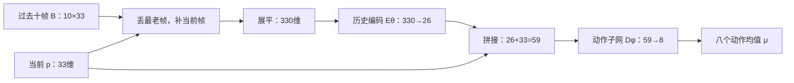
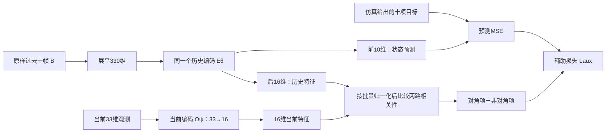

# actor.py：用这份代码学习Python、PyTorch与神经网络

更新：2026-10-27。**内容纯AI生成，由人类要求生成，未经人类修改。**

源码目录：`Tita_Lab/src/Tita_Lab/learning/np3o/`。
完整源码路径：`/mnt/D/BaiduSyncdisk/1ACrutial_Files/Ubuntu_2404_projects/isaaclab_ws/Tita_HWBR/Tita_Lab/src/Tita_Lab/learning/np3o/actor.py`。

本页目标是读懂一个网络对象如何把观测变成动作，以及训练时如何给历史编码器提供学习目标。读完应能画出三个子网络、写出辅助损失、对上每一步 shape，并分清“建立层”“计算结果”“更新参数”。

迁移23/24章保留来源与迁移取舍；本页集中讲 Python、PyTorch 和数学，不要求继续新增代码。

**状态：** 本页解释已保存的动作网络、辅助编码支路与损失计算。方法名按当前源码使用`auxilary_loss`。CPU前向、损失、梯度与BN检查范围见[实际结果](../../../../../../docs/audits/2026-10-27_saved_stack_sim62/actor/result.json)，完整NP3O训练循环尚未接入。

阅读分两段：第0—6节从整体架构读到动作前向；第7—9节读辅助损失与求梯度。完整源码只在第1节保留一份，后文贴正在解释的短片段。第11节可按 API 回查，实际提问集中在末尾。

重点定位：编码器用途见0.2；两种历史窗口见0.3—0.4；BatchNorm的批量方向见8.1；嵌套网络调用见7.1；Pylance类型提示见8.7。

## 0. 先看完整数学架构：每条支路究竟为什么存在

本页的actor指你正在写的`TitaHistoryActor`：它负责动作均值及辅助学习。旧仓库更外层`ActorCriticBarlowTwins`还包含奖励价值/cost价值等部分，本页不把那些未迁入的部分画成已经完成。

### 0.1 输入、目标与三个有参数的函数

先用符号给实际数据起名。这里t是策略时间步，n是批内样本序号；特征不一定都是原始传感器单位，因为观测配置已经做了缩放、噪声等处理。

| 数学名字 | 代码对应 | 每条样本的内容 |
| --- | --- | --- |
| $p_t\in\mathbb R^{33}$ | `obs`的一行 | 当前观测：角速度、重力方向、命令、关节量、上次动作等 |
| $B_t=[p_{t-10},\ldots,p_{t-1}]$ | `obs_hist`的一行 | 按旧到新排列的过去十帧，10×33 |
| $s_t\in\mathbb R^{10}$ | `targets`的一行 | 仿真训练提供的十项状态/参数目标 |
| $\mu_t\in\mathbb R^8$ | `forward`输出的一行 | 八维动作分布的均值，尚未采样和执行 |

网络里三个函数的参数独立：

| 代码对象 | 数学记号 | 输入→输出 | 功能 |
| --- | --- | --- | --- |
| `self.mlp_encoder` | $E_\theta$ | 330→26 | 把十帧信息组合成状态估计与历史特征 |
| `self.actor` | $D_\phi$ | 59→8 | 根据历史编码和当前观测算动作均值 |
| `self.obs_encoder` | $O_\psi$ | 33→16 | 为辅助学习产生当前观测的特征 |

θ、φ、ψ分别表示这三个子网络里所有可学习的权重、偏置和归一化参数，不是单个标量。

当前33维可按已有观测配置理解为：角速度3、重力方向3、速度命令3、处理后的关节位置8、关节速度8、上一策略动作8，合计33。这里是观测配置处理后的值，并非所有量的原始物理单位。历史由这样的整帧按时间排列而成。

### 0.2 encoder到底干什么

编码器在这里就是一个可学习函数：把输入数据变换成下游要用的中间特征。`encoder`是按功能起的名字，不是额外一种神秘的软件对象；这里它实际由Linear、ELU、LayerNorm组成，并装在Sequential里。

输入有330个数，输出26个数。它会学习如何组合时间和特征信息，例如关节运动、过去动作与机身变化之间的关系；输出不保证能无损还原全部330个数。是否学到有用信息，取决于后续损失与训练数据。

一帧观测可能不足以直接说明速度、接触、延迟和动力学参数。使用历史让网络有机会从运动变化中估计这些量；这不是说任何隐藏参数都能仅靠十帧唯一确定。TITA用十个真实训练目标监督一部分编码输出，并用后面的表示学习目标约束另外16维。

### 0.3 动作计算支路：26维全部参与动作

代码先把过去十帧的最老一帧丢掉，补入当前帧：

$$
\widetilde B_t=[p_{t-9},\ldots,p_t].
$$

然后：

$$
r_t=E_\theta(\operatorname{vec}(\widetilde B_t))\in\mathbb R^{26},
$$

$$
\mu_t=D_\phi([r_t,p_t])\in\mathbb R^8.
$$

vec表示按帧顺序展平，方括号表示按特征拼接，所以26+33=59。这里用的是26维全部编码，前10维并没有从动作计算中丢弃。



动作均值后续还需组成分布、采样，再交给环境的动作处理/PD等流程。这里不把均值解释成八个电机力矩。

### 0.4 辅助学习支路：让中间特征有训练目标

同一个历史编码器Eθ还会被调用一次；这一次输入原样的过去十帧B，不补当前：

$$
[\widehat s_t,z_t^H]=E_\theta(\operatorname{vec}(B_t)),\qquad
\widehat s_t\in\mathbb R^{10},\ z_t^H\in\mathbb R^{16}.
$$

这是同一个网络对象和同一套θ，只是另一组输入。当前观测进入独立的编码器：

$$
z_t^O=O_\psi(p_t)\in\mathbb R^{16}.
$$

前10维与仿真目标s比较；后16维与当前观测编码比较：



辅助损失是在训练时提供学习信号，不负责选择本次动作。当前动作forward不会调用obs_encoder和bn。

### 0.5 Barlow Twins是什么，以及TITA采用了哪部分

Barlow Twins是2021年的表示学习方法。原论文把同一图像的两个增强版本送入共享函数，约束输出的跨支路相关矩阵接近单位矩阵，用于学习一致且较少重复的表示。[原论文](https://proceedings.mlr.press/v139/zbontar21a.html)

旧TITA借用这个损失形式：一条支路是过去观测，另一条是当前观测；两条编码器结构不同、参数独立，并且额外加入十项状态的监督预测损失。本页分析的是这份TITA代码，不能仅凭Barlow Twins名字把它当成原论文完整图像训练流程。

在一批N条样本中，归一化后的两路特征记为H、O，均为(N,16)：

$$
C=H^{\mathsf T}O/N,\qquad
L_{BT}=\sum_i(C_{ii}-1)^2+0.005\sum_{i\ne j}C_{ij}^2.
$$

“对角接近1”鼓励两路的同编号特征对应；“非对角接近0”减少不同编号分量的重复。这里约束的是按特征乘积平均得到的相关性，不等于证明所有特征统计独立。

为什么不能让所有输出都成为一个常数？那样标准化后趋于零，C也趋于零，16个对角项的误差合计约16，不能得到低损失。若不同特征都复制同一个变化量，非对角项也会很大。这说明损失惩罚什么，不保证任何初始化与数据下都能训练成功。

十状态预测另外计算：

$$
L_{pred}=\frac1{10N}\sum_{n,j}(\widehat s_{nj}-s_{nj})^2,
$$

$$
L_{aux}=L_{BT}+0.01L_{pred}.
$$

十项目标取值的数学含义必须与列布局一起读。令完整训练输入为 $x_t\in\mathbb R^{586}$，则：

$$
s_t=x_t[220:230]=[2v_x^b,2v_y^b,2v_z^b,\ c_L-0.5,c_R-0.5,\ \ell/(L-1),\ \Delta m,\Delta c_x,\Delta c_y,\Delta c_z].
$$

$c_L,c_R$ 是经过本任务两帧 OR 处理的接触布尔值，$\ell$ 是延迟选择编号，$L=3$。这些是观测处理后的监督数值，不能把每项都当作未经缩放的传感器物理量。MSE 直接比较这十列，沿用旧实现的数值尺度。

### 0.6 三套参数将从哪里得到学习信号

| 参数/状态 | 该辅助损失涉及吗 | 后续完整训练中的角色 |
| --- | --- | --- |
| θ：历史编码器参数 | 是，预测项和两路相关项 | 还会通过动作输出获得策略损失的梯度 |
| ψ：当前编码器参数 | 是，两路相关项 | 主要服务辅助学习 |
| φ：动作输出子网参数 | 否，辅助方法没有调用它 | 由后续策略相关损失学习 |
| BN累计统计缓冲 | 训练调用中更新，不是优化器参数 | 与梯度更新机制不同 |

本文件能计算动作与辅助损失，但没有写完整NP3O损失或优化器循环。前向、损失计算、反向求梯度、参数更新的关系在第9节对应到Python调用。

## 1. 当前源码：先知道我们在解释哪份代码

```python
"""History-based action network for TITA."""

from __future__ import annotations

from collections.abc import Sequence

import torch
from torch import nn
from torch.nn import functional as F


def _build_mlp(
        input_dim: int,
        output_dim: int,
        hidden_dims: Sequence[int],
        *,
        layer_norm: bool = False,
) -> nn.Sequential:
    """Build an ELU multilayer perceptron with a linear output."""

    layers: list[nn.Module] = []
    previous_dim = input_dim
    for index, hidden_dim in enumerate(hidden_dims):
        # 每层先做线性变换 Wx+b，再经过ELU非线性变换。
        layers.extend((nn.Linear(previous_dim, hidden_dim), nn.ELU()))
        # 沿用旧工厂的准确位置：第一隐层不加LayerNorm。
        if layer_norm and index > 0:
            layers.append(nn.LayerNorm(hidden_dim))
        previous_dim = hidden_dim

    # 输出层不加激活函数，动作均值不在这里裁剪。
    layers.append(nn.Linear(previous_dim, output_dim))
    return nn.Sequential(*layers)


class TitaHistoryActor(nn.Module):
    """Predict action means from current and historical observations."""

    def __init__(
            self, 
            num_proprio: int = 33,
            history_length: int = 10,
            num_actions: int = 8,        
    ) -> None:
        """Initialize the history encoder and action network."""
        super().__init__()
        self.num_proprio = num_proprio
        self.history_length = history_length

        # 旧网络的26个中间输出：10个辅助预测量，加16个学习得到的特征。
        # 本步只迁前向；辅助预测的监督损失后续接入。
        self.prediction_dim = 10
        self.latent_dim = 16
        encoded_dim =  self.prediction_dim + self.latent_dim

        # 默认维度：330 -> 512 -> 256 -> 128 -> 26。
        self.mlp_encoder = _build_mlp(
            num_proprio * history_length,
            encoded_dim,
            (512, 256, 128),
            layer_norm=True,
        )
        # 默认维度：26+33=59 -> 512 -> 256 -> 128 -> 8。
        self.actor = _build_mlp(
            encoded_dim + num_proprio,
            num_actions,
            (512, 256, 128),
        )

        # 当前33维观测的另一条编码支路，只用于辅助学习损失。
        self.obs_encoder = _build_mlp(
            num_proprio,
            self.latent_dim,
            (256, 128),
            layer_norm=True,
        )
        # 沿批量方向分别标准化16个特征列；不学习额外缩放和偏移。
        self.bn = nn.BatchNorm1d(self.latent_dim, affine=False)


    def forward(self, obs: torch.Tensor, obs_hist: torch.Tensor) -> torch.Tensor:
        """Return the action means for a batch of observations."""

        # obs为(N,33)，obs_hist为(N,10,33)，后者不含当前帧。
        # 丢掉最老一帧，补入当前帧；得到最近九帧历史加当前帧。
        history_with_current = torch.cat(
            (obs_hist[:, 1:, :], obs.unsqueeze(1)), dim=1
        )
        batch_size = obs.shape[0]
        history_flat = history_with_current.reshape(batch_size, -1) # (N,330)。
        features = self.mlp_encoder(history_flat) # (N,26)。

        # 顺序沿用旧网络：26维编码在前，33维当前观测在后。
        actor_input = torch.cat((features, obs), dim=-1) ## (N,59)。
        return self.actor(actor_input) # (N,8)，动作分布的均值。

    def auxilary_loss(
            self,
            obs: torch.Tensor,
            obs_hist: torch.Tensor,
            targets: torch.Tensor,
            off_diag_weight: float = 5e-3,
    ) -> torch.Tensor:
        """Compute state prediction and Barlow Twins losses."""

        batch_size = obs.shape[0]
        # obs=(N,33)，obs_hist=(N,10,33)，targets=(N,10)。
        # 沿用旧损失：直接使用过去十帧，不追加当前帧。
        predicted = self.mlp_encoder(obs_hist.reshape(batch_size, -1))
        state_prediction = predicted[:, :self.prediction_dim] # (N,10)。
        history_features = predicted[:, self.prediction_dim:] # (N,16)。
        current_features = self.obs_encoder(obs)

        # 训练模式下，BatchNorm需要至少两个样本。
        history_norm = self.bn(history_features)
        current_norm = self.bn(current_features)
        # (16,N) @ (N,16) -> (16,16)，比较两条编码支路的特征相关性。
        correlation = history_norm.T @ current_norm / batch_size

        # 同编号特征的相关性接近1，不同编号特征的相关性接近0。
        diagonal_loss = (torch.diagonal(correlation) - 1.0).square().sum()
        off_diagonal_mask = ~torch.eye(
            self.latent_dim, dtype=torch.bool, device=correlation.device,
        )
        redundancy_loss = correlation[off_diagonal_mask].square().sum()

        # 前10个输出拟合仿真提供的10个目标值，按全部元素平均平方误差。
        prediction_loss = F.mse_loss(state_prediction, target=targets)
        return diagonal_loss + off_diag_weight * redundancy_loss + 0.01 * prediction_loss


```

这个文件目前有一个辅助函数、一个网络类：

| 名字 | 类型 | 功能 |
| --- | --- | --- |
| `_build_mlp` | 本项目的Python函数 | 按指定宽度建立网络层并返回容器 |
| `TitaHistoryActor` | 本项目的Python类，继承`nn.Module` | 根据当前与历史观测计算动作均值 |
| `nn.Linear`、`nn.ELU`、`nn.LayerNorm` | PyTorch提供的类 | 分别实现仿射变换、激活、层归一化 |
| `nn.Sequential` | PyTorch提供的容器类 | 保存子网络层并按顺序调用 |

“建立网络”时产生的是层对象和参数；“调用网络”时才把输入张量算成输出。以下先拆建立过程。

## 2. 文件开头与函数签名：Python在声明什么

### 2.1 导入的是模块、名字还是对象

```python
from __future__ import annotations
from collections.abc import Sequence
import torch
from torch import nn
```

- `import torch`让本文件通过`torch`访问PyTorch提供的名字，例如`torch.cat`。
- `from torch import nn`取出`torch`包的`nn`子模块，让代码能写`nn.Linear`。
- `Sequence`用于类型提示，表示有顺序、支持按位置访问的一串元素；这里允许传整数列表或元组。
- Python 3.12中的`from __future__ import annotations`推迟类型注解的求值，通常以字符串形式保存注解，减少提前查找类型名字的需要。它不改变网络计算，也不自动检查数据shape。

点号表示访问对象或模块的属性。`torch.nn.Linear`与当前导入方式下的`nn.Linear`指向同一个类。

### 2.2 参数、默认值、返回类型

```python
def _build_mlp(
    input_dim: int,
    output_dim: int,
    hidden_dims: Sequence[int],
    *,
    layer_norm: bool = False,
) -> nn.Sequential:
```

`def`定义函数。函数名开头的单下划线是“主要供内部使用”的约定，不是访问权限开关。

| 部分 | 在这里的含义 |
| --- | --- |
| `input_dim: int` | 输入特征数，提示为整数 |
| `output_dim: int` | 最后输出的特征数 |
| `hidden_dims: Sequence[int]` | 各隐层宽度，例如`(512,256,128)` |
| `layer_norm: bool = False` | 是否增加指定归一化层；省略时为False |
| `-> nn.Sequential` | 返回值应是Sequential对象 |
| 冒号及缩进 | 后面的缩进代码属于此函数 |

`: int`、`: torch.Tensor`、`-> ...`都是类型注解。它们帮助读者和编辑器理解代码，不会把一个数自动变成Tensor，也不会强制验证运行时传入值。

函数体开头的三引号字符串是docstring，用于说明函数功能。`#`后面是注释。它们都不执行网络运算。

### 2.3 形参里单独的星号

```python
_build_mlp(330, 26, (512, 256, 128), layer_norm=True)
```

单独的`*`规定：它后面的参数必须按名字传递。因此上面正确，下面错误：

```python
# 错误示例：True没有写对应参数名。
_build_mlp(330, 26, (512, 256, 128), True)
```

前三个参数也可以写名字，例如`input_dim=330`。本例用`(512,256,128)`这个元组依次指定三个隐层宽度，元组中的逗号把多个元素组织在一起。

这里的星号与后面`nn.Sequential(*layers)`的位置不同，含义也不同。到第4节再看实参解包。

## 3. 逐步建立隐层：列表中装的是层对象

### 3.1 建空列表，记录当前输入宽度

```python
layers: list[nn.Module] = []
previous_dim = input_dim
```

`[]`建立空列表。`list[nn.Module]`说明列表预期存放Module对象。

`previous_dim`是普通Python整数，表示“本轮要建立的层应接收多少个输入特征”。它一开始等于`input_dim`，例如330。它不是前一个时间步的数据。

### 3.2 enumerate与两个变量接收结果

```python
for index, hidden_dim in enumerate(hidden_dims):
```

`for`依次遍历序列。`enumerate()`把元素和从0开始的序号配成一对，再由`index, hidden_dim`分别接收。

对于`(512,256,128)`，循环三次：

| 次数 | index | hidden_dim | 本轮开始时previous_dim |
| --- | ---: | ---: | ---: |
| 第一次 | 0 | 512 | 330 |
| 第二次 | 1 | 256 | 512 |
| 第三次 | 2 | 128 | 256 |

这张表的第三行为什么输入宽度变成256，来自循环末尾的赋值：

```python
previous_dim = hidden_dim
```

它把“刚建成层的输出宽度”保存为下一层的输入宽度。

### 3.3 extend、append与这句代码的求值过程

```python
layers.extend((nn.Linear(previous_dim, hidden_dim), nn.ELU()))
```

第一次循环时，这句相当于：

```python
linear = nn.Linear(330, 512)
activation = nn.ELU()
layers.append(linear)
layers.append(activation)
```

先创建两个层对象，再分别放进列表。此时没有观测张量进入，所以还没执行矩阵乘法。

`append(x)`加入一个元素；`extend(iterable)`逐个加入其中的元素：

```python
items = []
items.extend((1, 2))  # items成为[1,2]。
items.append((3, 4))  # items成为[1,2,(3,4)]。
```

两者都原地修改列表，并返回`None`，所以这里没有写`layers = layers.extend(...)`。若那样赋值，layers会变成None。

到第一次循环的这个位置，layers中装着Linear对象和ELU对象。它没有装实际观测数据，也没有装纸面上的代数表达式。

## 4. 每一种层做什么数学计算

### 4.1 Linear：PyTorch自动建立W和b

```python
linear = nn.Linear(330, 512)
```

这表示输入330个特征，输出512个特征。Linear构造时建立：

| 属性 | 含义 | shape |
| --- | --- | --- |
| `linear.weight` | 权重W | (512,330) |
| `linear.bias` | 偏置b，默认启用 | (512,) |

它们是已经有数值的可学习参数。PyTorch在构造时自动随机初始化；当前默认初始化使W和b的元素位于输入宽度决定的均匀分布范围内。初始化不是训练结果。

对单条列向量样本：

$$
y=Wx+b,\qquad y_j=\sum_{i=1}^{330}W_{ji}x_i+b_j.
$$

严格说，含偏置的是仿射变换，神经网络中通常仍称“线性层”。每个输出分量使用330个输入的加权和，再加自己的偏置。512个输出各自有一行W。

本项目按行保存样本：X为(N,330)，所以批量形式是：

$$
Y=XW^{\mathsf T}+b,\qquad Y\in\mathbb R^{N\times512}.
$$

b是(512,)，会按广播规则加到每条样本的512个输出上。同一层的W、b在所有样本间共享；没有为每个环境单独建一套网络。

建立对象与使用对象要分开：

```python
linear = nn.Linear(330, 512)  # 创建层和参数。
y = linear(x)               # 输入张量后，执行该层的计算。
```

第一句返回层对象，第二句返回计算结果张量。假设一个更小的层暂时具有W=[0.4,−0.2]、b=0.1，输入x=[2,3]时，输出为0.4×2−0.2×3+0.1=0.3。这些W、b只是手算示例，不是随机初始化必然产生的数值。

本地实现可看`torch/nn/modules/linear.py`的`__init__`、`reset_parameters`和`forward`。[Linear官方接口](https://docs.pytorch.org/docs/2.11/generated/torch.nn.Linear.html)

### 4.2 ELU：逐个特征做非线性变换

```python
activation = nn.ELU()
```

默认alpha为1，计算：

$$
\operatorname{ELU}(z)=\begin{cases}z,&z>0,\\ e^z-1,&z\le0.\end{cases}
$$

例如ELU(2)=2，ELU(0)=0，ELU(−1)约−0.632。输入输出shape相同，512个特征仍是512个。此处ELU没有可学习参数，也没有把结果限制到[−1,1]；正半轴无上界。

若只串多个仿射层，仍可合成一次仿射变换。激活使网络能够表示非线性关系。这里创建ELU对象，实际输入数据时才计算上述函数。

### 4.3 if条件与LayerNorm的位置

```python
if layer_norm and index > 0:
    layers.append(nn.LayerNorm(hidden_dim))
```

`and`要求两条件同时成立。layer_norm=False时不添加；为True时只给index=1和2添加。因此本项目历史编码器的第二、第三隐层都有Linear→ELU→LayerNorm，第一隐层只有Linear→ELU。

这保留了旧TITA工厂的位置，不能按别处见过的习惯自动改成每层归一化或调整顺序。

### 4.4 LayerNorm的均值、方差与可学习参数

```python
norm = nn.LayerNorm(256)
```

对(N,256)张量，它分别在每条样本的最后256个特征上计算。设某行的D个特征为h：

$$
\mu=\frac1D\sum_{j=1}^D h_j,\qquad
v=\frac1D\sum_{j=1}^D(h_j-\mu)^2,
$$

$$
z_j=\gamma_j\frac{h_j-\mu}{\sqrt{v+\varepsilon}}+\beta_j.
$$

μ、v是该行特征的统计量；ε默认1e−5，用来避免分母过小。γ、β是可学习参数，分别对应此模块的weight和bias，默认初始化为1和0。它们与Linear里的W、b属于不同层的参数。

以某行[1,3]为例，μ=2、v=1，初始γ=1、β=0时，结果约为[−1,1]，因为ε存在不会精确等于±1。另一行独立求自己的统计量，不会与第一行混合。

本地构造接口还可写为：

```python
nn.LayerNorm(
    normalized_shape, eps=1e-5, elementwise_affine=True,
    bias=True, device=None, dtype=None,
)
```

| 参数 | 此处含义 |
| --- | --- |
| normalized_shape | 传一个整数D，表示对最后D个特征归一化；若传多轴shape，则覆盖相应末尾轴 |
| eps | 分母中的小正数，默认1e-5 |
| elementwise_affine | 默认True，为归一化位置建立可学习γ/β |
| bias | 默认True；开启affine时，可单独关闭加性β |
| device/dtype | 参数初建时的设备和数值类型；本例使用默认设置 |

LayerNorm在train/eval都使用当前输入统计，不保存BN式累计均值/方差。它不改变shape。中间特征归一化与env_cfg对传感器做固定scale分别属于不同计算位置。[LayerNorm官方接口](https://docs.pytorch.org/docs/2.11/generated/torch.nn.LayerNorm.html)

### 4.5 循环结束后追加输出层

```python
layers.append(nn.Linear(previous_dim, output_dim))
```

循环结束时previous_dim=128，output_dim=26，因此追加Linear(128,26)。后面没有再加ELU或LayerNorm。输出层的参数依然由PyTorch创建，也参与后续训练。

### 4.6 Sequential与实参星号：将层连起来

```python
return nn.Sequential(*layers)
```

`*layers`在函数调用处展开列表，把其中各层作为独立参数传入。相当于：

```python
nn.Sequential(layers[0], layers[1], layers[2], ...)
```

不是乘法，也不是创建许多列表副本。Sequential保存刚才创建的这些模块，调用时让前一层输出进入后一层。

本次网络结构展开后如下；这是结构示意，重新执行这些构造函数会创建另一套随机初始化参数：

```python
nn.Sequential(
    nn.Linear(330, 512), nn.ELU(),
    nn.Linear(512, 256), nn.ELU(), nn.LayerNorm(256),
    nn.Linear(256, 128), nn.ELU(), nn.LayerNorm(128),
    nn.Linear(128, 26),
)
```

`return`把这个容器对象交给调用方，并结束_build_mlp。调用方随后把它保存为self.mlp_encoder。

## 5. 网络类：对象拥有参数，调用时反复使用

### 5.1 nn.Module、class与继承

```python
class TitaHistoryActor(nn.Module):
```

class定义一个类。括号中的nn.Module是父类。TitaHistoryActor继承它的网络对象管理能力，包括发现子模块、列出参数、转设备、保存状态、切换训练/评估模式等。

在本项目中，TitaHistoryActor是整个动作网络；其中self.actor只是最后产生动作均值的一条子网络。它们名称接近，但不是同一个对象。

### 5.2 __init__、self与super

```python
def __init__(self, num_proprio=33, history_length=10, num_actions=8):
    super().__init__()
    self.num_proprio = num_proprio
```

本段省略类型提示，仅展示关系。执行model=TitaHistoryActor()时建立实例并调用初始化方法。self指向正在初始化的这个实例；普通调用时不需要手动传self。

super()沿当前类的方法解析顺序找到后续实现，此处调用nn.Module.__init__，建立管理子模块和参数所需的内部结构。接着再给self保存子模块。

形参num_proprio是本次初始化调用的局部名字；self.num_proprio是实例属性，可在初始化结束后继续读取。self.mlp_encoder保存建立好的Sequential对象。这样forward每次调用都使用它已经持有的层与参数，不重新建网络。

### 5.3 每一个构造变量的含义

| 名字 | 类型/默认值 | 保存或作用在哪里 |
| --- | --- | --- |
| `self` | 当前TitaHistoryActor实例 | 所有实例属性所属对象 |
| `num_proprio` | int，33 | 一帧当前观测的特征数 |
| `history_length` | int，10 | 使用的历史帧数 |
| `num_actions` | int，8 | 动作输出维度 |
| `self.num_proprio` | int，33 | 保留供实例其他方法读取 |
| `self.history_length` | int，10 | 保留历史长度 |
| `self.prediction_dim` | int，10 | 辅助状态预测的输出数量 |
| `self.latent_dim` | int，16 | 历史表示的特征数量 |
| `encoded_dim` | int，26 | 此次初始化的局部宽度：10+16 |
| `self.mlp_encoder` | Sequential | 编码展平的十帧，330→26 |
| `self.actor` | Sequential | 将26维编码与33维当前观测合成的59维输入变成8维均值 |
| `self.obs_encoder` | Sequential，已保存 | 当前观测的辅助编码，33→16，第7节解释 |
| `self.bn` | BatchNorm1d，已保存 | 16维辅助特征的批量归一化，第8节解释 |

当前辅助损失已按前10维与后16维划分计算。真正训练时，相应损失将给这两段提供不同的学习信号。16个学习特征的物理语义没有逐维手工指定。

### 5.4 可学习参数、普通张量与模块状态

Linear的weight/bias是nn.Parameter，即Module按参数管理的张量。通常它们requires_grad=True，参与自动求导；但必须有相应损失和优化器调用，才会更新。

普通输入Tensor描述一批数据，不会因为传入网络就变成网络参数。它们通常不需要求自己的梯度；网络参数仍可求梯度。

Module会递归找到保存在属性中的子模块。因此model.parameters()能列出编码器与动作网络的参数；不用为每层手动维护一个W列表。单纯把模块放进普通Python列表并存成属性，不等同于Sequential的子模块注册；本文件最终用Sequential管理它们。

辅助支路的self.bn包含running_mean等统计缓冲。缓冲是持久状态，但不等于优化器更新的可学习参数。第8节解释它们的更新时机。

## 6. forward：从输入张量到八个动作均值

### 6.1 Tensor、shape与N的含义

```python
def forward(self, obs: torch.Tensor, obs_hist: torch.Tensor) -> torch.Tensor:
```

Tensor是带shape、dtype、device等信息的多维数值数组。这里obs为(N,33)，obs_hist为(N,10,33)。三条轴依次是样本、时间、特征。

N表示本次输入的样本数。在线计算动作时，一条样本通常对应一个环境；训练将轨迹打散成小批后，N是小批样本数，未必等于环境总数。

`: torch.Tensor`不包含shape约束；shape约定由调用方及函数实现保持。

### 6.2 切片：取哪些样本、帧、特征

```python
obs_hist[:, 1:, :]
```

第一个冒号取全部样本；1:从时间下标1取到末尾；最后冒号取全部33个特征。十帧保留九帧，shape从(N,10,33)成为(N,9,33)。

若历史按[t−10,...,t−1]保存，它去掉t−10，保留[t−9,...,t−1]。这没有把环境原历史向前移动，只是为本次计算选择一部分张量。

### 6.3 unsqueeze与第一次cat

```python
history_with_current = torch.cat(
    (obs_hist[:, 1:, :], obs.unsqueeze(1)), dim=1
)
```

obs.unsqueeze(1)在位置1插入长度为1的轴，使(N,33)成为(N,1,33)。数值不改变，只增加时间轴。

cat的第一个参数是装着两个张量的元组。dim=1表示沿时间轴拼接；其他轴大小必须匹配。9帧历史加1帧当前，得到(N,10,33)，时间为[t−9,...,t]。

cat产生拼接结果，保存为局部变量history_with_current。它不更新ProprioHistory，也不改环境中的历史缓冲。

### 6.4 shape[0]与reshape中的−1

```python
batch_size = obs.shape[0]
history_flat = history_with_current.reshape(batch_size, -1)
```

shape给出各轴长度，shape[0]取第0轴，即样本数量N。batch_size是整数。

reshape保留每行数据顺序，把后面的时间与特征轴合并。−1要求PyTorch根据元素总数推断宽度，10×33=330，所以结果是(N,330)。它没有求平均，也没有打乱时间。

例如两帧三特征的小例：

```text
[[1,2,3], [4,5,6]] → [1,2,3,4,5,6]
```

reshape可能返回共享存储的视图，也可能根据输入布局复制数据；本页依赖的是结果值与shape，不依赖它是否复制。

### 6.5 调用编码器、第二次cat与return

```python
features = self.mlp_encoder(history_flat)
actor_input = torch.cat((features, obs), dim=-1)
return self.actor(actor_input)
```

self.mlp_encoder是已建立的Sequential对象。括号表示调用它，逐层执行得到(N,26)的features。

第二次cat的dim=−1表示最后一轴，此时是特征轴；26列编码在前，33列当前观测在后，合计59列。当前帧既参与历史窗口编码，又直接提供给动作输出网络，沿用旧模型设计。

self.actor接收(N,59)，输出(N,8)。return把这个输出张量交给调用方。八个值目前是动作分布均值，不是八个已经算完PD的电机力矩。

| 局部变量 | 实际内容 | shape |
| --- | --- | --- |
| `obs` | 当前一帧 | (N,33) |
| `obs_hist` | 过去十帧 | (N,10,33) |
| `history_with_current` | 最近九历史+当前 | (N,10,33) |
| `batch_size` | 样本数 | int |
| `history_flat` | 每样本十帧展平 | (N,330) |
| `features` | 历史编码器输出 | (N,26) |
| `actor_input` | 26编码+33当前 | (N,59) |
| 返回值 | 动作均值 | (N,8) |

### 6.6 为什么model(...)会执行forward

```python
model = TitaHistoryActor()
mean = model(obs, obs_hist)
```

第一句建立对象并初始化参数。第二句调用实例，经过nn.Module提供的__call__进入本类forward，并处理PyTorch的相关钩子。

forward不是Python保留字，是PyTorch约定的方法名。普通Python类随便写一个forward，并不会自动获得Module的调用行为。这里依靠继承nn.Module。

通常调用model(...)，避免直接调用model.forward(...)绕开Module的调用处理。前向可用于推理，也可用于训练；前向本身不执行optimizer.step。[Module说明](https://docs.pytorch.org/docs/2.11/generated/torch.nn.Module.html#torch.nn.Module.forward)

## 7. 已写入的辅助学习代码：先看对象与输入目标

本节解释辅助导入、两个成员与当前源码的损失方法。

导入：

```python
from torch.nn import functional as F
```

F是模块别名。functional提供直接作用于Tensor的函数；这里F.mse_loss计算误差，不建立一个持有W、b的网络层。

构造函数新增：

```python
self.obs_encoder = _build_mlp(
    num_proprio,
    self.latent_dim,
    (256, 128),
    layer_norm=True,
)
self.bn = nn.BatchNorm1d(self.latent_dim, affine=False)
```

obs_encoder把当前33维观测编码成16维，用于和历史编码的后16维比较。动作forward没有使用这条新增支路。

完整辅助方法见第1节的当前源码。下面按输入、编码、归一化、相关矩阵和三项损失逐句解释，不再重复整段实现。

这个方法需要三组输入，都是调用方已经得到的数据：

| 参数 | 含义 | shape |
| --- | --- | --- |
| `obs` | 当前观测 | (N,33) |
| `obs_hist` | 过去十帧 | (N,10,33) |
| `targets` | 仿真训练提供的十项目标 | (N,10) |
| `off_diag_weight` | 非对角线相关项系数，5e−3即0.005 | float |

当前586布局中，targets取220:230，即6维privileged_state加dynamics前4维：线速度×2的3维、轮过滤接触减0.5的2维、归一化延迟编号1维、质量增量1维、局部质心增量3维。

“privileged”通常指训练可得、部署策略不能直接取得的额外信息。本项目既给价值网络使用这些量，也拿其中十列监督历史预测；它不是仅凭英文名字就被Python限制为critic专用。

### 7.1 再次调用编码器与按列划分

```python
predicted = self.mlp_encoder(obs_hist.reshape(batch_size, -1))
state_prediction = predicted[:, : self.prediction_dim]
history_features = predicted[:, self.prediction_dim :]
current_features = self.obs_encoder(obs)
```

辅助损失直接使用过去十帧。与动作forward的九历史+当前不同，这是旧代码的实际规则。

这句的执行顺序是先算括号里面，再调用外面的网络对象。可展开为：

```python
history_flat = obs_hist.reshape(batch_size, -1)  # (N,10,33)变成(N,330)。
history_network = self.mlp_encoder              # 取得__init__里保存的Sequential对象。
predicted = history_network(history_flat)       # 逐层计算，得到(N,26)。
```

第一句只整理shape，第二句取得已有对象，不重新建立层；第三句使用其已有参数计算。self.mlp_encoder既不是这次输入的数据，也不是每次调用_build_mlp的函数名。它是此前_build_mlp返回并保存下来的网络实例。

predicted为(N,26)。:self.prediction_dim取列0到9，得到十状态预测；self.prediction_dim:取列10到25，得到16维历史特征。current_features来自当前观测编码，shape也为(N,16)。这三者都是网络算出的量。

## 8. BatchNorm、相关矩阵与每个损失API

### 8.1 BatchNorm1d的轴、affine与状态

先明确矩阵里每个方向。假设N=4条样本、D=2个特征：

```text
              特征0  特征1
样本0            1     10
样本1            3     14
样本2            5     18
样本3            7     22
```

“沿批量方向”就是沿第0轴，分别取每一列的四个值。特征0使用[1,3,5,7]求统计量；特征1使用[10,14,18,22]求统计量。不是把整张表8个值混成一个均值，也不是对一条样本的两个特征求统计。

特征0的均值为4，方差为((1−4)²+(3−4)²+(5−4)²+(7−4)²)/4=5。归一化约得到[−1.3416,−0.4472,0.4472,1.3416]。每列独立重复此计算，输出仍为(4,2)。实际本文件D=16，完全相同的规则处理16列。

在线批次的一行通常对应一台环境；训练小批次的一行也可以是从不同环境、不同时间抽取的一条记录。所以批量轴首先表示“当前这一批样本”，不是固定指机器人数量或时间轴。


```python
self.bn = nn.BatchNorm1d(self.latent_dim, affine=False)
history_norm = self.bn(history_features)
current_norm = self.bn(current_features)
```

这里输入为(N,16)。BatchNorm1d的1d是该模块的接口命名，不表示本例输入必须是一维向量。

这是nn.Module的子类，构造函数的主要接口是：

```python
nn.BatchNorm1d(
    num_features,
    eps=1e-5,
    momentum=0.1,
    affine=True,
    track_running_stats=True,
    device=None,
    dtype=None,
    *,
    bias=True,
)
```

| 参数 | 本文件取值 | 功能 |
| --- | --- | --- |
| num_features | self.latent_dim=16 | 特征列/通道数量C |
| eps | 默认1e−5 | 加在方差中，避免标准差分母为零 |
| momentum | 默认0.1 | 当前批统计在累计统计更新中的权重 |
| affine | 显式False | 关闭逐特征可学习γ、β；默认True时初始为1、0 |
| track_running_stats | 默认True | 保存累计均值/方差，供评估模式使用 |
| bias | 默认True，关键字参数 | affine=True时控制是否学习加性β；本例affine=False，γ/β均关闭 |
| device | 默认None | 创建参数/缓冲时采用默认设备设置；后续也可随model.to移动 |
| dtype | 默认None | 采用默认浮点类型，通常float32；可由外部设置改变 |

对累计统计，令momentum=m，更新为：

$$
\overline r_{new}=(1-m)\overline r_{old}+m\,r_{batch}.
$$

它控制统计量更新；momentum=None时采用累计平均。训练前向使用本批的1/N方差，而running_var的更新使用无偏估计，二者不要手工混写。PyTorch负责这部分实现。

模块还持有以下缓冲：running_mean初始为16个0，running_var初始为16个1，num_batches_tracked初始为0。当前每次辅助损失对同一个bn调用两次，计数相应增加两次，两路各自用自己本批统计做训练归一化；不是先把两路拼成同一个批量再统一求均值。

接口也接受(N,C,L)三维输入；那时每个通道的统计覆盖N与L。本文件实际使用(N,16)的二维情况，所以先按上面的“每列取N条样本”理解。

在训练模式下，它对每个特征列沿N个样本求统计量。对第j列：

$$
\mu_j=\frac1N\sum_n H_{nj},\qquad
v_j=\frac1N\sum_n(H_{nj}-\mu_j)^2,
$$

$$
\widehat H_{nj}=\frac{H_{nj}-\mu_j}{\sqrt{v_j+\varepsilon}}.
$$

这是此调用当前批量的归一化公式。affine=False关闭额外的可学习γ、β；不代表这个模块完全没有状态。默认track_running_stats=True，模块保留running_mean、running_var与num_batches_tracked，训练调用会更新它们；评估模式使用累计统计。归一化和累计方差更新有估计方式差别，由PyTorch实现，本项目不手写更新。

当前实现对两路特征调用的是同一个self.bn，沿用旧代码；在训练模式下每次调用分别用该路当前批量计算，同时更新同一组累计缓冲。动作forward不调用它。

| 比较项 | 此处LayerNorm | 此处BatchNorm1d |
| --- | --- | --- |
| 对(N,D)统计哪个方向 | 每一行的D个特征 | 每一列的N个样本 |
| 是否使用其他样本 | 否 | 训练时使用同批其他样本 |
| 本例额外可学习缩放/偏移 | 默认有 | affine=False关闭 |
| 是否维护累计统计缓冲 | 不维护 | 默认维护 |

因此，auxilary_loss返回前可能已经更新BN的统计缓冲，但不会自行更新网络可学习权重。训练模式下本例至少需要两个样本；动作forward本身仍能单样本运行。[BatchNorm1d说明](https://docs.pytorch.org/docs/2.11/generated/torch.nn.BatchNorm1d.html)

### 8.2 .T、@、除法与相关矩阵

```python
correlation = history_norm.T @ current_norm / batch_size
```

本例张量都是二维，.T交换行列，(N,16)变成(16,N)。@表示矩阵乘法，维度(N)被求和；不是逐元素乘法。结果为(16,16)，除以N后：

$$
C=\widehat H^{\mathsf T}\widehat O/N,
\qquad C_{ij}=\frac1N\sum_n\widehat H_{ni}\widehat O_{nj}.
$$

correlation比较两条支路。第i行、第j列反映历史第i个特征与当前第j个特征的相关程度；它不是(N,N)的环境两两关系矩阵。

### 8.3 diagonal、square与sum

先看两个便于手算的理想例子，忽略ε造成的微小差别：

- 两路的同编号特征相同，而且两个特征列互不相关时，C可以接近[[1,0],[0,1]]，两项Barlow损失都小。
- 如果两路各自的两个特征列都复制同一列，则C接近[[1,1],[1,1]]。对角项虽小，非对角项为1²+1²=2，仍受到惩罚。

这就是“对应”和“减少重复”分别由两项承担的原因。C仍是特征与特征的比较，不是对环境编号做分类。


```python
diagonal_loss = (torch.diagonal(correlation) - 1.0).square().sum()
```

torch.diagonal取C的16个对角元素，得到(16,)；减去1.0是标量广播。square逐元素平方；sum把所有元素加成一个标量Tensor，shape为()，不是(1,)。

$$
L_{diag}=\sum_{i=1}^{16}(C_{ii}-1)^2.
$$

因此这项鼓励同编号特征的相关性接近1。square和sum在这里不带末尾下划线，不会原地改写correlation。

### 8.4 eye、bool、device、~与布尔索引

```python
off_diagonal_mask = ~torch.eye(
    self.latent_dim, dtype=torch.bool, device=correlation.device
)
redundancy_loss = correlation[off_diagonal_mask].square().sum()
```

eye(16)建立16×16单位矩阵。dtype=torch.bool让对角线为True、其余为False；~对布尔值取反，变成对角False、其余True。

device=correlation.device让掩码建立在与C相同的设备上，C在CPU就建CPU掩码，在GPU就建GPU掩码。这不是再做一次物理设备选择。

correlation[off_diagonal_mask]选出True位置的元素，得到一维的16×15=240个非对角元素。随后平方求和：

$$
L_{off}=\sum_{i\ne j}C_{ij}^2.
$$

它鼓励不同编号分量的跨支路相关性接近0，减少表示中的重复内容。这个目标不会直接为每个特征指定物理名称。

### 8.5 mse_loss、默认平均与系数

```python
prediction_loss = F.mse_loss(state_prediction, targets)
return diagonal_loss + off_diag_weight * redundancy_loss + 0.01 * prediction_loss
```

两张(N,10)张量逐元素相减、平方；默认reduction='mean'对所有N×10个元素取平均：

$$
L_{pred}=\frac1{10N}\sum_n\sum_j(\widehat s_{nj}-s_{nj})^2.
$$

三个分量的标量Tensor相加，保持求梯度关系：

$$
L_{aux}=L_{diag}+0.005L_{off}+0.01L_{pred}.
$$

注意对角与非对角项使用sum，预测项使用mean；不能未经核对就把它们都改成平均。

手算一个小例：若两维C为[[0.8,0.1],[−0.2,0.9]]，则Ldiag=0.05、Loff=0.05。再假设Lpred=0.4，总和为0.05+0.005×0.05+0.01×0.4=0.05425。这里只演示公式，不是当前网络实测值。

返回值是带计算关系的标量Tensor，不必先转成Python浮点数。后续在该Tensor上调用backward，才能沿计算追踪参数。

### 8.6 每一个辅助变量

| 名字 | 含义 | shape/类型 |
| --- | --- | --- |
| `batch_size` | 当前批量样本数N | int |
| `predicted` | 原样过去十帧的编码输出 | (N,26) |
| `state_prediction` | 前10维状态估计 | (N,10) |
| `history_features` | 后16维历史表示 | (N,16) |
| `current_features` | 当前观测支路的表示 | (N,16) |
| `history_norm` | 按批量标准化后的历史表示 | (N,16) |
| `current_norm` | 按批量标准化后的当前表示 | (N,16) |
| `correlation` | 两路特征的相关矩阵C | (16,16) |
| `diagonal_loss` | 同编号特征对齐误差之和 | 标量Tensor |
| `off_diagonal_mask` | 选择C的非对角元素 | (16,16)，bool |
| `redundancy_loss` | 非对角元素的平方和 | 标量Tensor |
| `prediction_loss` | 十状态预测的平均平方误差 | 标量Tensor |
| 返回值 | 三项加权合计 | 标量Tensor |

### 8.7 为什么correlation、device、square、sum可能没有代码提示

这些运行时接口存在：correlation是相关矩阵Tensor，device是Tensor保存的设备属性；square逐元素平方，sum做归约。无补全不能单独证明接口不存在或计算错误。

本地PyTorch的Module调用入口有如下类型声明：

```python
__call__: Callable[..., Any] = _wrapped_call_impl
```

Callable表示可调用对象；...代表参数未限定，Any表示静态类型信息没有限定结果。Sequential.forward在本地实现里也没有明确的返回注解。Pylance有时会因此把self.mlp_encoder(...)或self.bn(...)看成Any，然后在后续.T、@、除法、索引上继续传播，无法确认结果是Tensor。具体编辑器状态还需看悬停类型，不能仅凭现象断言整个Python环境有问题。

可以给关键结果显式标注类型：

```python
history_norm: torch.Tensor = self.bn(history_features)
current_norm: torch.Tensor = self.bn(current_features)
correlation: torch.Tensor = history_norm.T @ current_norm / batch_size
selected_correlations: torch.Tensor = correlation[off_diagonal_mask]
redundancy_loss: torch.Tensor = selected_correlations.square().sum()
```

这里新增selected_correlations只是把原来链式表达式拆开，shape为(240,)。这些注解告诉编辑器预期类型，不创建另一个Tensor、不移动设备、不改变数学公式，也不在运行时强制检查类型。

本地依据：torch/nn/modules/module.py的__call__声明，container.py的Sequential.forward。user级extraPaths是否配置正确属于另一个排查层次，本次不改编辑器配置。

## 9. 前向、反向、优化器：何时参数才变化

```python
mean = model(obs, obs_hist)
loss = model.auxilary_loss(obs, obs_hist, targets)
```

第一句执行动作前向；第二句执行辅助项内部的网络计算并算出损失。当前辅助项没有使用mean，所以不是每项损失都必须直接比较最终动作。

令模型参数统称θ，前向计算为y=fθ(x)。反向传播从标量损失开始，按链式法则求∂L/∂θ。PyTorch可根据本例支持求导的操作自动完成，不需要给TitaHistoryActor再写一个backward方法。

下面只是加入辅助项以后训练操作的教学示意，不是本项目已接好的NP3O入口，也不要求现在执行：

```python
optimizer = torch.optim.Adam(model.parameters(), lr=1e-3)
optimizer.zero_grad()
loss = model.auxilary_loss(obs, obs_hist, targets)
loss.backward()
optimizer.step()
```

| 接口 | 这里做什么 |
| --- | --- |
| `model.parameters()` | 递归取得Module管理的可学习参数，供优化器使用 |
| `torch.optim.Adam(...,lr=...)` | 建立优化器并持有这些参数；lr为学习率 |
| `zero_grad()` | 清理参数已有梯度，避免无意累加 |
| `loss.backward()` | 反向计算并积累各参数的梯度，不自行更新W、b |
| `optimizer.step()` | Adam根据梯度及自身状态更新参数 |

以y=wx+b为例，x=3、w=2、b=1，前向y=7。若L=0.5(y−5)²，反向给出∂L/∂w=6、∂L/∂b=2。此时w、b仍是2、1；优化器更新后才变化。深层网络使用同类链式求导，只是中间操作更多。

辅助预测项涉及mlp_encoder；相关性项还涉及obs_encoder。本项没有调用动作子网self.actor，所以它的参数不会仅靠这项损失得到梯度，之后还需要策略损失。

把这个手算例子写成链式法则：

$$
\frac{\partial L}{\partial w}
=\frac{\partial L}{\partial y}\frac{\partial y}{\partial w}
=(y-5)x=6,\qquad
\frac{\partial L}{\partial b}=y-5=2.
$$

若教学中改用最简单的梯度下降，更新写成 $w_{new}=w-\eta\,\partial L/\partial w$。实际示意代码选 Adam，它还维护梯度统计；这里不把这条简单更新式当作 Adam 的完整算法。

### 9.1 train、eval与禁用梯度不是一回事

model.train()让子模块进入训练模式；model.eval()让它们进入评估模式。这主要影响BN等有模式差别的层，调用它们不会自动开始或停止优化器更新。

torch.no_grad()或inference_mode()用于关闭相应梯度记录，不等于切换Module到评估模式。比如BN保持训练模式时，即使在no_grad上下文中仍会更新统计缓冲。动作forward本身没有BN；辅助支路则需要考虑模式。

本项目后续runner决定何时采样、何时训练以及怎样组合总损失；单独定义auxilary_loss不会让Lab自动调用它。

## 10. 在旧TITA训练实现中的位置

当前动作前向来源是旧MlpBarlowTwinsActor；辅助学习沿用其BarlowTwinsLoss中已有的相关项和十状态MSE。NP3O.update在启用imi_flag时把该项加入总损失，再执行backward和optimizer.step。

本页只是模型和辅助目标这个知识点。完整算法还涉及动作分布、奖励/cost价值、轨迹存储、策略目标与约束更新。代码已在/home/eaziel/Downloads/tita_rl-master中，不需要为了继续此迁移再找另一份同名算法。

2026-10-26辅助损失检查直接读取当时保存的动作前向与辅助计算体；本轮文档整理没有重跑此检查。batch1/4/64动作输出差0；batch4/32辅助值差约3.81e−6/0，所检参数与输入梯度差0，BN统计一致，两处时间窗口正确。计算检查通过与方法名需统一是两项不同结论。证据见[当前源码检查](../../../../../../docs/audits/2026-10-26_saved_actor/README.md)。没有优化器step、Sim或训练结果。

本轮用户明确停止推进迁移，当前只检查和学习本文件。这里不安排新的实现步骤，后续状态以用户明确要求和实际文件为准。

## 11. 语法与API查阅索引

本表按本页出现的接口列出，供回查，不替代上面的逐段解释。

| 类别 | 具体内容 | 主线位置 |
| --- | --- | --- |
| 模块导入/命名 | future annotations、Sequence、torch、nn、F别名 | 2、7 |
| 函数与类型 | def、类型注解、默认值、return、->、docstring | 2 |
| 两种星号 | 形参keyword-only分隔、实参列表解包 | 2.3、4.6 |
| Python容器与循环 | list、tuple、enumerate、解包赋值、extend、append、and、比较 | 3、4.3 |
| 类与对象 | class、继承、self、属性/局部变量、__init__、super、__call__ | 5、6.6 |
| PyTorch网络组件 | Module、Linear、ELU、LayerNorm、Sequential | 4、5 |
| 张量与shape | Tensor、切片、shape[0]、unsqueeze、cat、dim、reshape、−1 | 6 |
| 辅助成员 | obs_encoder、BatchNorm1d、affine、训练/评估统计 | 7、8.1 |
| 矩阵与损失 | .T、@、广播、diagonal、square、sum、eye、dtype、device、~、布尔索引、mse_loss | 8 |
| 梯度与参数更新 | Parameter、parameters、Adam、zero_grad、backward、step | 5.4、9 |
| 模式与状态 | train、eval、no_grad、inference_mode、统计缓冲 | 8.1、9.1 |

## 12. 官方阅读入口

本地环境为Python 3.12与PyTorch 2.11；具体计算以本地实现与项目源码为准。

- [Python列表：append与extend](https://docs.python.org/3.12/tutorial/datastructures.html#more-on-lists)
- [Python特殊参数与解包](https://docs.python.org/3.12/tutorial/controlflow.html#special-parameters)
- [Module](https://docs.pytorch.org/docs/2.11/generated/torch.nn.Module.html)
- [Sequential](https://docs.pytorch.org/docs/2.11/generated/torch.nn.Sequential.html)
- [ELU](https://docs.pytorch.org/docs/2.11/generated/torch.nn.ELU.html)
- [MSE函数](https://docs.pytorch.org/docs/2.11/generated/torch.nn.functional.mse_loss.html)

## 补充问答

**Q：layers.extend((nn.Linear(previous_dim, hidden_dim), nn.ELU()))这句没看懂，你注释是“每层先做线性变换 Wx+b，再经过ELU非线性变换。”，但是我们没给w和b啊，这句代码最后是一个代数式，还是什么？**

**A：** 它先建立Linear和ELU对象，再把两个对象加入列表。W、b由Linear构造时自动创建并初始化，数值存在层的参数张量中。此时还没有输入x；随后调用网络时才真正执行Wx+b和ELU。具体对象、参数shape与数值小例见3.3、4.1。

**Q：LayerNorm是啥？nn.Module又是啥？`*layers`又是啥语法？？形参`*`又是啥鬼？？**

**A：** LayerNorm是4.4的按样本特征归一化层；Module是5.1的网络组件基类；实参*layers在4.6展开层列表；形参单独*在2.3要求后续参数写名字。它们分别属于数学操作、网络对象管理、Python函数调用语法，需要按各自出现位置理解。

**Q：forward指的是啥？我没学深度学习神经网络的前向传播和反向传播。这指的是前向传播这个概念吗？**

**A：** 是。forward定义怎样使用当前参数把输入算成输出。model(...)经Module.__call__进入它。反向传播计算损失梯度；优化器另一步更新参数。6.6和第9节分别对应调用过程与数学过程。仅运行forward不是已经开始训练。

**Q：什么叫批量方向？BatchNorm1d这个类也讲。**

**A：** 对本文件的(N,16)，批量方向是第0轴。每个特征列分别取N条样本求均值、方差并归一化；第8.1节给出4×2矩阵逐列手算，并解释affine、累计缓冲、训练/评估状态。

**Q：整个架构指的是数学架构。我都不知道encoder用来干啥的！**

**A：** 第0节先定义输入与三个参数化函数，再分开画动作支路和辅助支路。编码器是把原始观测映射到中间特征的可学习函数；本文件的历史编码26维全部用于动作计算，其中10维还接受状态监督、16维接受两路相关性约束。

**Q：Barlow Twins是啥玩意？**

**A：** 第0.5节给出原论文出处和损失含义，再说明TITA将历史/当前两路编码用于这个目标，并额外加入十状态预测；两条编码器不是原论文图像场景的同一函数副本。矩阵与各损失API在第8节逐行对应。

**Q：self.mlp_encoder(obs_hist.reshape(batch_size, -1))，没看懂。**

**A：** 第7.1节将它展开成整理历史shape、取得已保存网络对象、调用网络三句。括号内reshape先得到(N,330)，外部网络调用再得到(N,26)，过程中不重新建网络。

**Q：device=correlation.device的correlation没有代码提示；correlation[off_diagonal_mask].square().sum()这里的square().sum()也没有代码提示。**

**A：** 第8.7节解释实际API与静态类型传播的区别，并给出关键Tensor注解和拆开链式表达式的写法；它们不改变计算。当前实际源码的数值与梯度检查通过，不用据此把缺少补全判断为接口不存在。
