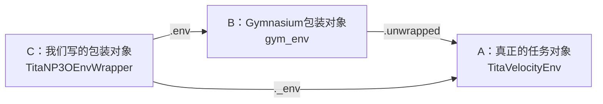

# env_wrapper.py：把环境交互数据交给训练循环

内容纯 AI 生成，由人类要求生成，未经人类修改。整理与当前调用核对：2026-11-04。

被解释文件：`Tita_Lab/src/Tita_Lab/learning/np3o/env_wrapper.py`。完整路径：`/mnt/D/BaiduSyncdisk/1ACrutial_Files/Ubuntu_2404_projects/isaaclab_ws/Tita_HWBR/Tita_Lab/src/Tita_Lab/learning/np3o/env_wrapper.py`。

## 先明确目标与结果

环境已经知道怎样推进机器人，并返回观测、奖励、结束标志与附加数据。训练循环需要按自己的格式接收它们。本文件建立一个位于环境与训练程序之间的包装对象，保存现有环境的引用，将 **Lab 的五项 step 返回整理成旧 TITA 训练循环使用的六项**。它还提供环境数量、动作维数和当前观测等训练程序需要读取的信息。

读完应能顺着这一条调用说明每个变量：

```text
未来的 runner 调用 wrapper.step(actions)
    → wrapper 调用已有 Lab 环境的 step(actions)
    → 环境推进物理并计算本步数据
    → wrapper 拼观测、取 cost、整理结束标志与 infos
    → 返回六项给 runner
```

包装对象使双方调用方法、返回顺序和张量格式相符。奖励的物理意义由任务设计决定，训练算法按约定使用奖励数值；网络需要哪些观测也要由配置或代码明确指定。当前NP3O包装器传出六项cost，后续算法还需要明确读取、保存和使用它们。存储与GAE已接check并完成用户短检查；完整训练入口、NP3O更新和runner尚未接通。

先读 [官方训练流程](../../../../../../docs/训练流程与Wrapper入门.md) 第2—8节，可了解wrapper的地位、gym.make的创建过程、三层对象和官方RSL接线。第6节详细解释OnPolicyRunner的构造与learn调用，第8节将收集数据对应到PPO的优势、损失和参数更新。下文沿当前wrapper源码解释对象保存和数据整理；检查脚本已调用此类，正式NP3O训练入口仍未接好。

新增的`infos["terminated"]`保留真实终止标记；`dict(extras)`也保留Lab启用compute_final_obs后提供的最终观测字典。check据此区分纯超时，并取得reset前状态的价值，详细数据流见[check第7节](../../../../scripts/check_np3o_interface.py.md)。

## 1. 当前源码快照

```python
"""Environment interface for TITA NP3O training."""

from __future__ import annotations

from typing import TYPE_CHECKING, cast

import gymnasium as gym
import torch

from Tita_Lab.tasks.velocity.observation_layout import pack_tita_observations

if TYPE_CHECKING:
    from Tita_Lab.tasks.velocity.tita_velocity_env import TitaVelocityEnv


class TitaNP3OEnvWrapper:
    """Expose the TITA Lab task through the NP3O rollout interface."""

    def __init__(self, env: gym.Env) -> None:
        """Store the environment and its training dimensions."""

        self.env = env
        # env可能带Gymnasium包装层；_env直接指向真正的TitaVelocityEnv。
        self._env = cast("TitaVelocityEnv", env.unwrapped)
        self.num_envs = self._env.num_envs
        self.device = self._env.device
        self.num_actions = self._env.action_manager.total_action_dim
        self.max_episode_length = self._env.max_episode_length

        # 五组按既定顺序拼成586列；价值网络所需数据也已包含在其中。
        self.num_obs = 586
        self.num_privileged_obs = None
        self.cost_names = self._env.cost_manager.active_terms
        self.num_cost = len(self.cost_names)

        # 供算法读取的六项参数，分别为(1,6)和(1,1,6)；不乘进本步cost。
        self.cost_k_values = self._env.cost_manager.k_values
        self.cost_d_values_tensor = self._env.cost_manager.d_values

    @property
    def episode_length_buf(self) -> torch.Tensor:
        """Return the policy-step counts of the current episodes."""
        return self._env.episode_length_buf

    @episode_length_buf.setter
    def episode_length_buf(self, value: torch.Tensor) -> None:
        """Set the policy-step counts of the current episodes."""
        self._env.episode_length_buf = value

    def reset(self) -> torch.Tensor:
        """Reset all environments and return the packed observations."""
        observations, _ = self.env.reset()
        return pack_tita_observations(observations=observations)

    def get_observations(self) -> torch.Tensor:
        """Return the most recently computed observations."""
        # 读取reset/step已经算好的结果，不再次采噪声或更新历史。
        return pack_tita_observations(self._env.obs_buf)

    def get_privileged_observations(self) -> None:
        """Use the packed observations as the critic input."""
        return None

    def step(self, actions: torch.Tensor) -> tuple[torch.Tensor, None, torch.Tensor, torch.Tensor, torch.Tensor, dict]:
        """Advance the task and return one NP3O rollout transition."""
        observations, rewards, terminated, truncated, extras = self.env.step(actions)
        obs = pack_tita_observations(observations=observations)

        # (N,6)，已经乘过一次step_dt，并保留了自动reset前的本步数值。
        costs = extras["costs"]
        # (N,)，失败或超时都表示本回合结束；旧存储使用整数0/1。
        dones = (terminated | truncated).to(dtype=torch.long)

        # 仅往副本添加旧训练循环需要的键，不改Lab自己的extras字典。
        infos = dict(extras)
        infos["terminated"] = terminated
        
        if not self._env.cfg.is_finite_horizon:
            infos["time_outs"] = truncated
        if bool(dones.any()) and "log" in extras:
            infos["episode"] = dict(extras["log"])
        infos["depth"] = None  # 旧TITA默认不启用深度相机分支。

        # 第二项None表示不另传一张critic专用观测，数据已在obs的586列中。
        return obs, None, rewards, costs, dones, infos

    def close(self) -> None:
        """Close the wrapped environment."""
        self.env.close()
```


## 2. 构造对象：保存哪个环境，谁拥有数据

```python
self.env = env
self._env = cast("TitaVelocityEnv", env.unwrapped)
```

### 2.1 先看创建与包装的顺序

构造函数的参数来自调用方。将接线写成下面的教学示意，先用不同变量名区分对象：

```python
import gymnasium as gym

gym_env = gym.make("TitaLab-Velocity-Tita", cfg=env_cfg)
training_env = TitaNP3OEnvWrapper(gym_env)
```

`gym`是Gymnasium的别名，与旧NVIDIA Isaac Gym不是同一个库。`make`就是“创建”：查找已登记的任务名，找到`TitaVelocityEnv`类并调用它，传入配置；环境类及Lab父类据此创建机器人任务。Gymnasium再按设置加上自己的包装层，将结果交给`gym_env`。当前任务使用默认的`OrderEnforcing`包装层；具体登记与创建过程见[训练流程第3—4节](../../../../../../docs/训练流程与Wrapper入门.md)。

第二句将make的返回对象传入我们这个类。由此得到三个对象：



1. **A**负责任务：物理仿真、机器人、观测、奖励、reset等。
2. **B**是Gymnasium在A外面加的接口层，当前`gym.make()`返回它。
3. **C**是当前文件实现的接口层，将数据整理成旧TITA训练程序所需形式，`training_env`指向它。

包装层持有已有对象，三个对象围绕同一套仿真工作，不增加并行机器人数量。

### 2.2 对照构造函数的两次赋值

执行第二句时，`self`是正在创建的C，参数`env`接收B。于是：

| 当前源码 | 保存的对象 | 用途 |
| --- | --- | --- |
| `self.env = env` | B | reset/step/close通过传入的完整接口转交 |
| `self._env = cast("TitaVelocityEnv", env.unwrapped)` | A | 直接读取任务特有的cost_manager、obs_buf等属性 |

`cast("TitaVelocityEnv", ...)`告诉类型检查器怎样理解对象，不创建环境、不做运行时类型验证，也不改变数值。`_env`的下划线表示作者将其作为内部属性；取得A的操作是`.unwrapped`。

之前出现的`raw_env`、`native_env`和检查脚本里的`nativa_env`，都是用于接收make结果B的普通变量名。它们没有定义不同类型的环境。本页统一使用`gym_env`指B、`training_env`指C。

当检查函数写`run_check(env, ...)`时，它的参数env接收的是C，与这里构造函数中接收B的参数env不是同一个局部变量。检查函数里的`env.env`指B，`env.env.unwrapped`及`lab_env`指A。因此要结合当前函数的参数来源理解名字。

构造函数只保存引用与维度，没有 reset 或推进物理。

### 2.3 保存训练侧需要读取的信息

| 属性 | 值或 shape | 用途 |
| --- | --- | --- |
| `num_envs` | N | 并行环境数，环境张量每行对应一个环境 |
| `device` | 例如 cuda:0 | 环境主要计算张量所在设备 |
| `num_actions` | 8 | 由 ActionManager 的 total_action_dim 读取 |
| `max_episode_length` | 2000 个策略步 | 20 s / 0.01 s，用于训练侧回合计数约定 |
| `num_obs` | 586 | 包装后每行观测列数 |
| `num_privileged_obs` | None | 不另外提供第二张 critic 专用输入矩阵 |
| `cost_names` | 六个名称 | 来自 CostManager，固定 cost 列含义 |
| `num_cost` | 6 | cost列数，当前接口为num_cost |
| `cost_k_values` | `(1,6)` | 原任务约束项的六个系数，供算法使用 |
| `cost_d_values_tensor` | `(1,1,6)` | 六项约束阈值参数，供后续算法/存储使用 |

最后两项是管理器已有张量的引用。包装器不会把 k/d 再乘进本步 cost。

## 3. reset 与读取观测：两种操作有何区别

```python
observations, _ = self.env.reset()
return pack_tita_observations(observations=observations)
```

`reset()` 真正重置环境，并计算初始观测。Lab 返回 `(observations, extras)`；这里 `_` 接收暂时不用的第二项。`observations` 是按名称取张量的字典，交给拼接函数得到 `(N,586)`。

```python
return pack_tita_observations(self._env.obs_buf)
```

`get_observations()` 读取最近一次 reset/step 已经算好的缓存。它不再次调用 ObservationManager，因此不会因为训练循环多读一次数据而重新抽噪声或推进历史。

五组的排列由 `pack_tita_observations` 明确规定：

| 列区间，右端不含 | 字典键 | 每行列数 |
| --- | --- | --- |
| 0:33 | policy | 33 |
| 33:220 | scan | 187 |
| 220:226 | privileged_state | 6 |
| 226:256 | dynamics | 30 |
| 256:586 | history | 330 |

数学上，对第 n 个环境：

$$
x_n=\operatorname{clip}\left([p_n,h_n,s_n,d_n,b_n],-100,100\right)
\in\mathbb R^{586}.
$$

方括号表示沿特征列拼接；clip 对每个元素裁剪。这里的 $h_n$ 是地面高度组，$b_n$ 是十帧历史。拼接函数不改组内关节顺序。详细循环、索引与检查见 [布局解释](../../tasks/velocity/observation_layout.py.md)。

## 4. 为什么单独的 critic 观测返回 None

```python
self.num_privileged_obs = None

def get_privileged_observations(self) -> None:
    return None
```

当前六维额外状态、30 维动力学参数已放进 586 列。这里用 None 表示“不再单独交第二张矩阵”。接收方需要约定如何处理 None；None 本身不具有训练含义。

旧 `OnConstraintPolicyRunner` 明确写了：

```python
privileged_obs = self.env.get_privileged_observations()
critic_obs = privileged_obs if privileged_obs is not None else obs
```

若有第二张矩阵就使用它，否则把整张 obs 交给 critic。后续网络自己按列选择信息。旧 actor 动作支路只读取当前观测和历史；critic 还可用高度和训练额外状态。**把 586 列交给同一个模型入口，不等于动作支路使用全部 586 列。**

privileged 通常指训练中可取得、部署策略不能直接读取的额外信息。本项目还用其中一些量监督历史编码器；其用途由取数代码决定。不要仅凭组名就把它理解成 Python 强制的 critic 专用数据。

来源：[旧约束 runner](/home/eaziel/Downloads/tita_rl-master/runner/on_constraint_policy_runner.py:101)。

## 5. step：一次交互怎样形成六项结果

### 5.1 先让已有环境完成一次策略步

```python
observations, rewards, terminated, truncated, extras = self.env.step(actions)
obs = pack_tita_observations(observations=observations)
costs = extras["costs"]
```

`actions` 为 `(N,8)`，包装器原样转交；滤波、缩放、延迟和 PD 都由环境内既有模块执行。一次环境 step 包含四个物理步。

Lab 返回：观测字典、奖励 `(N,)`、任务终止 `(N,)`、超时截断 `(N,)`、附加数据字典。包装器把第一项拼成 obs，从 extras 取已经保存的 costs `(N,6)`。

本项目在自动 reset 前计算 cost，再保存本步副本。假设原始第 i 项函数为 $f_{n,i}$，管理器已经得到：

$$
c_{n,i}=\Delta t_{policy}\,f_{n,i},\qquad \Delta t_{policy}=0.01\ \mathrm{s}.
$$

wrapper 只传 $c_{n,i}$。此处再乘一次 dt 会把数值额外缩小 100 倍；在环境 reset 后重算则可能读到下回合状态。

### 5.2 合并结束标志，同时保留结束原因

```python
dones = (terminated | truncated).to(dtype=torch.long)
```

两个输入是布尔张量。`|` 对每个环境做逻辑或，`.to(dtype=...)` 把 True/False 转成整数 1/0，设备不因此改变：

$$
\mathrm{done}_n=\mathbf 1\{\mathrm{terminated}_n\lor\mathrm{truncated}_n\}.
$$

done 告诉轨迹存储本回合在这里结束。truncated 仍需单独保存，因为时间上限与任务真正终止对后续回报估计可能不同。

Lab 原生 step 已自动重置结束的环境。对这些行，返回观测通常已是下一回合的初始观测，而 reward/cost/done 属于刚结束的一步。包装器不能再因 done 调一次全量 reset。

### 5.3 infos 是交互之外的附加反馈

```python
infos = dict(extras)
if not self._env.cfg.is_finite_horizon:
    infos["time_outs"] = truncated
if bool(dones.any()) and "log" in extras:
    infos["episode"] = dict(extras["log"])
infos["depth"] = None
```

`infos` 是交给训练循环的附加信息字典。主返回值已经单独提供 obs/reward/cost/done；这里再传算法或日志需要的其他信息。

| 键 | 内容 | 后续谁读取、为什么 |
| --- | --- | --- |
| `time_outs` | `(N,)` 超时标志 | 旧 NP3O 用来处理超时的回报补偿；当前无限时域设置下保留它。具体补偿公式仍需在迁算法时核对 |
| `episode` | 环境提供的回合统计字典 | 旧 runner 收集已结束回合的统计并记录日志 |
| `depth` | None | 对应旧默认关闭的深度相机分支 |
| 原有 extras 各键 | 例如 costs、log | 保留环境已经给出的其他反馈 |

`dict(extras)` 新建外层字典。之后添加 episode 不会给原 extras 新添同名键；已有张量值仍共享引用，并没有全部深复制。`dict(extras["log"])` 同样只复制该字典一层。

`dones.any()` 检查是否至少有一行非零，返回单元素张量；bool 将其用于 Python 条件判断。在 CUDA 上读取这个结果会涉及主机等待设备值。它在这里决定是否整理回合统计，不是物理步计数或模型学习。

### 5.4 返回语句对应训练循环的接收变量

```python
return obs, None, rewards, costs, dones, infos
```

未来训练循环对应地写：

```python
obs, privileged_obs, rewards, costs, dones, infos = env.step(actions)
```

| 位置 | 返回内容 | shape/类型 |
| --- | --- | --- |
| 1 | 下步观测 obs | `(N,586)` Tensor |
| 2 | 另传的 critic 输入 | None |
| 3 | 本步奖励 | `(N,)` Tensor |
| 4 | 本步六项 cost | `(N,6)` Tensor |
| 5 | 本回合结束标志 | `(N,)` long Tensor |
| 6 | 附加反馈 | dict |

Python 按位置接收，不按变量名匹配。调换两项会改变训练程序实际收到的数据。

## 6. property：把回合计数交给真正拥有它的对象

```python
@property
def episode_length_buf(self) -> torch.Tensor:
    return self._env.episode_length_buf

@episode_length_buf.setter
def episode_length_buf(self, value: torch.Tensor) -> None:
    self._env.episode_length_buf = value
```

访问 `training_env.episode_length_buf` 时执行 getter，得到环境持有的 `(N,)` 策略步计数。赋值 `training_env.episode_length_buf = value` 时执行 setter，把赋值转交给环境。包装器没有另建一份计数，Lab 每策略步负责递增、reset 时负责清相应行。

旧 runner 可在训练起始随机化各环境回合计数；这就是它需要能读写该属性的原因。实际规则由训练入口选择。

`close()` 也只转交原环境关闭操作，没有另建资源清理流程。

## 7. 文件开头与类型写法

| 写法 | 此处作用 |
| --- | --- |
| `from __future__ import annotations` | 延后处理类型注解，减少运行时解析类型名的需要 |
| `TYPE_CHECKING` | 类型检查器可进入该分支解析 TitaVelocityEnv；普通运行时该值为 False，避免为注解额外导入仿真任务模块 |
| `import gymnasium as gym` | 给模块起别名；gym.Env 表示输入对象遵守的环境接口 |
| `cast(...)` | 类型提示，不执行对象转换 |
| `-> None` | 方法不返回一张数据张量，Python 返回 None |
| `tuple[torch.Tensor, None, ...]` | 返回元组各位置的类型说明，不自动生成或检查这些返回值 |
| `dict(extras)` | 调用字典构造函数复制键值对应关系 |

Gymnasium 提供环境接口、注册与包装机制，不负责本项目的物理求解或 NP3O 更新。此包装类是项目普通 Python 类，没有继承 gym.Wrapper；它提供旧 runner 所需的方法，不声称实现 Gymnasium Wrapper 的全部接口。[Gymnasium Env](https://gymnasium.farama.org/api/env/)

## 8. 当前证据与尚未接通的部分

- 当前源码：已保存，实际类名为 TitaNP3OEnvWrapper，实际 cost 数量属性为 num_cost。
- [新venv实际wrapper检查](../../../../../../docs/audits/2026-10-27_saved_stack_sim62/README.md)：586拼接、cost/done/timeout、日志副本及属性转发CPU通过；使用环境状态夹具，不能代替真实物理联调。
- 用户已写入并报告运行actor检查脚本。当前脚本确有`run_check(TitaNP3OEnvWrapper(nativa_env), ...)`接线；助手未独立运行，也未取得该次完整输出，不据此声明全部检查或训练通过。
- [早期 CPU 替身检查](../../../../../../docs/audits/2026-10-25_np3o_env_interface/README.md)：验证当时的数据整理候选，不能代替当前完整仿真接口检查。
- 未完成：训练入口、完整价值网络/分布、轨迹存储、NP3O、runner 联调；旧 runner 的 cfg 路径与超时 cost 补偿仍需逐段核对。

读到这里，先能手工对应“5 项输入 → 6 项输出”和三个对象引用即可；本页没有新增实现任务。

## 补充问答

**Q：infos = dict(extras) 那一段我完全不知道干啥。我想知道 infos 是啥。**

**A：** infos 是训练循环接收的附加反馈字典。time_outs 给算法判断超时，episode 给 runner 记回合统计，depth 对应旧相机分支。dict(extras) 是建立这份反馈字典的第一步；为什么复制字典是次要的实现细节，先看其中每项交给谁。

**Q：get_privileged_observations 这个方法为啥返回 None？**

**A：** 因为 586 列里已经包含所需额外状态，本接法不再另外传一张矩阵。旧 runner 明确检查 None，并回退使用 obs，见第 4 节。

**Q：gymnasium 这玩意还得研究研究。gym 的 env 和你说的“_env 直接指向真正的 TitaVelocityEnv”，为啥要这么说？**

**A：** gym.Env 描述通用接口；TitaVelocityEnv 是项目里实际实现这套机器人任务的类。gym.make 返回的外层可能还有框架包装对象；unwrapped 才取到最内层任务，便于访问 cost_manager 等项目特有属性。

**Q：我记得之前还有代码写了raw env,还有_env和env一块出现的，这里的native env,好多env,到底有啥区别！**

**A：** 第2节统一用gym_env指B、training_env指C。构造函数里的self.env保存B，self._env保存A；检查函数的参数env指C。同名局部变量可以属于不同函数，判断对象时要找它由哪句赋值或哪次调用传入。

**Q：make到底有何含义？**

**A：** make是“创建”。gym.make按登记的任务名创建环境实例，并应用Gymnasium设置的包装层，见第2.1节。它返回可交互的对象，训练程序还要另外调用算法收集数据、更新网络。
