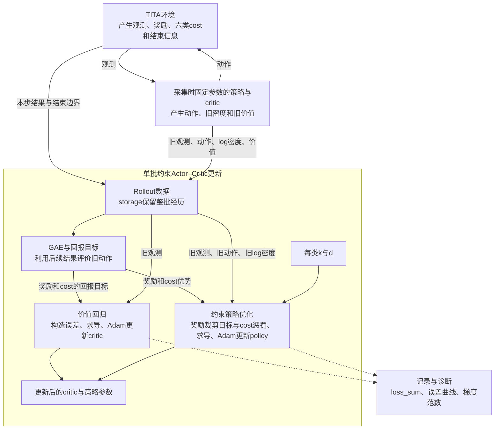

# 一批经历怎样完成策略更新

更新：2026-11-14。本文连接当前TITA的cost、rollout storage、GAE和网络更新，帮助理解它们共同完成的算法环节。各个Python文件的逐段说明仍留在对应解释文档中。本文没有新增实现或运行命令。

## 1. 先明确我们正在理解哪个模块

机器人已经用一份策略行动了一段时间。现在要利用这段经历，得到一份新的策略，使后续行动兼顾任务奖励与六类cost。我们同时训练一个价值网络，让下一轮对累计结果的预测更可靠。

这可以在方法框图中画成一个**单批约束Actor–Critic更新模块**。Actor指产生动作分布的策略，Critic指预测累计奖励与cost的价值网络。这个模块接收旧策略产生的一批经历和约束参数，输出更新后的两组网络参数。缓冲、GAE、损失与优化器共同实现这件事。

本项目目前把这部分计算放在check脚本里执行。它已经完成一批数据的真实更新，但还没有持续runner。因此“逻辑上是一个算法模块”与“源码里已经有一个统一的algorithm类”要分开理解。下图表示当前数据与数学关系，不要求把这些文件合并成一个.py。



图中两条更新支路并列，是为了说明它们解决的问题不同。当前check的执行顺序是先完成critic的8次更新、保存拟合图，再完成policy的8次更新；两条支路读取同一批固定的旧学习信号。并列箭头不代表两个优化器在程序中同时运行。

环境计算cost位于模块上游。k、d属于策略目标的设置。loss_sum和图属于记录旁路。它们虽然都出现在代码里，位置和职责并不相同。

放回完整RL循环，更新后的policy会再去采集下一批经历，更新后的critic为下一批GAE提供价值参照；然后重复这块计算。当前check走到第一批更新结束。这样就能同时看清它在整场训练中的位置，以及当前源码实际执行到哪里。

## 2. 从任务要求出发，为什么需要两种评价

TITA需要根据速度命令运动，奖励描述我们希望获得的行为；cost分别记录不希望发生的现象，例如速度越限、接触力过大或加速度超阈值。一个动作可能有利于跟踪，同时增加某种cost，所以不能仅根据一个即时奖励断定它适合继续增加概率。

理想的约束学习目标是：提高期望折扣累计奖励，同时让每类期望折扣累计cost不超过各自允许上限。这一目标涉及未来，不只涉及动作执行后的一个瞬间。

当前环境先计算各原始项f_j，再由cost_manager得到单步cost：

$$
c_{t,j}=\Delta t\,f_{t,j},\qquad \Delta t=0.01\text{ s}.
$$

五类原始项是0/1判断，另一类是超阈值加速度的均值。例如某个关节速度越限，原始对应项为1，本步cost为.01。这里的物理判据回答“本步算不算超限”；后面的d回答“学习允许累计多少这类cost”。d不是关节速度上限，也不是力矩上限；这些物理阈值已经在cost函数里使用了。

**本步cost、累计cost预测、cost优势和策略cost惩罚，是同一种任务信息在不同计算阶段的表达。** 它们需要通过后续计算连接，不能仅凭名字中都有cost就直接相加。

## 3. 先保留过去，才能在更新时评价同一个动作

采集前的策略参数记作θ₀，critic参数记作φ₀。这是同一批网络在采集时的数值，不代表程序另外维护了两份目标网络。采集阶段固定它们，每步做三件事：根据旧观测采动作，推进环境，保存本次对应的数据。

对时间t、环境n，storage保存旧观测x、原始动作a、本步奖励r、六列cost、结束标记，以及采集时的logπθ₀(a|x)、Vφ₀ᵣ(x)、Vφ₀ᶜ(x)。结束标记和最终状态价值另外保留，以免把reset后的新回合接进旧回合。

这批数据叫rollout；rollout_storage.py实现它的保存、目标计算与取数。当前T=24、N=4，得到96条经历，但每个环境仍只推进.24s。这批可能包含回合边界，并不等于96个完整回合。

开始更新后，θ与φ会改变，刚才保存的数不会随之重算。例如我们需要比较“同一个旧动作现在有多大密度”，分母必须是当时的密度；若把分母也换成当前网络输出，比较基准就丢了。保存独立旧数值，正是让后面的学习问题有明确参照。

## 4. GAE把后续经历接回当前动作，再分成两条学习支路

只有r_t和c_t，还不能完整描述当前动作后面带来的结果。普通步先用下一状态的旧价值补上未来，再与当前旧预测比较：

$$
\delta_t^r=r_t+\gamma V_{\phi_0}^r(x_{t+1})-V_{\phi_0}^r(x_t),
$$

$$
\delta_{t,j}^c=c_{t,j}+\gamma V_{\phi_0,j}^c(x_{t+1})-V_{\phi_0,j}^c(x_t).
$$

真实终止时后续价值取0；纯超时使用reset前最终状态的旧价值。GAE随后将多步TD误差按γλ的幂组合，从后往前计算优势，并在每个回合结束处断开递推。奖励与每类cost各有自己的优势，六列不在这里混成一个数。

对未跨越结束边界的普通步，两种优势都使用下面的递推，q可以代指奖励或某一类cost：

$$
\widehat A_t^q=\delta_t^q+\gamma\lambda\widehat A_{t+1}^q.
$$

γ决定未来累计结果的折扣；λ决定这次优势估计还要吸收多少后续TD误差。λ=0时只用一步TD，更多依靠旧critic补未来；λ增大时让更多实际后续结果修正当前判断，但采样波动也可能增加。GAE在这里做的是构造学习信号，还没有对网络参数求导或更新参数。

得到优势后，storage再加回旧价值，形成两种去向：

$$
\widehat R_t=V_{\phi_0}^r(x_t)+\widehat A_t^r,
\qquad
\widehat C_{t,j}=V_{\phi_0,j}^c(x_t)+\widehat A_{t,j}^c.
$$

回报目标R̂、Ĉ用于教critic预测累计量；优势Âᵣ、Âᶜ用于评价旧动作、构造策略目标。它们来自同一批经历，却不交给同一个损失。

看一个独立教学例子，只有一个环境、三步、最后真实终止；取γ=.9、λ=.8。数值均已是学习端收到的单步量，不是本次TITA日志：

| t | 奖励 | 旧奖励价值 | 一类cost | 旧cost价值 |
| --- | --- | --- | --- | --- |
| 0 | 1 | .5 | 0 | .1 |
| 1 | 0 | .6 | .2 | .15 |
| 2 | 2 | .7 | 0 | .05 |

奖励TD误差是[1.04,.03,1.3]，倒推得到奖励优势[1.73552,.966,1.3]与奖励目标[2.23552,1.566,2]。cost的TD误差是[.035,.095,-.05]，优势是[.07748,.059,-.05]，目标是[.17748,.209,0]。

根据这批数据的估计，第0条旧动作在奖励方面高于旧预期，同时cost也高于旧预期。后面的策略目标需要同时处理这两种信号；critic则要分别拟合两份累计目标。第2条cost优势却是负值：本次实际cost为0，低于旧预测.05。**本步cost非负，不意味着cost优势也非负**，优势表达的是相对旧预测的差异。GAE倒推的每一步见[storage第13节](../code_explaination/Tita_Lab/src/Tita_Lab/learning/np3o/rollout_storage.py.md)。

本批GAE只计算一次。critic后来变得更准确，也不回写这批旧目标和优势。它为以后新批次提供更好的估计，而当前策略支路继续使用同一份固定信号。

## 5. 同一批数据怎样分别更新critic与policy

联系你知道的策略评估PE与策略改进PI：价值回归尝试估计采集策略的累计结果，策略目标则利用这些估计与实际经历尝试改进行为。这里用有限样本和神经网络近似这两个过程，critic没有先得到精确价值，policy更新也没有单步必然改善的保证。

### 5.1 critic学习预测累计量

storage按相同索引取出输入与目标。当前critic重新计算Vφ(x)，与固定目标作平方误差。对B条记录、C=6类cost：

$$
L_V^r=\frac1B\sum_b(V_\phi^r(x_b)-\widehat R_b)^2,\qquad
L_V^c=\frac1{BC}\sum_{b,j}(V_{\phi,j}^c(x_b)-\widehat C_{b,j})^2,
$$

$$
L_V=L_V^r+L_V^c.
$$

autograd计算L_V对φ的导数，Adam修改critic参数。x和目标都是固定数据，导数经过的是当前critic前向。policy参数不由这个优化器修改。其详细机制在[check第12节](../code_explaination/Tita_Lab/scripts/check_np3o_interface.py.md#12-check_value_update从误差到自动求导再到参数更新)，包括从手算导数到计算图的解释。

### 5.2 policy利用动作密度与优势改变行为

policy重新读入同一批旧观测，计算旧动作在当前分布下的密度。新旧密度比为ρ=exp(logπθ(a|x)−logπθ₀(a|x))。动作、旧密度和优势固定，只有分子随当前θ变化。

奖励支路使用标准化奖励优势与PPO裁剪目标，构造一个希望提高奖励的损失Lπʳ。cost支路分别标准化六列cost优势，形成每类的裁剪代理量S_j。这里的标准化改变优化尺度，计算也必须保留六类各自的约束余量。

用Ã表示各自标准化后的优势，ρ̄=clip(ρ,.8,1.2)。两条支路具体为：

$$
L_\pi^r=-\frac1B\sum_b\min(\rho_b\widetilde A_b^r,\bar\rho_b\widetilde A_b^r),
\qquad
S_j=\frac1B\sum_b\max(\rho_b\widetilde A_{b,j}^c,\bar\rho_b\widetilde A_{b,j}^c).
$$

奖励用min，限制对收益增加的乐观估计；cost用max，限制对cost下降的乐观估计。奖励损失前的负号，把“提高奖励目标”写成优化器统一使用的“减小损失”。实际是在重新分配旧动作附近的密度，不是把每条记录配上一个人工规定的正确动作。两种裁剪怎样随优势正负工作，见check第13、17节。

当前参数含义是：k_j是第j类代理违反的惩罚权重；d_j在本次检查里解释为第j类折扣累计cost的允许上限。k不是本次要学习的网络参数，也没有按拉格朗日乘子规则更新；λ是GAE参数，也不是本代码中的可学习约束乘子。

设旧cost优势均值、标准差为μ_j、σ_j，累计cost估计为Ĵ_j，当前归一化代理违反量是：

$$
u_j(\theta)=S_j(\theta)+\frac{(1-\gamma)(\widehat J_j-d_j)+\mu_j}{\sigma_j},
$$

$$
L_\pi^c=\sum_j k_j\max(0,u_j),\qquad L_\pi=L_\pi^r+L_\pi^c.
$$

均值补回与分母缩放来自把约束改写到标准化优势的尺度；实际分母还有数值下限。1−γ用于换算折扣累计量与归一化访问分布下的优势期望，不是再次乘时间步长。随后用有限旧样本、密度比和裁剪估计这个期望，因此这里是局部代理约束。[N-P3O原论文III-B](https://arxiv.org/html/2309.15430v1#S3.SS2)提供该归一化代理形式；推导和本项目估计选择见check第17.4节。

六类先分别判断是否违反，再加权求和。例如三类u=[.2,−.4,.1]、k=[.1,.3,.1]，惩罚为.1×.2+.3×0+.1×.1=.03。负的一类表示当前代理条件还有余量，不能用它抵消另一类的正违反。增大k会加强该类正违反在损失中的权重；增大d则放宽允许的累计cost。这解释了为什么原始cost、d、k和最终cost_loss要分别保存与使用。

此时autograd计算Lπ对θ的导数，Adam修改产生动作分布的参数。导数通过当前动作密度，既不穿过旧动作采样，也不穿过物理仿真。奖励与cost在同一次总损失中提供更新贡献，才能让未来动作分布同时考虑这两类结果。

当前Ĵ取从reset开始的第0步GAE目标均值，含随机旧critic的预测；这是单批接线检查近似。d目前全0。有限数据、价值误差、裁剪和采样分布近似意味着代理违反量不能直接当作真实物理违反次数；后续持续训练还需要合适的累计cost估计。详见[check第13、17节](../code_explaination/Tita_Lab/scripts/check_np3o_interface.py.md)。

## 6. loss与loss_sum分别在模块的哪里

在读代码时，先写出所属函数。check_value_update和check_policy_update都有名为reward_loss、cost_loss的局部变量，但它们不共享一个变量，也不表示同一种目标。

| 所属函数 | reward_loss的数学含义 | cost_loss的数学含义 | 真正用于求导的总量 |
| --- | --- | --- | --- |
| check_value_update | L_Vʳ，奖励累计量预测误差 | L_Vᶜ，六类累计cost预测误差的平均 | loss=L_Vʳ+L_Vᶜ，对critic参数φ求导 |
| check_policy_update | Lπʳ，负的奖励裁剪目标 | Lπᶜ，六类正代理违反量的加权和 | loss=Lπʳ+Lπᶜ，对策略参数θ求导 |

再看两个函数都出现的统计代码：

```python
reward_loss_sum += float(reward_loss.item())
cost_loss_sum += float(cost_loss.item())
```

item取出Python数，两个sum跨小批量更新累加，最后除以更新次数用于打印。它们已经离开Tensor求导路径，不是另一个学习目标，也没有再反馈到loss。

必须分开三次“加起来”：损失内对B条样本求平均；策略惩罚内对C类约束按k求和；日志里再对U次更新累计后取平均。当前B=24、C=6、U=8，各自处理不同轴，数学作用不同。reward_loss_sum也不是环境累计reward，cost_loss_sum不是当前回合的累计cost。

本次真实输出可以放回这两条支路：

- critic：奖励预测MSE过程平均.210205，cost预测MSE过程平均.808655。
- policy：奖励损失过程平均−.035403，cost惩罚过程平均.069989，两者相加为总损失.034586。

这些数字不是同一种误差，也不都要求非负。固定整批critic误差曲线另由measure_value_fit测量；它使用同一份目标比较不同参数，与逐批损失平均也不同。于是论文架构图中可以用一个记录／诊断旁路表示这些量，无需为每个*_sum画一个算法子模块。

## 7. 回到各份.py说明时，怎样连续读

第一次从 check 的第 1 节进入。那一节沿两步经历说明，为什么前一步的动作要考虑后一步才出现的 cost。读到哪一步卡住，就打开下面对应的一页。[check 第 1 节](../code_explaination/Tita_Lab/scripts/check_np3o_interface.py.md#1-从一条经历看完整次更新)

| 想知道什么 | 去哪里读 |
| --- | --- |
| 环境怎样判断超限、怎样记录每类 cost | [costs.py 第 2、3 节](../code_explaination/Tita_Lab/src/Tita_Lab/tasks/velocity/mdp/costs.py.md) · [cost_manager.py 第 4–7 节](../code_explaination/Tita_Lab/src/Tita_Lab/tasks/velocity/cost_manager.py.md) |
| 后一步的结果怎样进入前一步，storage 怎样给出两种学习信号 | [rollout 第 13 节](../code_explaination/Tita_Lab/src/Tita_Lab/learning/np3o/rollout_storage.py.md#13-gae-把后几步结果算进当前动作) |
| 误差怎样经过自动求导变成参数更新 | [check 第 12 节](../code_explaination/Tita_Lab/scripts/check_np3o_interface.py.md#12-check_value_update从误差到自动求导再到参数更新) |
| 状态价值、八个动作均值及密度怎样从观测得到 | [critic.py](../code_explaination/Tita_Lab/src/Tita_Lab/learning/np3o/critic.py.md) · [actor.py](../code_explaination/Tita_Lab/src/Tita_Lab/learning/np3o/actor.py.md) · [policy.py](../code_explaination/Tita_Lab/src/Tita_Lab/learning/np3o/policy.py.md) |
| 六类 cost 怎样改变策略参数 | [check 第 17 节](../code_explaination/Tita_Lab/scripts/check_np3o_interface.py.md#17-六类-cost-怎样进入同一次策略更新) |

## 8. 现在停在哪里

2026-11-14用户已完成4环境24步的单批检查：critic与约束策略各8次更新，cost合计梯度非零、策略参数改变且正常退出。[实际日志](audits/2026-11-14_constrained_policy_update/README.md)支持这一结论。

11 月 25 日，用户把两种损失移到 `losses.py`，又完成相同规模的单批检查。critic 和约束策略各更新 8 次，主要终端数值与拆分前相同。持续训练、辅助损失接入和回放是后续工作。[拆分后的运行记录](audits/2026-11-25_loss_extraction/README.md)
