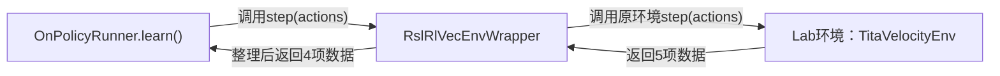

# 从官方训练流程理解 Wrapper

整理与当前调用链核对：2026-10-28。**内容纯AI生成，由人类要求生成，未经人类修改。**

这份说明先讲现有 Isaac Lab + RSL-RL/PPO 如何训练，再讲准备接入的 TITA NP3O 路线。读完应能回答：谁生成动作、谁推进物理、谁保存数据、谁更新网络，以及 wrapper 为什么处在环境与训练循环之间。当前只将已经保存的actor与环境做前向联调，随后暂停新增内容、阅读文档；完整NP3O训练尚未接通。

依据是当前项目、`/home/eaziel/IsaacLab-main` 的实际源码，以及 `lab3_sim62` venv 中的 `rsl-rl-lib 5.5.1`、`gymnasium 1.3.0`。本轮只读核对了入口、包装器、runner及安装元数据，没有重新安装包或运行训练。文中标注“教学示意”的代码省略了必要的初始化，不能直接作为训练脚本运行。

## 1. 先想清楚：一次训练必须做哪些事

先不考虑文件名和包装器。训练机器人时，反复发生两件事：**用当前策略收集经历，再用这些经历修改策略。**

收集经历时：

1. 环境给出观测，例如机身角速度、关节状态、目标速度。
2. 策略网络根据观测产生动作。
3. 环境接收动作，推进物理仿真。
4. 环境返回新的观测、奖励和回合是否结束。
5. 训练程序保存这一次交互的数据，继续下一次。

积累一批数据后，训练算法计算损失，用 PyTorch 求梯度，再让优化器修改网络参数。然后用更新后的策略收集下一批数据。

“网络产生动作”和“更新网络参数”是两个不同的操作。机器人每走一步，并不意味着马上更新一次网络。

你当前 RSL 配置中 `num_steps_per_env = 16`。假设开四个环境，一次先让每个环境走16个策略步，就收集了64次环境交互；随后进入一次训练迭代的更新阶段。PPO可能把这批数据分成小批量、重复处理多个轮次，执行多次优化器更新。

这里的“16步”不是一个回合的长度。机器人可能在第5步摔倒，环境重置后继续收集这一批剩下的步数；也可能整批16步都没有结束回合。

本项目一个策略步是0.01秒，其中包含四个0.0025秒的物理步。策略步、物理步、回合、训练迭代，分别计数。

用最少的数学表达这两件事。令 $o_t$ 是当前观测、$a_t$ 是动作，策略参数为 $\theta$：

$$
a_t\sim\pi_\theta(\cdot\mid o_t),\qquad
(o_{t+1},r_t,\mathrm{done}_t,\ldots)=\mathrm{Env.step}(a_t).
$$

环境内部还有真实仿真状态；策略不必直接看到全部状态。学习通常希望提高期望累计奖励，例如折扣目标：

$$
J(\theta)=\mathbb E_{\pi_\theta}\left[\sum_{t=0}^{T-1}\gamma^t r_t\right],\qquad 0\le\gamma<1.
$$

$r_t$ 由环境计算；$J$ 是跨多步的学习目标。价值网络估计从当前信息继续行动的期望回报，不负责产生环境的即时奖励。PPO/NP3O用具体损失和数据近似更新参数；wrapper只转交数据，不计算这个期望目标。

$N$ 个并行环境、每个收集 $H$ 步，得到 $NH$ 条交互记录。这里 N=4、H=16 时为64条；这既不是64个完整回合，也不是64次优化器更新。

## 2. 谁负责这些事情

先认识四个对象，后面再看它们怎样建立。

| 对象 | 负责什么 | 在本项目中的对应物 |
| --- | --- | --- |
| 环境 | 接收动作、推进仿真、计算观测/奖励/结束条件 | `TitaVelocityEnv`，由 `env_cfg.py` 和 MDP 等代码配置与扩展 |
| 策略网络 | 输入观测，产生动作分布或动作 | 官方路线的 RSL-RL actor；准备迁移的 TITA 动作网络 |
| 算法 | 规定损失怎样计算、数据怎样用于更新参数 | PPO，或者旧 TITA 的 NP3O |
| 训练循环 | 安排收集多少步、何时调用更新、何时记录和保存 | runner；官方路线主要是 `OnPolicyRunner.learn()` |

runner可以翻成“训练流程的执行者”。在这里它是一个普通Python类，`learn()`里有收集数据和调用更新的循环。

actor就是负责产生动作的策略网络。critic是训练时估计未来累计收益的价值网络；它与环境里计算即时奖励的函数职责不同。本页不展开价值估计的数学公式。

PyTorch提供张量、神经网络层、自动求梯度和优化器。PPO/NP3O使用这些工具实现学习。Isaac Lab负责环境，物理后端负责物理推进。它们通过明确的方法调用协作。

所以，`env_cfg.py`决定机器人、地形、动作、观测、奖励等环境内容；“网络有几层、PPO学习率是多少、一次收集多少步”由训练配置决定。

## 3. 创建项目时选择 RSL-RL 和 PPO，留下了什么

看当前任务注册文件：

[任务注册源码](/mnt/D/BaiduSyncdisk/1ACrutial_Files/Ubuntu_2404_projects/isaaclab_ws/Tita_HWBR/Tita_Lab/src/Tita_Lab/tasks/velocity/config/Tita/__init__.py)

```python
gym.register(
    id="TitaLab-Velocity-Tita",
    entry_point="Tita_Lab.tasks.velocity.tita_velocity_env:TitaVelocityEnv",
    disable_env_checker=True,
    kwargs={
        "env_cfg_entry_point": f"{__name__}.env_cfg:VelocityEnvCfg",
        "default_agent": "rsl_rl",
        "rsl_rl_cfg_entry_point": f"{agents.__name__}.rsl_rl_ppo_cfg:PPORunnerCfg",
    },
)
```

这段把任务名与几个入口关联起来。`gym.register()`完成登记，并没有在这一刻创建机器人或开始训练。

| 字段 | 在这份任务中的作用 |
| --- | --- |
| `id` | 以后查找这个任务使用的名字 |
| `entry_point` | 创建环境时使用哪个环境类 |
| `env_cfg_entry_point` | 到哪里加载环境配置 |
| `default_agent` | 官方统一入口未显式指定训练库时，使用哪个默认库 |
| `rsl_rl_cfg_entry_point` | 选择RSL-RL路线时，到哪里加载训练配置 |

例如 `模块路径:类名` 这样的字符串，让加载代码知道去哪个Python模块找哪个类。字符串本身没有创建对象；读取入口的代码会加载类并建立配置实例。

创建项目时选择RSL-RL/PPO，在当前工程中体现为：已有RSL-RL的训练配置、相应配置入口和默认库设置。它提供了一条默认训练接法。环境类仍然是 `TitaVelocityEnv`，也可以由别的训练程序调用。

只运行zero agent时，也会创建相同任务环境；因为没有进入PPO的训练循环，所以不会更新策略网络。能运行环境和能训练，是两个不同阶段。

## 4. 原来的官方路线，按什么顺序开始

以下解释本地官方入口选择 `rsl_rl` 后的主要路径。项目任务需要先被导入并完成注册；这里不补写启动命令。

**第一步：选择训练库并读取两份配置。**

官方入口根据显式的 `--rl_library`，或者任务登记的默认库，选择对应训练实现。RSL-RL这一侧读取环境配置和RSL训练配置：

```python
env_cfg, agent_cfg = resolve_task_config(args_cli.task, args_cli.agent)
```

`env_cfg`描述环境；`agent_cfg`描述训练。它们是两个不同配置对象。

**第二步：启动仿真运行环境，创建任务环境。**

本地训练入口使用 `launch_simulation(...)` 建立仿真运行上下文，随后调用 `create_isaaclab_env(...)`。对本项目使用的Torch前端，该辅助函数内部的核心语句是：

```python
env = gym.make(task, cfg=env_cfg)
```

这时才根据任务注册里的 `entry_point` 创建 `TitaVelocityEnv`。它的父类和项目扩展建立场景、管理器、历史与cost收集等内容。

**第三步：为RSL-RL建立环境包装器。**

```python
env = RslRlVecEnvWrapper(env, clip_actions=agent_cfg.clip_actions)
```

包装器负责让Lab环境的接口符合RSL-RL的预期。下一节专门拆这句。

**第四步：建立runner。**

```python
runner = create_rsl_rl_runner(env, agent_cfg, log_dir=log_dir)
```

当前配置选择 `OnPolicyRunner`。Lab接入层的这个工厂最终调用：

```python
OnPolicyRunner(
    env,
    agent_cfg.to_dict(),
    log_dir=log_dir,
    device=agent_cfg.device,
)
```

`to_dict()`把训练配置转成RSL-RL使用的字典。runner收到的是包装后的环境。

当前安装的RSL-RL 5.5.1在runner构造时读取初始观测，并让选中的算法构造actor、critic、轨迹存储与优化器等对象。

**第五步：开始训练循环。**

```python
runner.learn(
    num_learning_iterations=agent_cfg.max_iterations,
    init_at_random_ep_len=agent_cfg.init_at_random_ep_len,
)
```

`learn()`反复收集一批数据、调用算法更新、记录训练状态并按条件保存模型。

上面的语句来自当前源码的不同函数；为说明顺序省略了参数处理、日志和检查点等代码，不是一份可直接执行的脚本。

## 5. `env = Wrapper(env)`，Python究竟做了什么

先换成不同的变量名，就容易读了：

```python
raw_env = gym.make(task, cfg=env_cfg)
training_env = RslRlVecEnvWrapper(raw_env)
```

第一句建立Lab环境。第二句建立一个包装对象，将已有环境传进去。

包装器内部保存：

```python
self.env = env
```

因此，`training_env.env`指向传入的`raw_env`。包装器持有已有对象的引用；它不需要复制一套环境源码，也没有因为包装这一动作又生成一套机器人。

官方把变量名继续写成`env`：

```python
env = RslRlVecEnvWrapper(env)
```

Python先计算等号右边：把原来`env`指向的环境传给构造函数，得到包装对象；然后让左边`env`改为指向包装对象。原环境仍由包装对象的`self.env`引用着。

本地官方RSL包装器在构造时会调用一次原环境的reset，这是它的初始化约定。当前已保存的NP3O包装器则安排由调用方显式reset。包装器能有初始化行为；“包装”本身不等于复制环境。

这里主要使用的是“对象持有另一个对象”：

| 代码 | 对象关系 |
| --- | --- |
| `TitaVelocityEnv(ManagerBasedRLEnv)` | 继承：子类沿用和扩展父类方法 |
| 包装器里的`self.env = env` | 持有：保存已有环境的引用，需要时调用它 |

wrapper的通用含义是包住已有对象并提供另一层接口。具体继承哪个Python基类，要看实现。本地`RslRlVecEnvWrapper`继承RSL-RL的`VecEnv`；当前`TitaNP3OEnvWrapper`是普通类。两者都通过持有环境来转交调用。

## 6. 训练循环调用step，怎样最后到了机器人

官方运行时，主要对象关系是：

```text
runner.env              → RslRlVecEnvWrapper对象
runner.env.env          → 传入包装器的Lab环境对象
runner.alg              → PPO算法对象
runner.alg.actor        → 动作网络
runner.alg.critic       → 价值网络
runner.alg.storage      → 本批交互数据的存储
runner.alg.optimizer    → 更新网络参数的优化器
```

`gym.make()`本身也可能套Gymnasium包装层；需要取得真正的任务实例时使用`unwrapped`。上面只保留理解训练调用所需的主要层次。

一次step的调用和返回：



例如runner写：

```python
obs, rewards, dones, extras = self.env.step(actions)
```

此处`self.env`是包装器，所以先进入包装器的step。包装器内部再写：

```python
obs_dict, rewards, terminated, truncated, extras = self.env.step(actions)
```

这句中的`self`已经是包装器对象，`self.env`是它保存的原环境，所以继续进入Lab环境的step。

Lab环境接着处理动作，在decimation循环中应用控制并推进物理，计算结束条件、奖励等，重置结束的环境，更新命令和观测，返回数据。本项目还扩展了历史、奖励最终合成和cost保存。

返回后，包装器整理数据，再返回给仍在等待的runner。然后runner继续执行下一句。这里是普通Python方法调用；调用到哪一个对象的方法，取决于点号前的对象。

## 7. 为什么两边需要不同的返回格式

Lab环境的step返回五项：

```python
observations, rewards, terminated, truncated, extras
```

- `observations`：本项目是五组观测组成的字典。
- `rewards`：每环境本步奖励，形状`(N,)`。
- `terminated`：任务终止，例如失败，形状`(N,)`。
- `truncated`：例如达到时间上限，形状`(N,)`。
- `extras`：附加数据字典，本项目通过它提供cost和回合统计。

这沿用Gymnasium的五项返回约定；Lab在这里按多个环境批量返回张量。[Gymnasium接口说明](https://gymnasium.farama.org/api/env/)

当前RSL-RL采样循环期待四项，所以官方包装器做：

```python
dones = (terminated | truncated).to(dtype=torch.long)
```

然后把观测字典整理成`TensorDict`，返回：

```python
observations, rewards, dones, extras
```

`TensorDict`可以先理解为“保留名字、装着一组张量的容器”。它不是把所有组自动拼成586列。对当前无限时域设置，包装器还在`extras['time_outs']`保留超时标志，以供算法处理。

RSL-RL怎样选择网络输入，由训练配置中的观测组映射决定。你当前配置是：

```python
obs_groups = {"actor": ["policy"], "critic": ["policy"]}
```

所以，虽然Lab能返回五个组，当前模板里的actor和critic都只读取`policy`的33列。保存历史、扫描和动力学组，并不自动意味着这个PPO网络已使用它们。这个模板尚未改成完整TITA训练配置。

## 8. 谁真的修改了网络参数

下面是从当前`OnPolicyRunner.learn()`提取并删去日志、设备处理后的主干。保留了核心方法名，便于去源码对应：

```python
for iteration in range(num_learning_iterations):
    with torch.inference_mode():
        for step in range(num_steps_per_env):
            actions = self.alg.act(obs)
            obs, rewards, dones, extras = self.env.step(actions)
            self.alg.process_env_step(obs, rewards, dones, extras)

        self.alg.compute_returns(obs)

    self.alg.update()
```

依次理解：

1. `act(obs)`调用网络，采样动作，并保存与这次动作有关的训练数据。
2. `env.step(actions)`完成一次环境交互。
3. `process_env_step(...)`把返回的数据收进这批轨迹。
4. 收集够步数，`compute_returns(...)`计算后续更新需要的回报等量。
5. `update()`读取这批数据，计算损失并更新网络。

收集数据这一段在`inference_mode()`中执行，更新阶段在它外面。当前PPO更新中能看到：

```python
self.optimizer.zero_grad()
loss.backward()
# 中间还有梯度裁剪等处理。
self.optimizer.step()
```

`zero_grad()`清理梯度，`backward()`计算当前损失对网络参数的梯度，`step()`根据梯度更新参数。这些操作由PPO调用PyTorch完成；wrapper的step里没有这一组学习操作。

本地实际训练库文件位于：

```text
/home/eaziel/my_venvs/lab3_sim62/.venv/lib/python3.12/site-packages/rsl_rl/
```

Lab侧的接入代码位于：

```text
/home/eaziel/IsaacLab-main/source/isaaclab_rl/isaaclab_rl/
```

`rsl_rl`与`isaaclab_rl`名字相近，但这里属于两个不同包。前者提供当前RSL训练实现，后者提供Lab接入层，包括包装器、训练配置和入口。

## 9. 接入旧TITA NP3O，我们到底准备改变哪里

先把术语放在相应层次：RSL-RL是一套训练库；PPO和NP3O是算法。旧TITA仓库除了NP3O算法，还带有配套网络、轨迹存储和runner。

我们准备接入的是旧TITA这套训练实现。环境仍使用已经迁好的Lab任务。

两条路线可以这样比较；一次训练选择其中一条：

| 部分 | 官方RSL-RL路线 | 准备迁移的旧TITA路线 |
| --- | --- | --- |
| 启动与组织训练 | Lab的RSL训练入口 | 计划中的项目自有入口，尚未接好 |
| 环境 | 现有TitaVelocityEnv | 现有TitaVelocityEnv |
| 环境接口转换 | RslRlVecEnvWrapper | TitaNP3OEnvWrapper（已保存） |
| 训练流程 | RSL-RL OnPolicyRunner | 由旧OnConstraintPolicyRunner迁入并调整 |
| 参数更新算法 | RSL-RL PPO | 旧TITA NP3O迁入并核对 |
| 模型与数据存储 | RSL-RL的网络与RolloutStorage | 旧TITA网络、带六项cost的存储等 |
| 张量、梯度、优化器工具 | PyTorch | PyTorch |

**切换完整训练路线，需要入口、wrapper、runner、模型、存储和算法一起接好。** 单独新建wrapper文件，不会把当前默认训练路线自动切走；当前注册中的`default_agent='rsl_rl'`仍然存在，官方入口依然按其规则选择训练实现。

NP3O也不是当前统一入口里一个已经登记好的`--rl_library np3o`选项。我们目前提出的是项目自有训练入口的路线，尚未完成。

这是一项工程取舍。另一种做法是将NP3O改造成当前RSL-RL算法接口的扩展，但仍需适配cost存储、网络、更新与构造约定。现阶段沿旧TITA训练实现迁入，是为了逐项对照其行为；并不是Lab要求每个任务都自己写训练库。

## 10. 那个自定义wrapper具体只做哪一段

旧TITA runner每次期待：

```python
obs, privileged_obs, rewards, costs, dones, infos
```

当前TitaNP3OEnvWrapper把Lab五项返回整理为这六项。其中：

1. 调用已有`pack_tita_observations()`，按旧网络所需布局拼成586列。
2. 从`extras['costs']`取出环境已经算好的六项cost，单独交给训练循环。
3. 合并结束标志，同时保留超时信息。
4. 将已有回合统计整理给旧日志代码使用。

它仍通过`self.env.step(actions)`调用已有Lab环境。它没有把PPO训练循环装进自己，也没有因为有了586列就建立或训练了一个网络。

先前CPU替身检查验证的是上述数据整理行为，不是训练成功。旧runner还读取Gym的配置路径，网络/存储/算法也尚未完整接好，所以包装器本身还不能直接开训。

还有一个关键区别：当前PPO不会因为`extras`中有一个名叫`costs`的键，就自动把六项cost加入NP3O约束。必须由训练算法明确读取、存储和使用这些数据。这正是完整迁移还需要训练侧代码的原因。

## 11. 理解这条路所需的Python知识

当前先掌握下面几件事即可，遇到具体源码再逐步补充：

| 语法/机制 | 在这条流程里的具体例子 |
| --- | --- |
| 类与实例 | `OnPolicyRunner`是类，`runner`是建立出来的对象 |
| 对象属性保存引用 | `wrapper.env`持有原环境，`runner.env`持有wrapper |
| 调用方法并返回 | runner调用wrapper.step，后者调用环境.step，结果逐层返回 |
| 配置与实例分开 | `PPORunnerCfg`描述参数；工厂据此创建真正的runner和算法 |
| 继承与持有对象 | 环境继承Lab父类；wrapper保存环境对象 |

不用先学完Python才能继续，也不需要把每个API名背下来。阅读时先找：当前变量指向哪个对象；这一句调用谁；返回值交给了谁。然后再看该方法内部的数值计算。

## 12. 去源码时按这个顺序看

先读能确认本页主线的几个短位置，无需从头读完每个文件：

| 顺序 | 位置 | 先确认什么 |
| --- | --- | --- |
| 1 | [本项目任务注册](/mnt/D/BaiduSyncdisk/1ACrutial_Files/Ubuntu_2404_projects/isaaclab_ws/Tita_HWBR/Tita_Lab/src/Tita_Lab/tasks/velocity/config/Tita/__init__.py) | 环境入口与训练配置入口分开登记 |
| 2 | [本项目PPO配置](/mnt/D/BaiduSyncdisk/1ACrutial_Files/Ubuntu_2404_projects/isaaclab_ws/Tita_HWBR/Tita_Lab/src/Tita_Lab/tasks/velocity/config/Tita/agents/rsl_rl_ppo_cfg.py) | 网络、观测组、算法参数、收集步数分别在哪里 |
| 3 | [官方训练入口](/home/eaziel/IsaacLab-main/source/isaaclab_rl/isaaclab_rl/entrypoints/backends/train_rsl_rl.py) | 连续看到wrapper、runner、learn三个建立/调用位置 |
| 4 | [RSL包装器step](/home/eaziel/IsaacLab-main/source/isaaclab_rl/isaaclab_rl/rsl_rl/vecenv_wrapper.py) | 调用原环境，再整理五项为四项 |
| 5 | [runner的learn](/home/eaziel/my_venvs/lab3_sim62/.venv/lib/python3.12/site-packages/rsl_rl/runners/on_policy_runner.py) | 收集循环与算法更新之间的顺序 |
| 6 | [PPO构造](/home/eaziel/my_venvs/lab3_sim62/.venv/lib/python3.12/site-packages/rsl_rl/algorithms/ppo.py) | 训练配置如何建立网络、存储与算法对象 |
| 7 | [PPO更新](/home/eaziel/my_venvs/lab3_sim62/.venv/lib/python3.12/site-packages/rsl_rl/algorithms/ppo.py) | backward与optimizer.step发生在哪里 |

官方概览：[Isaac Lab训练指南](https://isaac-sim.github.io/IsaacLab/main/source/concepts/reinforcement_learning.html)。包装器职责：[isaaclab_rl说明](https://isaac-sim.github.io/IsaacLab/main/source/api/lab_rl/isaaclab_rl.html)。版本差异以本地对应文件为准。

## 补充问答

**Q：这个包装器是不是把已有lab官方的训练软件流程“提取出来”放到自己的训练框架？**

**A：** 包装器只持有已有Lab环境，把它的数据和方法整理成训练程序期待的接口。独立迁入的网络、存储、NP3O与runner才组成准备接入的训练实现。理解完整路线时，需要把这两部分分开。

**Q：结合你的意思（NP3O），我感觉这就是截断了使用官方创建任务的时候选择的py rl库，把这条路线引导至其他框架比如np3o。**

**A：** 计划中，启用迁移后的入口时，训练侧将由旧TITA的NP3O及配套实现负责，环境侧继续由Lab负责。RSL-RL属于训练库，NP3O属于算法；旧TITA仓库提供的是包含该算法的一套训练代码。wrapper与actor已经保存，完整NP3O训练尚未接通；原来的RSL-RL默认登记并未自动改变，两条路线也可以分别保留。

**Q：我还没搞懂官方的原厂软件流程。**

**A：** 先读本页1—8节：任务注册指向两份配置，官方入口创建环境，包装器适配接口，runner循环收集数据，PPO调用PyTorch更新网络。确认这些对象关系后，再读9—10节理解迁移改在哪里。22、23章实现可以暂缓。
