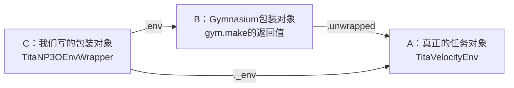
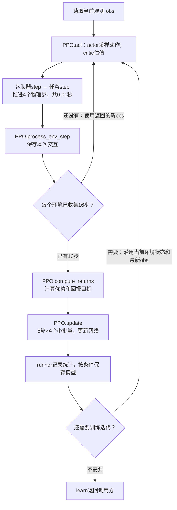

# 从官方训练流程理解 Wrapper

整理与调用链核对：2026-10-29；2026-10-31补充Gymnasium与训练库接口，2026-11-04核对rollout命名、配置传递与自定义check接线。**内容纯AI生成，由人类要求生成，未经人类修改。**

2026-11-14阅读提示：本页主要解释官方RSL-RL训练入口与wrapper。当前自有check的一批约束更新，先看[一批经历怎样完成策略更新](一批经历怎样完成策略更新.md)，再用本页第9节核对两条接线；不要把官方模板的16步、5个epoch等配置当作当前check的24步、2个epoch。

这份说明先讲训练需要哪些对象，再沿“登记任务 → 创建环境 → 包装环境 → 交给runner → 交互与更新”的顺序读现有 Isaac Lab + RSL-RL/PPO，最后对照准备接入的 TITA NP3O 路线。读完应能回答：谁生成动作、谁推进物理、谁保存数据、谁更新网络，以及不同位置的env究竟指向谁。当前29已完成24步存储采集，31回报与GAE也已完成用户普通/含超时短检查；完整NP3O训练尚未接通。

如果已经读到第6节，现在从[第6节](#6-onpolicyrunner怎样组织完整训练循环)接着读：先认识runner对象，再把一次0.01秒的环境交互展开，最后在第8节理解PPO怎样使用收集的数据修改网络。第6—8节共同讲一个完整训练闭环。

依据是当前项目、`/home/eaziel/IsaacLab-main` 的实际源码，以及 `lab3_sim62` venv 中的 `rsl-rl-lib 5.5.1`、`gymnasium 1.3.0`。本轮只读核对了入口、包装器、runner及安装元数据，没有重新安装包或运行训练。文中标注“教学示意”的代码省略了必要的初始化，不能直接作为训练脚本运行。

## 1. 先想清楚：一次训练必须做哪些事

先不考虑文件名和包装器。训练机器人时，反复发生两件事：**用当前策略收集经历，再用这些经历修改策略。**

收集经历时：

1. 环境给出观测，例如机身角速度、关节状态、目标速度。
2. 策略网络根据观测产生动作。
3. 环境接收动作，推进物理仿真。
4. 环境返回新的观测、奖励和回合是否结束。
5. 训练程序保存这一次交互的数据，继续下一次。

积累一批数据后，训练算法计算损失，用 PyTorch 求梯度，再让优化器修改网络参数。然后用更新后的策略收集下一批数据。

“网络产生动作”和“更新网络参数”是两个不同的操作。机器人每走一步，并不意味着马上更新一次网络。

你当前 RSL 配置中 `num_steps_per_env = 16`。假设开四个环境，一次先让每个环境走16个策略步，就收集了64次环境交互；随后进入一次训练迭代的更新阶段。PPO可能把这批数据分成小批量、重复处理多个轮次，执行多次优化器更新。

这里的“16步”不是一个回合的长度。机器人可能在第5步摔倒，环境重置后继续收集这一批剩下的步数；也可能整批16步都没有结束回合。

本项目一个策略步是0.01秒，其中包含四个0.0025秒的物理步。策略步、物理步、回合、训练迭代，分别计数。

用最少的数学表达这两件事。令 $o_t$ 是当前观测、$a_t$ 是动作，策略参数为 $\theta$：

$$
a_t\sim\pi_\theta(\cdot\mid o_t),\qquad
(o_{t+1},r_t,\mathrm{done}_t,\ldots)=\mathrm{Env.step}(a_t).
$$

环境内部还有真实仿真状态；策略不必直接看到全部状态。学习通常希望提高期望累计奖励，例如折扣目标：

$$
J(\theta)=\mathbb E_{\pi_\theta}\left[\sum_{t=0}^{T-1}\gamma^t r_t\right],\qquad 0\le\gamma<1.
$$

$r_t$ 由环境计算；$J$ 是跨多步的学习目标。价值网络估计从当前信息继续行动的期望回报，不负责产生环境的即时奖励。PPO/NP3O用具体损失和数据近似更新参数；wrapper只转交数据，不计算这个期望目标。

$N$ 个并行环境、每个收集 $H$ 步，得到 $NH$ 条交互记录。这里 N=4、H=16 时为64条；这既不是64个完整回合，也不是64次优化器更新。

## 2. 谁负责这些事情

先认识各部分的职责，后面再看它们怎样建立。

| 对象 | 负责什么 | 在本项目中的对应物 |
| --- | --- | --- |
| 环境 | 接收动作、推进仿真、计算观测/奖励/结束条件 | `TitaVelocityEnv`，由 `env_cfg.py` 和 MDP 等代码配置与扩展 |
| 包装器（wrapper） | 保存已有环境，提供训练库要求的方法、属性和数据格式 | 官方路线的 `RslRlVecEnvWrapper`；本项目的 `TitaNP3OEnvWrapper` |
| 策略网络 | 输入观测，产生动作分布或动作 | 官方路线的 RSL-RL actor；准备迁移的 TITA 动作网络 |
| 算法 | 规定损失怎样计算、数据怎样用于更新参数 | PPO，或者旧 TITA 的 NP3O |
| 训练循环 | 安排收集多少步、何时调用更新、何时记录和保存 | runner；官方路线主要是 `OnPolicyRunner.learn()` |

`OnPolicyRunner`是RSL-RL提供的类；`runner = OnPolicyRunner(...)`建立一个训练对象。该对象保存环境包装器和PPO算法对象。调用`runner.learn(...)`后，Python按`learn()`的方法体执行循环：先调用网络和环境收集数据，再调用PPO更新网络。第6节会逐句展开这些调用。

actor就是负责产生动作的策略网络。critic是训练时估计未来累计收益的价值网络；它与环境里计算即时奖励的函数职责不同。本页不展开价值估计的数学公式。

PyTorch提供张量、神经网络层、自动求梯度和优化器。PPO/NP3O使用这些工具实现学习。Isaac Lab负责环境，物理后端负责物理推进。它们通过明确的方法调用协作。

所以，`env_cfg.py`决定机器人、地形、动作、观测、奖励等环境内容；“网络有几层、PPO学习率是多少、一次收集多少步”由训练配置决定。

wrapper可以理解为环境与训练程序之间的中间层。“让RSL-RL认识Lab环境”，具体指它能按预期取得观测、提交动作、接收奖励和结束标志，并读取环境数量、动作维数等信息。动作经过它交给环境；环境的计算结果再经过它交给训练程序。Lab已为多个训练库提供相应接入层，见[官方说明](https://isaac-sim.github.io/IsaacLab/main/source/api/lab_rl/isaaclab_rl.html)。

这里的“认识”是接口和数据约定相符。网络使用哪些观测组由配置指定；某列是机身速度、某项奖励鼓励什么行为，由任务设计者定义。算法按约定使用张量和奖励数值，不会自动理解这些物理含义。把包装对象交给runner之后，runner才把环境交互与算法更新组织起来。

## 3. 创建项目时选择 RSL-RL 和 PPO，留下了什么

先辨认注册代码中的`gym`。项目导入的是：

```python
import gymnasium as gym
```

`as gym`只是在本文件里给Gymnasium起简称。英文gym通常指健身房或体育馆，可以借“让智能体练习的地方”来记忆；代码中的Gymnasium是提供RL环境接口、注册和包装机制的库。它延续自OpenAI Gym，与旧TITA仓库使用的NVIDIA Isaac Gym是不同的软件；当前Isaac Lab使用Gymnasium接口。[Gymnasium介绍](https://gymnasium.farama.org/)

看当前任务注册文件：

[任务注册源码](/mnt/D/BaiduSyncdisk/1ACrutial_Files/Ubuntu_2404_projects/isaaclab_ws/Tita_HWBR/Tita_Lab/src/Tita_Lab/tasks/velocity/config/Tita/__init__.py)

```python
gym.register(
    id="TitaLab-Velocity-Tita",
    entry_point="Tita_Lab.tasks.velocity.tita_velocity_env:TitaVelocityEnv",
    disable_env_checker=True,
    kwargs={
        "env_cfg_entry_point": f"{__name__}.env_cfg:VelocityEnvCfg",
        "default_agent": "rsl_rl",
        "rsl_rl_cfg_entry_point": f"{agents.__name__}.rsl_rl_ppo_cfg:PPORunnerCfg",
    },
)
```

这段把任务名与几个入口关联起来。`gym.register()`完成登记，并没有在这一刻创建机器人或开始训练。

| 字段 | 在这份任务中的作用 |
| --- | --- |
| `id` | 以后查找这个任务使用的名字 |
| `entry_point` | 创建环境时使用哪个环境类 |
| `env_cfg_entry_point` | 到哪里加载环境配置 |
| `default_agent` | 官方统一入口未显式指定训练库时，使用哪个默认库 |
| `rsl_rl_cfg_entry_point` | 选择RSL-RL路线时，到哪里加载训练配置 |

例如 `模块路径:类名` 这样的字符串，让加载代码知道去哪个Python模块找哪个类。字符串本身没有创建对象；读取入口的代码会加载类并建立配置实例。

创建项目时选择RSL-RL/PPO，在当前工程中体现为：已有RSL-RL的训练配置、相应配置入口和默认库设置。它提供了一条默认训练接法。环境类仍然是 `TitaVelocityEnv`，也可以由别的训练程序调用。

只运行zero agent时，也会创建相同任务环境；因为没有进入PPO的训练循环，所以不会更新策略网络。能运行环境和能训练，是两个不同阶段。

## 4. 原来的官方路线，按什么顺序开始

以下解释本地官方入口选择 `rsl_rl` 后的主要路径。项目任务需要先被导入并完成注册；这里不补写启动命令。

**第一步：选择训练库并读取两份配置。**

官方入口根据显式的 `--rl_library`，或者任务登记的默认库，选择对应训练实现。RSL-RL这一侧读取环境配置和RSL训练配置：

```python
env_cfg, agent_cfg = resolve_task_config(args_cli.task, args_cli.agent)
```

`env_cfg`描述环境；`agent_cfg`描述训练。它们是两个不同配置对象。

**第二步：启动仿真运行环境，创建任务环境。**

本地训练入口使用 `launch_simulation(...)` 建立仿真运行上下文，随后调用 `create_isaaclab_env(...)`。对本项目使用的Torch前端，该辅助函数内部的核心语句是：

```python
gym_env = gym.make(task, cfg=env_cfg)
```

`make`是“创建”的意思，是Gymnasium提供的函数。把这句读作“按任务名称和配置，创建一个可交互的环境对象”：

1. 用`task`中的任务名查找上一节的登记信息。
2. 从`entry_point`找到`TitaVelocityEnv`类，调用其构造过程，并传入`cfg`。
3. 该类及其Lab父类建立场景、机器人、管理器、历史与cost收集等内容。
4. Gymnasium按登记设置加上自己的包装层，然后返回对象给`gym_env`。

当前任务关闭了环境检查器，但保留默认的`OrderEnforcing`包装器，用来检查先reset再step等调用顺序。因此当前`gym.make()`返回的是这一层包装对象；它里面保存着真正的`TitaVelocityEnv`。[make/register接口](https://gymnasium.farama.org/api/registry/)

只有第2步调用环境类时才开始创建任务实例。`register()`只是先记下名字与类的对应关系。`make()`完成后，得到可调用reset/step的对象；训练循环还没有开始。

**第三步：为RSL-RL建立环境包装器。**

```python
training_env = RslRlVecEnvWrapper(gym_env, clip_actions=agent_cfg.clip_actions)
```

这里用`gym_env`保存make的返回对象，用`training_env`保存面向RSL-RL的包装对象，避免同名变量在建立过程中改变含义。两者的关系下一节单独拆开。

**第四步：建立runner。**

```python
runner = OnPolicyRunner(
    training_env,
    to_dict(agent_cfg),
    log_dir=log_dir,
    device=agent_cfg.device,
)
```

当前配置选择`OnPolicyRunner`。`to_dict(agent_cfg)`把训练配置转成RSL-RL使用的字典。第一个参数把包装后的环境交给runner；runner构造函数通过`self.env = env`保存它。后面runner调用`self.env.step(...)`，就会进入这个包装对象的方法。

当前安装的RSL-RL 5.5.1在runner构造时读取初始观测，并让选中的算法构造actor、critic、轨迹存储与优化器等对象。

**第五步：开始训练循环。**

```python
runner.learn(
    num_learning_iterations=agent_cfg.max_iterations,
    init_at_random_ep_len=agent_cfg.init_at_random_ep_len,
)
```

`learn()`反复收集一批数据、调用算法更新、记录训练状态并按条件保存模型。

上面为了区分对象，统一使用了`gym_env`和`training_env`这两个教学变量名；实际官方入口会重复使用变量名`env`。语句省略了参数处理、日志和检查点等代码，不是一份可直接执行的脚本。

## 5. `env = Wrapper(env)`，Python究竟做了什么

### 5.1 先区分三个对象

上一节讲了官方RSL路线。先用我们已经写好的NP3O包装器看同样的对象关系，下面均为教学示意：

```python
gym_env = gym.make(task, cfg=env_cfg)
training_env = TitaNP3OEnvWrapper(gym_env)
```



1. **A**负责机器人任务：推进物理、计算观测和奖励、处理reset等。
2. **B**是Gymnasium在A外面加的接口层。当前`gym.make()`返回B，`gym_env`指向它。
3. **C**是我们写的接口层，把环境数据整理成旧TITA训练程序所需的形式。`training_env`指向它。

这里有三个Python对象，围绕同一套仿真工作。包装没有再创建一批机器人；并行环境数量仍由`num_envs`决定。

对象之间的联系来自保存引用的赋值语句。B保存A，C保存B；当前自定义C还通过`self._env`保存A。B因此能调用A的方法，C因此能调用B的方法。A完成任务计算时，无需反过来保存B或C。Lab提供任务对象A；Gymnasium的`make()`根据登记设置把B加在A外面。本页的三层关系对应当前接法，增加录像等包装器时还会有更多层。

### 5.2 `self.env`与`self._env`各自保存谁

调用`TitaNP3OEnvWrapper(gym_env)`时，会进入当前源码的构造函数：

```python
def __init__(self, env: gym.Env) -> None:
    self.env = env
    self._env = cast("TitaVelocityEnv", env.unwrapped)
    # 后面继续保存环境维度等信息。
```

此处`self`是正在创建的C，参数`env`接收传进来的B。所以`self.env`保存B，`self._env`保存通过`B.unwrapped`取得的A。`cast`只提供类型提示，不转换或复制对象。下划线是作者标记内部属性的命名习惯；取得最内层任务的操作是`.unwrapped`。

### 5.3 为什么到处出现env，含义却会变化

`raw_env`、`native_env`和检查脚本里的`native_env`都是普通变量名。在之前的例子里，它们用来保存make的返回值B，并不代表几种不同的环境类型。本页统一将这个位置叫`gym_env`，将C叫`training_env`。

不同函数还可能把参数都叫作`env`：构造函数的`env`接收B；检查函数`run_check(env, ...)`接收C。两个函数的局部变量互相独立，要看谁传进来了哪个对象。

在当前检查脚本的`run_check()`内部，对照关系是：

| 表达式 | 指向哪个对象 |
| --- | --- |
| `env` | C，传进来的`TitaNP3OEnvWrapper` |
| `env.env` | B，C保存的Gymnasium对象 |
| `env.env.unwrapped` | A，真正的`TitaVelocityEnv` |
| `env._env` | A，C已经保存好的同一个任务对象 |
| `lab_env` | A，脚本给上面那个任务对象起的局部变量名 |

`env.env`的第一个env是局部变量，第二个env是该对象的属性名。

### 5.4 再读官方的同名赋值

官方把变量名继续写成`env`：

```python
env = RslRlVecEnvWrapper(env)
```

Python先计算等号右边：把旧`env`指向的B传给构造函数，得到C；然后让左边`env`改为指向C。B仍由C的`self.env`引用着。回到官方RSL路线时，C的类是`RslRlVecEnvWrapper`；上图中的`._env`属性是我们NP3O包装器的写法，官方RSL包装器通过自己的`unwrapped`属性访问A。

本地官方RSL包装器在构造时会调用一次原环境的reset，这是它的初始化约定。当前已保存的NP3O包装器则安排由调用方显式reset。包装器能有初始化行为；“包装”本身不等于复制环境。

这里主要使用的是“对象持有另一个对象”：

| 代码 | 对象关系 |
| --- | --- |
| `TitaVelocityEnv(ManagerBasedRLEnv)` | 继承：子类沿用和扩展父类方法 |
| 包装器里的`self.env = env` | 持有：保存已有环境的引用，需要时调用它 |

wrapper的通用含义是包住已有对象并提供另一层接口。具体继承哪个Python基类，要看实现。本地`RslRlVecEnvWrapper`继承RSL-RL的`VecEnv`；当前`TitaNP3OEnvWrapper`是普通类。两者都通过持有环境来转交调用。

检查脚本已经实例化C并把它交给`run_check()`，验证actor与环境交互。正式NP3O训练入口尚未接好，不能把检查脚本中的包装等同于完整训练接通。

## 6. OnPolicyRunner怎样组织完整训练循环

### 6.1 先把类、对象、方法和算法分清楚

`OnPolicyRunner`的源码属于安装在venv里的`rsl_rl`包：

[on_policy_runner.py](/home/eaziel/my_venvs/lab3_sim62/.venv/lib/python3.12/site-packages/rsl_rl/runners/on_policy_runner.py:20)

Lab的官方训练入口导入这个类，再建立runner对象。类名和方法名是RSL-RL作者起的名字：

| 写法 | 在当前程序中的含义 |
| --- | --- |
| `OnPolicyRunner` | 类，规定训练对象保存哪些属性、提供哪些方法 |
| `runner = OnPolicyRunner(...)` | 调用构造过程，建立一个训练对象并让变量`runner`引用它 |
| `runner.learn(...)` | 调用该对象的训练方法，进入训练循环 |
| `runner.alg` | runner保存的PPO算法对象 |
| `runner.env` | runner保存的RSL环境包装对象C |

`learn`的英文意思是“学习”。Python执行`runner.learn(...)`时，会找到`OnPolicyRunner`中定义的`learn()`方法，再执行方法体。方法体里的循环和函数调用才实现训练；Python不会因为方法叫`learn`就自动学习。

`OnPolicy`来自强化学习的on-policy分类：当前PPO先用一版策略收集一批数据，再以这批数据更新策略，之后用更新后的策略收集新一批。PPO允许在当前批数据上做多轮更新，并保存采样时的旧动作概率，用于限制更新幅度。[PPO原论文](https://arxiv.org/abs/1707.06347)

`Runner`说明该类组织训练执行顺序。RSL-RL把具体损失、优势估计和优化器操作写在PPO类中；`OnPolicyRunner.learn()`按顺序调用PPO的方法。阅读源码时，必须同时知道调用方runner和被调用方PPO各负责哪一段。

### 6.2 构造runner时，哪些对象已经存在，哪些对象刚建立

官方入口先完成环境创建和包装，再执行：

```python
runner = OnPolicyRunner(
    training_env,
    to_dict(agent_cfg),
    log_dir=log_dir,
    device=agent_cfg.device,
)
```

此时`training_env`已经指向C。C内部保存B，B内部保存A及其机器人场景。把C传入runner后，runner构造函数首先保存引用和配置。当前源码的关键部分是：

```python
self.env = env
self.cfg = train_cfg
self.device = device

obs = self.env.get_observations()
alg_class = resolve_callable(self.cfg["algorithm"]["class_name"])
self.alg = alg_class.construct_algorithm(obs, self.env, self.cfg, self.device)
```

这段代码中的`self`是新建立的runner；形参`env`接收C。`self.env = env`因此让runner也持有C。`train_cfg`是由`agent_cfg`转换得到的字典，里面有收集步数、网络配置和PPO参数等。`self.device`指定训练网络与训练张量使用的设备；环境C也有自己的`device`。实际`learn()`在调用环境前将动作搬到环境设备，收到结果后将训练需要的数据搬到runner设备；当前教学摘录省略了这些搬运语句。

`get_observations()`读取环境当前已保存的观测。官方RSL包装器在构造时已经调用过环境reset；这里读取观测时没有额外推进0.01秒物理。

当前配置的算法类是PPO。`resolve_callable(...)`按配置找到PPO类；随后`PPO.construct_algorithm(...)`建立：

1. **actor**：当前模板是输入33列、两层32单元隐藏层、输出8个动作均值的网络，并配有高斯动作分布。
2. **critic**：当前模板同样读取33列，输出每个环境的一个价值估计。
3. **RolloutStorage**：按并行环境数量和每批16步，分配保存观测、动作、奖励、结束标志和旧价值/概率等数据的张量。
4. **PPO对象**：保存上述网络和存储，并建立Adam优化器，准备以后计算损失和更新参数。

runner还建立日志对象，并将`current_learning_iteration`设为0。构造完成时，各训练对象已经接好；批量收集与梯度更新要等到调用`runner.learn(...)`才开始。

对象关系如下。此处回到官方RSL路线，C是`RslRlVecEnvWrapper`：

```text
runner                          OnPolicyRunner对象
├─ env                          C：RslRlVecEnvWrapper对象
│  └─ env                       B：Gymnasium包装对象
│     └─ unwrapped              A：TitaVelocityEnv任务对象
├─ alg                          PPO算法对象
│  ├─ actor                     动作网络及动作分布
│  ├─ critic                    价值网络
│  ├─ transition                暂存当前一次交互的信息
│  ├─ storage                   保存当前一批交互数据
│  └─ optimizer                 修改网络参数的Adam对象
├─ cfg                          训练配置字典
└─ logger                       训练统计与日志对象
```

图中的`unwrapped`是取得A的属性，不表示B又复制出一个任务。runner、PPO、网络和环境也都是同一Python程序中的对象；这些调用无需另启一个训练进程才能成立。

### 6.3 先确定各层循环对应多少时间

下面使用当前TITA环境和PPO模板的实际参数；并行环境数量取4作为讲解示例。

| 层次 | 当前参数 | 一次操作具体做什么 |
| --- | --- | --- |
| 物理步 | `sim.dt = 0.0025 s`，400 Hz | 后端推进一次物理状态 |
| 策略步 | `decimation = 4`，所以`step_dt = 0.01 s`，100 Hz | 使用一次策略输出，完成四个物理步，再返回一次RL交互结果 |
| 一批数据的收集 | `num_steps_per_env = 16` | 每个环境前进16个策略步，即0.16秒仿真时长 |
| 一次训练迭代 | 收集16步，再调用一次`PPO.update()` | 得到新数据并使用这批数据更新网络 |
| 更新阶段内部 | `num_learning_epochs = 5`，`num_mini_batches = 4` | 当前MLP/PPO每次`update()`执行5×4=20次优化器更新 |
| 回合时间上限 | `episode_length_s = 20.0` | 一个完整、未提前终止的回合最多2000个策略步 |

物理步长是**0.0025秒**，不是0.025秒。四次物理推进的时间点是2.5、5、7.5、10毫秒。

四个环境在同一次`env.step()`中各前进0.01秒。收集16步后，每个环境前进0.16秒，共有`4 × 16 = 64`条交互数据。64条记录对应的环境时长相加是0.64秒，但任何一台机器人在这一批里都只前进了0.16秒。

上表描述仿真时间。实际电脑处理这批数据需要多久，由计算速度决定；训练程序不必每隔现实时间0.01秒等待一次。PPO更新网络时也消耗现实时间，但该更新阶段没有调用环境`step()`，所以不会因此额外推进机器人。

回合和训练迭代独立计数。某台机器人可以在一批的第5步失败并reset，接着用新回合补完这一批剩余的11步；其他机器人继续原来的回合。runner不会为这次reset重新创建网络，也不会等所有机器人同时结束回合才训练。

### 6.3.1 rollout长度在哪配置，变量名属于谁

本节依据2026-11-04本地Lab与RSL-RL源码核对。rollout指按策略采集的一段交互；当前并行环境共同形成一批rollout数据。采集后再更新网络，合起来是learn外层的一次训练迭代。一个rollout可以包含回合结束与reset，不要求从回合开始一直采到回合结束。

Lab为不同RL库提供接入，训练字段没有一个跨所有库统一的`num_steps`含义。当前RSL-RL路线用以下具体命名：

| 对象 | 字段 | 含义 |
| --- | --- | --- |
| Lab提供的RSL训练配置 | num_steps_per_env | 每次更新之前，每个环境采集多少个策略步 |
| Lab提供的RSL训练配置 | max_iterations | 入口交给learn的训练迭代次数 |
| RSL-RL的RolloutStorage | num_transitions_per_env | 每个环境在这一批里的存储容量，由num_steps_per_env传入 |
| RSL-RL的RolloutStorage | step | 这一批已经写入多少步，同时是下一写入位置 |
| 我们的TitaRolloutStorage | num_steps | 我们使用的简写，对应上述每批容量 |
| 我们的TitaRolloutStorage | step | 这一批已写数量，与RSL存储的step用途一致 |

[Lab配置定义](/home/eaziel/IsaacLab-main/source/isaaclab_rl/isaaclab_rl/rsl_rl/rl_cfg.py:217)明确将num_steps_per_env描述为每环境每次更新的步数。[PPO创建存储](/home/eaziel/my_venvs/lab3_sim62/.venv/lib/python3.12/site-packages/rsl_rl/algorithms/ppo.py:455)将它传入RolloutStorage；存储构造函数将其保存为num_transitions_per_env。容量随配置传递，不是整个训练累计步数。

我们当前的[默认PPO配置](/mnt/D/BaiduSyncdisk/1ACrutial_Files/Ubuntu_2404_projects/isaaclab_ws/Tita_HWBR/Tita_Lab/src/Tita_Lab/tasks/velocity/config/Tita/agents/rsl_rl_ppo_cfg.py:13)是：

```python
num_steps_per_env = 16
max_iterations = 150
```

若按该配置从头运行150次迭代且未覆盖参数，每次采集16步后进入更新阶段，总共调用环境step 150×16=2400次。一次更新阶段内部可以有多次优化器更新，不改变本轮先采16步的安排。

我们check的24来自另一处：

```python
# check脚本创建我们自己的存储。
storage = TitaRolloutStorage(
    num_envs=env.num_envs,
    num_steps=max_steps,
    num_obs=env.num_obs,
    num_actions=env.num_actions,
    num_costs=env.num_cost,
    device=env.device,
)
```

当前check用agent_cfg_entry_point=None解析环境配置，没有加载上述PPO agent cfg，也没构造OnPolicyRunner。所以`--max_steps 24`直接决定这一批容量24，配置文件里的16没有参与。它在这一批后计算GAE并执行critic与约束策略更新，然后退出；未来NP3O runner与agent配置将另外明确rollout长度与训练迭代预算，当前尚未实现。

num_steps作为类内简写可以表达容量，但比上游的num_steps_per_env/num_transitions_per_env少了语义。若以后统一命名，可沿用上游的具体名称；本轮只说明对应关系，不要求在GAE候选中同时重命名源码。

### 6.4 learn的方法体怎样把各部分串起来

先看从当前`learn()`提取的主干。为突出执行顺序，以下教学摘录省略日志、设备搬运、NaN检查、检查点和可选功能，保留实际核心方法名：

```python
# 进入learn后，先读取当前观测；读取操作不会推进物理。
obs = self.env.get_observations()

for iteration in range(num_learning_iterations):
    # 收集阶段只做网络计算，不建立用于反向传播的计算图。
    with torch.inference_mode():
        for step in range(self.cfg["num_steps_per_env"]):
            actions = self.alg.act(obs)
            obs, rewards, dones, extras = self.env.step(actions)
            self.alg.process_env_step(obs, rewards, dones, extras)

        self.alg.compute_returns(obs)

    # PPO内部读取这批数据，执行多次优化器更新。
    loss_dict = self.alg.update()
```

**`learn()`的方法体包含调用`env.step()`的语句，runner本身没有另一个负责物理推进的step方法。** Python进入内层循环时，按下面的顺序执行：

| 执行位置 | 当前操作由谁完成 | 完成后得到什么 |
| --- | --- | --- |
| `self.alg.act(obs)` | PPO调用actor和critic | 8维动作、旧价值估计、旧动作概率等 |
| `self.env.step(actions)` | 包装器C转交到任务A | 下一份观测、本步奖励、结束标志和附加信息 |
| `self.alg.process_env_step(...)` | PPO调用storage | 当前交互记录写入本批存储 |
| 内层循环下一次 | runner再次调用PPO和环境 | 使用刚收到的新观测产生下一步动作 |
| 16步收集结束 | PPO的`compute_returns()` | 为已存数据计算回报目标与优势估计 |
| `self.alg.update()` | PPO计算损失并调用优化器 | actor和critic参数发生更新 |
| 外层循环下一次 | runner重新收集数据 | 新动作由更新后的actor产生 |

`obs, rewards, dones, extras = ...`是解包赋值。第一次调用环境step前，局部变量`obs`保存当前观测；环境step返回后，同一个变量名`obs`改为保存下一份观测。内层循环因此把环境的返回值接到下一次网络输入。

`with torch.inference_mode():`只影响该代码块内的PyTorch梯度记录。actor仍然根据观测输出动作，critic仍然输出价值估计。PPO更新位于该代码块外面，更新时重新计算网络输出，并建立反向传播所需的计算图。无须把物理求解过程放入梯度图，PPO也不在这里对PhysX求导。

完整循环可以先沿箭头读一遍：



### 6.5 第一个策略步：网络具体输出什么

现在只看内层循环的第一次。假设四个环境都刚reset，`obs["policy"]`的形状是`(4, 33)`。四行分别属于四台机器人，四台机器人共用同一个actor的参数。

当前官方PPO模板使用高斯动作分布。令actor参数为$\theta$，critic参数为$\phi$：

$$
\mu_t=f_\theta(o_t),\qquad
a_t=\mu_t+\sigma\odot\epsilon_t,\qquad
\epsilon_t\sim\mathcal N(0,I),\qquad
v_t=V_\phi(o_t).
$$

- $o_t$：每台机器人的33维输入观测。
- $\mu_t$：actor给出的8个动作均值；四台机器人一起计算时，形状为`(4, 8)`。
- $\sigma$：当前配置每个动作维度一个标准差，初值为1，并参与学习；这8个参数由各环境共享。
- $a_t$：按分布采样的8维动作，形状`(4, 8)`。同一组均值也可能采到不同动作。
- $v_t$：critic对未来累计奖励的估计，形状`(4, 1)`。

`PPO.act(obs)`把采到的动作返回给runner，同时在`self.transition`里暂存旧观测、动作、价值估计、动作对数概率和分布参数。“旧”表示采集当前这批数据时的网络输出，更新阶段会拿这些数值作为参照。

当前策略输出的8个数仍是原始动作：六个腿关节动作、两个轮动作。位置目标、力矩前馈、延迟和实际电机力矩由环境动作项与执行器计算。actor没有直接输出下一时刻机器人的物理位置。

### 6.6 第一个策略步：动作怎样真的到了机器人

runner执行：

```python
obs, rewards, dones, extras = self.env.step(actions)
```

runner方法中的`self`是runner，`self.env`是C，因此调用先进入`RslRlVecEnvWrapper.step()`。包装器内部执行：

```python
obs_dict, rewards, terminated, truncated, extras = self.env.step(actions)
```

包装器方法中的`self`是C，`self.env`是B。因此包装器将动作交给B，B继续调用A的`TitaVelocityEnv.step()`。A先维护本项目观测历史，再通过`super().step(action)`进入Lab父类的物理推进逻辑。

下面是当前PhysX、`decimation=4`、`use_newton_actuators=False`接法的主要步骤。教学摘录保留实际管理器方法名，省略记录和渲染代码：

```python
# 一次策略步处理一次新的原始动作。
self.action_manager.process_action(action)

for _ in range(4):
    # 每个物理步提交延迟后的关节目标。
    self.action_manager.apply_action()
    # 把目标交给执行器；显式PD计算并限制本物理步的力矩。
    self.scene.write_data_to_sim()
    # PhysX根据力矩、重力和接触等推进0.0025秒。
    self.sim.step(render=False)
    self.scene.update(dt=0.0025)
```

当前动作项的`process_actions()`先裁剪、FIR滤波，再生成缩放后的位置目标或轮力矩前馈。这部分在一个策略步只处理一次。`apply_actions()`在四个物理步中各执行一次，维护目标历史并选择延迟目标；`TitaPDActuator.compute()`根据各物理步的关节状态重新计算力矩。

因此，同一次策略输出覆盖0.01秒，期间没有再问actor要四份新动作。每个物理步使用的延迟目标可能不同，PD反馈力矩也会随关节状态变化。策略频率100 Hz和执行器计算频率400 Hz在代码里分别对应上述两层调用。

四个物理步结束后，父类增加回合步数，计算终止和奖励，reset已经结束的环境，更新命令、区间事件和最终观测。本项目的`TitaVelocityEnv.step()`再完成奖励合成和cost返回；自定义reset链负责保留结束前需要的cost数据。

包装器把A返回的五项整理成RSL-RL需要的四项，再返回runner。runner在环境调用完成前不会继续执行`process_env_step(...)`。Python的方法调用按层进入、按层返回，调用顺序如下：

```text
runner.learn()
└─ C.step(actions)
   └─ B.step(actions)
      └─ A.step(actions)
         └─ Lab父类step()
            ├─ 处理动作
            ├─ 4次控制与物理推进
            └─ 奖励、结束判断、reset与观测
```

`self.sim.step()`、包装器`step()`和任务`step()`分别属于不同对象。方法都叫step，只说明各作者用这个词表示“一步”；需要通过点号前的对象判断一步具体执行什么。

### 6.7 返回runner后，数据保存到哪里

runner调用`PPO.process_env_step(obs, rewards, dones, extras)`时，参数`obs`已经是环境刚返回的观测。当前PPO的原观测、动作、价值估计和动作概率，早已由`act()`保存在`self.transition`中。

`process_env_step()`再加入奖励和结束标志，按超时信息处理存储用奖励，然后调用：

```python
self.storage.add_transition(self.transition)
self.transition.clear()
```

`add_transition()`把暂存数据复制到`RolloutStorage`当前行，存储写入位置加1。`transition.clear()`清空单步暂存对象中的引用，已经复制到storage的数据仍然保留。

四环境、每环境16步时，重要存储张量的形状如下：

| 存储内容 | 张量形状 | 三个轴的含义 |
| --- | --- | --- |
| `storage.observations["policy"]` | `(16, 4, 33)` | 本批策略步、环境、观测列 |
| `storage.actions` | `(16, 4, 8)` | 本批策略步、环境、动作列 |
| `storage.rewards` | `(16, 4, 1)` | 本批策略步、环境、一个奖励数值 |
| `storage.dones` | `(16, 4, 1)` | 本批策略步、环境、一个结束标志 |
| `storage.values` | `(16, 4, 1)` | 本批策略步、环境、旧critic估值 |
| `storage.actions_log_prob` | `(16, 4, 1)` | 本批策略步、环境、旧动作对数概率 |

当前storage也按名字保存其余观测组；当前actor和critic仍按配置只选`policy`。存储里有某组数据，与网络实际使用该组数据，需要分别确认。

下一次内层循环使用新`obs`，重复采样动作、推进环境、写入storage。循环16次后才离开收集阶段，进入第8节的回报计算和更新。

如果某台机器人在一次step结束时失败，Lab返回的该行奖励和done属于刚结束的回合，该行最终观测通常已经是reset后的新回合观测。done让PPO计算回报时停止跨越这个回合边界。下一次`act()`可以直接使用新回合观测，runner无需在此额外调用全体环境reset。

### 6.8 OnPolicyRunner还提供哪些方法

| 方法 | 调用后完成什么 |
| --- | --- |
| `__init__(env, train_cfg, log_dir, device)` | 保存环境与配置，建立算法及日志对象 |
| `learn(num_learning_iterations, init_at_random_ep_len=False)` | 执行指定数量的收集与更新迭代；循环结束后返回 |
| `save(path, infos=None)` | 保存网络、优化器状态、训练迭代等检查点内容 |
| `load(path, ...)` | 按选项恢复模型和训练状态，供继续训练或评估使用 |
| `get_inference_policy(device=None)` | 取得用于运行策略的网络，切到评估模式；调用该方法本身不推进环境 |
| `export_policy_to_jit(...)` / `export_policy_to_onnx(...)` | 把动作网络导出成相应格式 |

当前Lab模板的`init_at_random_ep_len=True`会让`learn()`开始时把各环境的回合计数设为不同随机值，使最初的超时错开；该赋值不会让物理状态先前进相应时长。后来正常reset的回合仍按任务设定计时。

这份教程讲的是已经安装的官方PPO训练路径。当前check脚本手写一批交互循环，没有构造`OnPolicyRunner`；它已计算GAE、小批量、critic回归，以及奖励与六类cost共同参与的策略损失并执行更新，随后退出。持续训练runner仍待接入。

## 7. 为什么两边需要不同的返回格式

Lab环境的step返回五项：

```python
observations, rewards, terminated, truncated, extras
```

- `observations`：本项目是五组观测组成的字典。
- `rewards`：每环境本步奖励，形状`(N,)`。
- `terminated`：任务终止，例如失败，形状`(N,)`。
- `truncated`：例如达到时间上限，形状`(N,)`。
- `extras`：附加数据字典，本项目通过它提供cost和回合统计。

这沿用Gymnasium的五项返回约定；Lab在这里按多个环境批量返回张量。[Gymnasium接口说明](https://gymnasium.farama.org/api/env/)

当前RSL-RL采样循环期待四项，所以官方包装器做：

```python
# 从Lab取得五项数据。
obs_dict, rewards, terminated, truncated, extras = self.env.step(actions)
# 整理成RSL-RL期待的结束标志与观测容器。
dones = (terminated | truncated).to(dtype=torch.long)
observations = TensorDict(obs_dict, batch_size=[self.num_envs])
# 调用方正好用四个变量接收。
return observations, rewards, dones, extras
```

runner对应的接收语句是：

```python
obs, rewards, dones, extras = self.env.step(actions)
```

这就是接口对接在代码中的具体体现：wrapper提供的方法名、返回顺序和数据类型，与runner读取它们的代码相符。`TensorDict`可以先理解为“保留名字、装着一组张量的容器”。它不是把所有组自动拼成586列。上面为说明五项到四项的整理，省略了动作裁剪与超时信息处理；实际包装器对当前无限时域设置还会在`extras['time_outs']`保留超时标志。

RSL-RL怎样选择网络输入，由训练配置中的观测组映射决定。你当前配置是：

```python
obs_groups = {"actor": ["policy"], "critic": ["policy"]}
```

所以，虽然Lab能返回五个组，当前模板里的actor和critic都只读取`policy`的33列。保存历史、扫描和动力学组，并不自动意味着这个PPO网络已使用它们。这个模板尚未改成完整TITA训练配置。

同样，环境负责把配置的奖励项算成每个环境本步的奖励数值；算法接收这个数值用于学习。wrapper一般不把每项奖励函数的Python源码交给算法。接入其他训练库时，也要对照它要求的方法、形状、设备和结束标志约定；若已有官方适配器，优先使用它。

## 8. 收集之后，PPO怎样把数据变成网络更新

### 8.1 为什么收集了奖励，还需要critic和compute_returns

环境给出的$r_t$只说明当前这一步的奖励。某个动作还会改变后续状态，影响以后很多步的奖励。PPO需要用一段交互记录判断：在观测$o_t$下采到动作$a_t$，后续表现相对原先估计怎样。

critic的$V_\phi(o_t)$提供一个参照：按当前策略从$o_t$继续行动，预计能得到多少折扣累计奖励。优势估计$\hat A_t$表示本次动作对应的后续表现比这个参照好多少。正优势会推动PPO提高该动作的概率，负优势会推动PPO降低该动作的概率，实际幅度还受PPO目标函数限制。

`PPO.compute_returns(obs)`读取已保存的16步数据，并调用critic计算最后收到的观测对应的价值。收集满16步时，回合可能远未结束；critic的末尾估计用来补上这段数据以后尚未观测的收益。

### 8.2 用数据计算优势和critic的学习目标

下面的$t$按策略步计数；一次$t\to t+1$对应0.01秒。先看没有终止的相邻两步，TD误差为：

$$
\delta_t=r_t+\gamma V_{\mathrm{old}}(o_{t+1})-V_{\mathrm{old}}(o_t).
$$

例如$r_t=0.1$、$V_{\mathrm{old}}(o_t)=2.0$、$V_{\mathrm{old}}(o_{t+1})=2.05$、$\gamma=0.99$，则：

$$
\delta_t=0.1+0.99\times2.05-2.0=0.1295.
$$

计算比较的是“当前奖励加上后续价值估计”与“原来的当前价值估计”。算法再把后面多步的误差合并，减少仅依赖单步结果的影响。

当前PPO使用GAE（Generalized Advantage Estimation，广义优势估计）。为同时表示回合边界，令$m_t=1-\mathrm{done}_t$；令$\tilde r_t$表示写入storage的奖励，包含实现中对超时做的处理：

$$
\delta_t=\tilde r_t+\gamma m_t V_{\mathrm{old}}(o_{t+1})-V_{\mathrm{old}}(o_t),
$$

$$
\hat A_t=\delta_t+\gamma\lambda m_t\hat A_{t+1},\qquad
\hat R_t=\hat A_t+V_{\mathrm{old}}(o_t).
$$

源码从第15步向第0步反向循环计算这些数。当前配置$\gamma=0.99$、$\lambda=0.95$。$\gamma$按策略步折扣未来收益，$\lambda$调节后续误差参与优势估计的程度；这两个数由PPO配置提供。

- `storage.advantages`保存$\hat A_t$，供actor更新使用。当前配置还会对整批优势减均值、除以标准差。
- `storage.returns`保存$\hat R_t$，供critic作为回归目标。critic更新时要让新的价值预测接近这个目标。
- done为1时$m_t=0$，优势递推停止连接下一个回合。收集批次末尾没有done时，末尾critic估计保留后续收益信息。

GAE的作用和推导可以以后单独展开；此处先把两个输出明确对应到actor和critic各自的学习用途。[GAE原论文](https://arxiv.org/abs/1506.02438)

当前RSL-RL 5.5.1对时间上限还有一段具体处理：包装器通过`extras["time_outs"]`保留超时标志，`PPO.process_env_step()`将超时行的存储奖励加上$\gamma V_{\mathrm{old}}(o_t)$，再按done切断跨回合递推。这里明确写出的是本地实现采用的当前步旧价值估计；它没有在这段代码里读取reset后的观测来冒充终止前观测。环境原奖励与用于学习的存储奖励因此可能不同。

### 8.3 一次update为什么会有20次优化器更新

四环境、每环境16步，当前批共有64条记录。`PPO.update()`通过`RolloutStorage.mini_batch_generator()`把时间轴和环境轴合并，再选取小批量：

```text
观测：(16, 4, 33) → (64, 33)
动作：(16, 4,  8) → (64,  8)
```

当前`num_mini_batches=4`，因此每个小批量包含16条记录；`num_learning_epochs=5`，因此这64条数据用于5轮更新，每轮4个小批量，共执行20次`optimizer.step()`。这些20次参数更新都使用已经收集的数据，不会额外调用环境step。

当前模板未启用循环网络、RND或对称扩展；以上次数对应当前普通MLP/PPO路径。

### 8.4 actor具体学什么：改变已采动作的概率

采集这批数据时，actor参数记为$\theta_{\mathrm{old}}$。更新阶段参数不断变化，记为$\theta$。PPO对同一条旧观测$o_t$和同一个已采动作$a_t$，比较新旧策略给出的概率密度：

$$
\rho_t(\theta)
=\frac{\pi_\theta(a_t\mid o_t)}{\pi_{\theta_{\mathrm{old}}}(a_t\mid o_t)}
=\exp\!\left(\log\pi_\theta(a_t\mid o_t)-\log\pi_{\theta_{\mathrm{old}}}(a_t\mid o_t)\right).
$$

动作是连续向量，所以这里使用概率密度；旧对数概率已经保存在storage中。当前PPO更新代码重新运行actor，用当前参数计算**已保存动作**的对数概率，再构造上述比值。

例如某条记录的优势为正，PPO会倾向于提高该动作在对应观测下的概率密度。比值$\rho_t=1.1$表示新策略对同一动作给出的密度是旧策略的1.1倍。这里比较的是更新前后两版策略，不是在比较机器人相邻时刻的两个动作值。

PPO的裁剪目标为：

$$
L^{\mathrm{clip}}(\theta)
=\frac{1}{B}\sum_{t\in\mathcal B}
\min\!\left(\rho_t\hat A_t,
\operatorname{clip}(\rho_t,1-\epsilon,1+\epsilon)\hat A_t\right).
$$

$\mathcal B$是当前小批量，$B$是其中记录数；$\epsilon$来自`clip_param=0.2`。该目标限制“继续扩大某些概率变化”带来的优化收益，帮助控制一次更新的幅度。裁剪发生在目标函数中，不保证所有动作的概率比都严格落在`[0.8, 1.2]`。

PyTorch优化器按最小化损失执行，因此本地代码使用$-L^{\mathrm{clip}}$，对应`surrogate_loss`。该名称指PPO用于替代直接优化期望累计奖励的目标。

### 8.5 critic、熵与总损失分别是什么

critic用同一批观测重新输出$V_\phi(o_t)$，并与已算好的$\hat R_t$比较。基本的价值损失是均方误差：

$$
L_V(\phi)=\frac{1}{B}\sum_{t\in\mathcal B}
\left(V_\phi(o_t)-\hat R_t\right)^2.
$$

当前配置`use_clipped_value_loss=True`。实际代码还将新价值相对旧价值的变化裁剪，分别计算普通与裁剪后的平方误差，取较大者；上式说明critic要拟合的目标，源码的`value_loss`包含这项额外规则。

actor的动作分布还提供熵$\mathcal H$。分布越集中，熵通常越小；熵项鼓励保留一定探索。当前普通PPO使用的总损失可以写成：

$$
L=-L^{\mathrm{clip}}+c_V L_V-c_H\overline{\mathcal H},
\qquad c_V=1.0,\quad c_H=0.005.
$$

PPO根据这三个部分计算一个总损失。损失通过网络计算图连接到actor权重、动作分布参数和critic权重。环境奖励作为已经采集的数值参与目标构造；梯度计算不要求对奖励函数或PhysX反向传播。

### 8.6 哪句代码让参数真的改变

当前`PPO.update()`在每个小批量中执行：

```python
self.optimizer.zero_grad()
loss.backward()
torch.nn.utils.clip_grad_norm_(self.actor.parameters(), self.max_grad_norm)
torch.nn.utils.clip_grad_norm_(self.critic.parameters(), self.max_grad_norm)
self.optimizer.step()
```

| 语句 | 执行结果 |
| --- | --- |
| `zero_grad()` | 清除上一次小批量留下的参数梯度 |
| `loss.backward()` | 自动计算总损失对各可学习参数的梯度，保存到参数的`.grad` |
| `clip_grad_norm_(...)` | 根据`max_grad_norm=1.0`限制过大的梯度范数 |
| `optimizer.step()` | Adam读取参数梯度和内部状态，实际修改网络参数 |

学习率初值是`1e-3`；当前`schedule="adaptive"`还按新旧动作分布的KL差异调整学习率，目标值来自`desired_kl=0.01`。PPO裁剪、学习率调整和梯度裁剪共同影响更新幅度，各自位于不同计算位置。

`optimizer.step()`推进一次参数优化，`env.step()`推进一次环境交互，`sim.step()`推进物理。三个step属于三个不同对象；只有后两者的调用链会让仿真状态前进。

### 8.7 更新结束后，下一次数据从哪里来

PPO完成20次小批量更新后，计算平均损失用于日志，并调用`storage.clear()`。当前clear只把存储写入位置恢复为0；下一批数据随后覆盖原来的缓冲区。

runner记录本次收集耗时、更新耗时、奖励统计和损失，并按保存间隔保存检查点。外层循环接着开始下一次训练迭代：

1. 环境保持上一批结束时的状态，各环境的回合也继续。
2. runner保留上一轮最后收到的`obs`，将它交给更新后的actor。
3. actor使用新参数产生动作，环境继续前进，再收集16步。

环境回合reset、storage清写入位置、网络参数更新，分别改变不同对象。收集一批数据结束时，不会因此把所有机器人重新出生，也不会把网络权重恢复初值。

对照当前模板：若从头训练150次迭代，每环境共进行`150 × 16 = 2400`个策略步，对应24秒累计交互时长；四环境合计9600条记录。普通路径共执行`150 × 20 = 3000`次优化器更新。这些只是配置推导，不能证明150次迭代足够训练好TITA。

本页涉及的`rsl_rl`位于venv的`site-packages`，负责当前PPO、网络、storage与runner；`isaaclab_rl`位于Lab源码中，负责Lab侧接入层、训练配置和入口。当前完整TITA NP3O训练尚未接通，不能用上述官方PPO闭环代替NP3O迁移完成的证据。

## 9. 当前NP3O模块怎样接在Lab环境后面

环境、训练接口、训练算法分别有明确的调用者。当前有两种接线需要区分：

| 部分 | 已有官方RSL-RL训练入口 | 我们实际运行的check |
| --- | --- | --- |
| 环境配置 | 加载任务env cfg | 加载同一任务env cfg |
| 算法配置 | 加载登记的rsl_rl_ppo_cfg.py | 没有加载agent cfg |
| 环境接口 | RslRlVecEnvWrapper | TitaNP3OEnvWrapper |
| 网络 | PPO按agent cfg创建网络 | check显式创建TitaGaussianPolicy与TitaValueNetworks |
| 存储 | PPO构造过程中创建RSL RolloutStorage | check显式创建TitaRolloutStorage |
| 谁循环调用环境 | OnPolicyRunner.learn | run_check里的for循环 |
| 采集长度 | agent_cfg.num_steps_per_env，当前模板为16 | CLI的max_steps，本次运行24 |
| 更新与后续批次 | PPO计算目标、update后清存储，再采下一批 | 一批GAE后critic更新8次并保存拟合图，再进行约束策略8次更新后退出；无下一批 |

因此，创建了policy.py、critic.py和rollout_storage.py，并不意味着官方入口已经使用它们。当前是check直接import并调用这些模块，才让它们与Lab环境完成了一批采集与更新。

官方路线的执行顺序为：Lab训练入口加载环境配置和agent配置，创建环境及RSL wrapper，将配置和环境交给OnPolicyRunner；runner建立PPO，PPO建立网络与存储；learn循环调用act、环境step、process_env_step、compute_returns和update。本地PPO.update在结束时调用storage.clear，然后runner进入下一轮采集。

我们保留相同的Lab环境与自有wrapper，逐步补齐NP3O训练侧。29存储已完成用户24步采集；31回报目标与GAE也已完成用户两次短检查。完整NP3O算法对象、runner、agent配置与训练入口尚未接通，所以当前没有一个已经运行的NP3O配置文件统一管理所有模块。

用户已明确要求：到需要复用NP3O更新代码时，选择独立公开实现，不使用旧TITA现成算法。旧TITA继续作为任务配置、网络计算与行为的参照；独立对照来源已记录于[30调查](migration/30_NP3O来源与接入边界.md)，未选运行依赖。当前六类cost的单批更新已有[用户运行证据](audits/2026-11-14_constrained_policy_update/README.md)，持续训练时的估计器、配置与接入仍需另行处理。当前先阅读，不自动进入这些实现工作。

NP3O也不是当前官方入口里已经登记好的`--rl_library np3o`选项。未来采用项目自有runner，或适配为现有训练框架的扩展，都需要明确接好算法、模型、存储和配置；仅写wrapper不会自动完成这些接线。

## 10. 那个自定义wrapper具体只做哪一段

旧TITA runner每次期待：

```python
obs, privileged_obs, rewards, costs, dones, infos
```

当前TitaNP3OEnvWrapper把Lab五项返回整理为这六项。其中：

1. 调用已有`pack_tita_observations()`，按旧网络所需布局拼成586列。
2. 从`extras['costs']`取出环境已经算好的六项cost，单独交给训练循环。
3. 合并结束标志，同时保留超时信息。
4. 将已有回合统计整理给旧日志代码使用。

它仍通过`self.env.step(actions)`调用已有Lab环境。它没有把PPO训练循环装进自己，也没有因为有了586列就建立或训练了一个网络。

先前CPU替身检查验证的是上述数据整理行为，不是训练成功。旧runner还读取Gym的配置路径，网络/存储/算法也尚未完整接好，所以包装器本身还不能直接开训。

还有一个关键区别：当前PPO不会因为`extras`中有一个名叫`costs`的键，就自动把六项cost加入NP3O约束。必须由训练算法明确读取、存储和使用这些数据。这正是完整迁移还需要训练侧代码的原因。

## 11. 理解这条路所需的Python知识

当前先掌握下面几件事即可，遇到具体源码再逐步补充：

| 语法/机制 | 在这条流程里的具体例子 |
| --- | --- |
| 类与实例 | `OnPolicyRunner`是类，`runner`是建立出来的对象 |
| 对象属性保存引用 | `wrapper.env`持有原环境，`runner.env`持有wrapper |
| 调用方法并返回 | runner调用wrapper.step，后者调用环境.step，结果逐层返回 |
| 配置与实例分开 | `PPORunnerCfg`描述参数；训练入口和runner据此建立实际训练对象 |
| 继承与持有对象 | 环境继承Lab父类；wrapper保存环境对象 |

不用先学完Python才能继续，也不需要把每个API名背下来。阅读时先找：当前变量指向哪个对象；这一句调用谁；返回值交给了谁。然后再看该方法内部的数值计算。

## 12. 去源码时按这个顺序看

先读能确认本页主线的几个短位置，无需从头读完每个文件：

| 顺序 | 位置 | 先确认什么 |
| --- | --- | --- |
| 1 | [本项目任务注册](/mnt/D/BaiduSyncdisk/1ACrutial_Files/Ubuntu_2404_projects/isaaclab_ws/Tita_HWBR/Tita_Lab/src/Tita_Lab/tasks/velocity/config/Tita/__init__.py) | 环境入口与训练配置入口分开登记 |
| 2 | [本项目PPO配置](/mnt/D/BaiduSyncdisk/1ACrutial_Files/Ubuntu_2404_projects/isaaclab_ws/Tita_HWBR/Tita_Lab/src/Tita_Lab/tasks/velocity/config/Tita/agents/rsl_rl_ppo_cfg.py) | 网络、观测组、算法参数、收集步数分别在哪里 |
| 3 | [官方训练入口](/home/eaziel/IsaacLab-main/source/isaaclab_rl/isaaclab_rl/entrypoints/backends/train_rsl_rl.py) | 连续看到wrapper、runner、learn三个建立/调用位置 |
| 4 | [RSL包装器step](/home/eaziel/IsaacLab-main/source/isaaclab_rl/isaaclab_rl/rsl_rl/vecenv_wrapper.py) | 调用原环境，再整理五项为四项 |
| 5 | [runner构造与learn](/home/eaziel/my_venvs/lab3_sim62/.venv/lib/python3.12/site-packages/rsl_rl/runners/on_policy_runner.py:26) | 先保存环境、建立算法；再进入收集与更新循环 |
| 6 | [PPO构造](/home/eaziel/my_venvs/lab3_sim62/.venv/lib/python3.12/site-packages/rsl_rl/algorithms/ppo.py:427) | 训练配置如何建立网络、存储与算法对象 |
| 7 | [PPO单步与回报计算](/home/eaziel/my_venvs/lab3_sim62/.venv/lib/python3.12/site-packages/rsl_rl/algorithms/ppo.py:124) | act、process_env_step和compute_returns分别读写什么 |
| 8 | [PPO更新](/home/eaziel/my_venvs/lab3_sim62/.venv/lib/python3.12/site-packages/rsl_rl/algorithms/ppo.py:193) | 损失、backward与optimizer.step发生在哪里 |
| 9 | [RolloutStorage](/home/eaziel/my_venvs/lab3_sim62/.venv/lib/python3.12/site-packages/rsl_rl/storage/rollout_storage.py:125) | 缓冲区维度、写入位置和小批量怎样建立 |
| 10 | [Lab父类step](/home/eaziel/IsaacLab-main/source/isaaclab/isaaclab/envs/manager_based_rl_env.py:177) | 动作处理、物理推进、奖励、reset和观测的先后顺序 |

官方概览：[Isaac Lab训练指南](https://isaac-sim.github.io/IsaacLab/main/source/concepts/reinforcement_learning.html)。包装器职责：[isaaclab_rl说明](https://isaac-sim.github.io/IsaacLab/main/source/api/lab_rl/isaaclab_rl.html)。版本差异以本地对应文件为准。

## 补充问答

**Q：这个包装器是不是把已有lab官方的训练软件流程“提取出来”放到自己的训练框架？**

**A：** 包装器只持有已有Lab环境，把它的数据和方法整理成训练程序期待的接口。独立迁入的网络、存储、NP3O与runner才组成准备接入的训练实现。理解完整路线时，需要把这两部分分开。

**Q：结合你的意思（NP3O），我感觉这就是截断了使用官方创建任务的时候选择的py rl库，把这条路线引导至其他框架比如np3o。**

**A：** 计划中，启用迁移后的入口时，训练侧将由旧TITA的NP3O及配套实现负责，环境侧继续由Lab负责。RSL-RL属于训练库，NP3O属于算法；旧TITA仓库提供的是包含该算法的一套训练代码。wrapper与actor已经保存，完整NP3O训练尚未接通；原来的RSL-RL默认登记并未自动改变，两条路线也可以分别保留。

**Q：我还没搞懂官方的原厂软件流程。**

**A：** 先读本页1—8节：任务注册指向两份配置，官方入口创建环境，包装器适配接口，runner循环收集数据，PPO调用PyTorch更新网络。确认这些对象关系后，再读9—10节理解迁移改在哪里。22、23章实现可以暂缓。

**Q：wrapper就是一个中间层，把lab的env包装，让rsl-rl库认识，从而能给lab环境加入真正的rl算法，即rl算法和环境的结合？**

**A：** 可以这样理解。“认识”具体指第7节中的调用与数据约定。第4节把包装对象传给runner，第6节展示交互调用，第8节再进入算法更新；这些环节共同组成训练接入。wrapper单独完成的是接口适配。

**Q：learn包含step还是什么的！**

**A：** `OnPolicyRunner.learn()`的方法体内有循环，循环体中有`self.env.step(actions)`这句调用。`learn()`先等环境完成这一步并返回数据，才继续保存数据。16次交互收集完后，`learn()`调用PPO的`compute_returns()`和`update()`。第6.4节的代码可以直接对应这个执行顺序。

**Q：一共就三个env，其中gym env和lab env（unwrapped）互相认识，直接可以调用。**

**A：** 当前最小接法有A、B、C三个对象，但“互相认识”容易让引用方向变得模糊。B保存A的引用，所以B能调用A；A计算机器人任务时不需要保存B。C保存B的引用，runner再保存C的引用；沿这些引用，方法调用才能逐层传到A。Lab提供A，Gymnasium的make过程建立B；增加其他包装器时，对象层数也会增加。

**Q：gym.make这一层包装，到底做了什么事情？和最底层和RL相关的A（文档里的A），多了什么东西？**

**A：** `gym.make()`是创建函数。当前调用中，make先按登记信息建立A，再将A交给`OrderEnforcing`包装器，最后返回包装对象B。`OrderEnforcing`的名称表示“强制遵守调用顺序”；它主要增加一个布尔标记，检查调用方是否先执行过reset。

按当前任务登记、没有额外make参数覆盖的接法，可以用以下教学示意理解创建顺序：

```python
# 仅突出对象建立顺序；make还负责查登记信息、传参数和设置spec等。
task_env = TitaVelocityEnv(cfg=env_cfg)  # A
gym_env = OrderEnforcing(task_env)     # B，保存A的引用
```

B初始化时令`_has_reset=False`。调用`B.reset()`后，B先将标记设为True，再调用A的reset。调用`B.step(actions)`时，B先检查标记：尚未reset就报`ResetNeeded`错误；已经reset就继续调用A的step，并原样返回A的五项结果。B默认也检查首次reset之前的render调用。[OrderEnforcing官方说明](https://gymnasium.farama.org/api/wrappers/misc_wrappers/#gymnasium.wrappers.OrderEnforcing)

因此，对当前任务而言：

| 内容 | 实际由谁提供 |
| --- | --- |
| 机器人、物理推进、动作处理、奖励、观测、终止和自动reset | A：TitaVelocityEnv及其Lab父类、管理器等 |
| 记录是否调用过reset，检查step/render的调用顺序 | B：OrderEnforcing |
| 将五项step结果转换成RSL-RL的四项结果 | C：RslRlVecEnvWrapper |

A已经继承Gymnasium的Env接口，已经提供reset、step、动作空间和观测空间。B沿用A的这些接口；当前B没有改动作数值、奖励数值或观测布局，也没有建立策略网络和训练算法。B的`_has_reset`只记录首次显式reset是否发生，不负责判断机器人摔倒或逐回合计数。

make可以按登记和参数选择其他包装器。当前注册使用`disable_env_checker=True`，所以没有附加`PassiveEnvChecker`；没有设置Gymnasium的`max_episode_steps`，所以默认调用没有附加`TimeLimit`。任务20秒时间上限由A内的Lab终止管理器实现。不能把Gymnasium对其他任务可能增加的全部功能，都算作当前B的行为。[make官方说明](https://gymnasium.farama.org/api/registry/#gymnasium.make)

对应本地源码：[make创建流程](/home/eaziel/my_venvs/lab3_sim62/.venv/lib/python3.12/site-packages/gymnasium/envs/registration.py:641)、[OrderEnforcing](/home/eaziel/my_venvs/lab3_sim62/.venv/lib/python3.12/site-packages/gymnasium/wrappers/common.py:339)、[Wrapper的转交方法](/home/eaziel/my_venvs/lab3_sim62/.venv/lib/python3.12/site-packages/gymnasium/core.py:323)。本次核对仅阅读源码，没有运行环境。

**Q：到底是rsl-rl要针对各种仿真平台适配，还是说，lab对rsl-rl进行了适配，还是说，各大rl库的开发，接口很巧妙，本身就可以适配各种仿真平台？？**

**A：** 当前路线是：RSL-RL规定训练程序需要的环境接口，Isaac Lab通过`RslRlVecEnvWrapper`让自己的环境满足这份约定。训练算法能够跨平台复用，是因为算法主要处理观测、动作、奖励和结束标志等数据；具体平台仍然需要提供符合要求的方法、数据格式和运行行为。

RSL-RL把环境接口要求写在[VecEnv类](/home/eaziel/my_venvs/lab3_sim62/.venv/lib/python3.12/site-packages/rsl_rl/env/vec_env.py:14)中。该类是接口要求的声明，不实现机器人或物理仿真。当前要求包括：

| RSL-RL需要什么 | Lab包装器怎样提供 |
| --- | --- |
| `get_observations()`返回TensorDict | 读取Lab的obs_buf，并建立TensorDict容器 |
| `step(actions)`返回观测、奖励、dones、extras四项 | 调用Lab的五项step，再整理观测容器、合并结束标志 |
| `num_envs`、`num_actions`、`device`等属性 | 读取Lab环境与动作管理器的数据 |
| 回合计数、超时和日志等信息 | 转交环境属性，在extras中保留相应数据 |

在Lab源码中可以直接看到二者的联系：

```python
from rsl_rl.env import VecEnv

class RslRlVecEnvWrapper(VecEnv):
    ...
```

继承行说明包装器按哪份接口要求实现；实际转换发生在包装器的构造函数、step、get_observations和属性方法中。RSL-RL的runner随后调用包装器的方法。例如runner里的`self.env.step(actions)`调用C，再由C把动作传到Lab任务。PPO计算损失和梯度时，使用收集的张量，无需直接调用PhysX或操作USD。

换成其他仿真平台时，只要该平台的接入代码能提供同样的接口，并正确处理并行数量、设备、观测组、结束和重置语义等约定，RSL-RL的训练代码就有条件继续复用。接口适配并不保证训练效果相同；物理、任务和数据分布仍取决于环境。

各RL库的环境接口并不完全相同。Gymnasium提供了常用的统一约定，但当前RSL-RL的四项step返回、TensorDict和批量张量要求，仍与Lab原始Gymnasium五项返回有差别。Lab因此按训练库分别提供接入代码。[Lab的训练库接入说明](https://isaac-sim.github.io/IsaacLab/main/source/api/lab_rl/isaaclab_rl.html)

适配代码也可以由训练库开发者或项目使用者编写，责任不必固定由某一方承担。当前官方RSL路线的包装器由Lab提供；我们为旧TITA训练实现编写的`TitaNP3OEnvWrapper`，则是在项目侧完成相同性质的接口适配。

**Q：这意味着ppo只是这个runner的一环，对吗？我想知道ppo核心模块如何存在于这个类中的？这个类的调用顺序？**

**A：** 是的。PPO类定义在独立的`algorithms/ppo.py`中；runner的构造过程建立PPO实例，将该实例保存为`self.alg`。第6.2节已经给出实际构造代码，第6.4节已经按执行顺序解释learn中的方法调用。当前配置下，`self.alg.act()`、`process_env_step()`、`compute_returns()`和`update()`均调用PPO对象的方法。

其中`alg_class`指向算法类，`self.alg`指向构造出来的算法实例；源码的`alg: PPO`只是类型标注，不会创建PPO对象。PPO对象继续持有actor、critic、storage和optimizer。runner安排收集与更新的先后；PPO实现动作采样、数据记录、优势与回报计算、损失和参数更新。

算法类从训练配置中解析，提供了替换实现的入口。但替换后的对象还必须满足runner实际调用的方法、属性、构造配置和数据流程要求，不能仅改一个算法名字就期待任意算法工作。

**Q：那如果rsl-rl有off policy的策略呢？他有对应的off policy runner吗？**

**A：** 2026-10-31只读核对本地安装的RSL-RL 5.5.1：当前算法导出是`PPO`和`Distillation`；runner导出是`OnPolicyRunner`和`DistillationRunner`。当前安装包没有OffPolicyRunner，也没有SAC或TD3实现。证据为[算法导出](/home/eaziel/my_venvs/lab3_sim62/.venv/lib/python3.12/site-packages/rsl_rl/algorithms/__init__.py)、[runner导出](/home/eaziel/my_venvs/lab3_sim62/.venv/lib/python3.12/site-packages/rsl_rl/runners/__init__.py)和这两个目录中的实际Python文件；不将该结论扩展为所有版本或其他分支的永久结论。

Distillation是让学生网络学习教师网络输出的训练方法。当前`DistillationRunner`继承OnPolicyRunner，检查教师已经加载后复用父类learn；Distillation对象提供同名的act、process_env_step、compute_returns和update等方法，其中compute_returns不执行回报计算。相似的调用结构因此可以复用，具体方法内容则不同。这个蒸馏训练方法不能直接当作SAC一类off-policy强化学习算法。

SAC、TD3等典型off-policy算法通常将交互数据长期保存在replay buffer（经验回放缓冲区）中，抽取新旧数据更新网络，并需要安排何时开始更新、每次交互更新几次等。当前PPO的流程则是收集一批、在这批上更新多轮、再用下一批覆盖存储。因此引入off-policy算法时，数据存储与训练流程也要匹配，不能只把PPO损失换掉。[SAC原论文](https://arxiv.org/abs/1801.01290)

框架可以将这样的训练循环写成OffPolicyRunner，也可以写在算法自己的learn或其他训练类中；Python和强化学习理论都没有规定必须采用某个类名。当前项目仍暂停新增模块，这段说明不引入其他算法或训练库。
